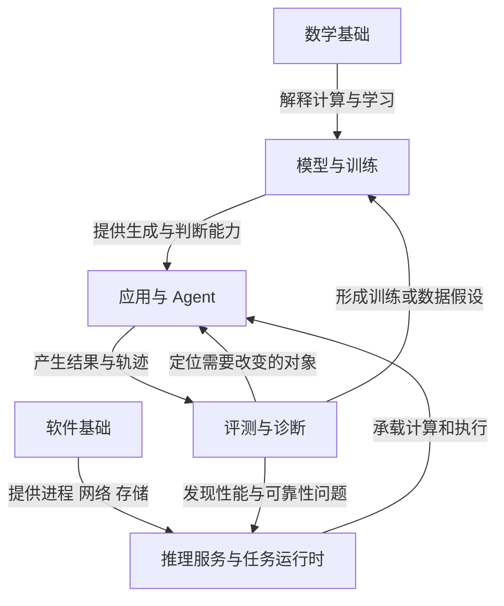
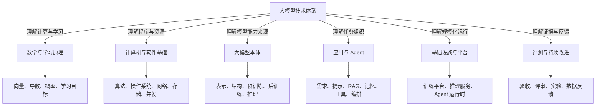

## 先把一件真实任务拆开

假设你要做一个研究助手：收到一份实验表，检查数据，计算不同条件下的结果，并给出能追溯依据的报告。先别问“要用哪种 Agent 框架”，先看这里究竟有哪些东西。

**模型是一组训练得到的参数，以及使用这些参数计算输出的程序。**文本先变成 token 和向量；网络逐层变换这些表示，产生下一 token 的概率。概率解释输出的不确定性，矩阵解释计算，导数解释训练时怎样调整参数。它们属于数学基础；预训练、后训练和推理讨论的是这台模型如何形成能力、如何使用能力。模型能提出分析方案，但生成“文件已保存”不会让磁盘真的出现文件。

**应用负责把能力接到任务上。**它接收文件、组织提示、选择资料，把模型输出交给工具。若流程始终固定，普通程序就能编排；若要根据缺列、报错和新证据选择下一步，就可以采用 Agent 循环。这里新增的是观察、决策和行动的组织方式，模型并没有因此变成操作系统。

**基础设施让这些对象真正运行。**推理服务管理模型计算、显存和并发请求；任务运行时管理脚本、容器、状态和产物。二者都依赖网络、存储和操作系统，但管理的资源不同。请求超时只能说明没有及时收到回答，不能证明脚本没跑；这才引出幂等、查询原执行和故障恢复。

**评测负责检验我们相信的结果。**报告有没有算对、引用是否支持结论、成本和等待时间是否可接受，需要分别取证。错误可能来自数据缺失、模型判断、工具执行或验收规则。只有找到原因，才能决定改检索、改流程、改系统，还是收集数据训练模型。运行中的工具反馈和离线训练反馈不是同一个循环。

这张图表达对象之间的作用，不是必须从头走到尾的学习顺序。**归属图**回答“知识研究什么”：注意力属于模型计算。**理解依赖图**回答“为什么成立”：理解 KV Cache 要先懂因果注意力。**运行流程图**回答“这次先后发生什么”：读取数据后调用模型，再执行工具。三种图可以围绕同一对象切换，不能把一种箭头当成另一种。

学习时任选入口：从“为什么答错”深入概率与数据，从“为什么很慢”深入计算和调度，从“能否安全重试”深入网络与状态。每条路径都可以讲透，又能回到全景定位。每日前沿独立记录新消息。这里把原理讲清楚，不要求每条新闻都变成学习任务。

## 这张图的根是什么

根是**大模型相关的技术体系**。Agent 是基于模型构建系统的一种方式；Agent Infra 是支撑这类任务执行的基础设施。它们都值得展开，但不能代替模型、训练、推理、数学和通用软件基础。

这里的六个分支是一种面向研发学习的组织方法，不是唯一标准分类。它们回答不同问题：基础原理解释为什么成立；模型知识解释能力怎样形成；应用知识解释怎样完成需求；基础设施解释怎样稳定运行；评测解释我们凭什么相信改进。真实问题通常要跨几个分支才能讲通。

上图的箭头只表示归属，不能拿来推断运行先后。[交互知识地图](/learn/agent)用于快速定位，原理页用于下潜；下载版保留相同章节和依赖链接。

## 三种关系必须分开

| 关系 | 回答的问题 | 一个例子 |
| --- | --- | --- |
| 归属 | 这个概念描述什么对象？ | KV Cache 属于模型推理机制；任务恢复属于执行系统 |
| 理解依赖 | 为什么先懂 A，才能讲清 B？ | 先懂注意力的 K/V，再解释缓存内容与显存公式 |
| 应用联系 | 这个原理怎样影响另一层？ | 数据库事务帮助任务状态一致，但不能包住远端工具的副作用 |

同一对节点可能有多种联系。为了不把图画成难以阅读的线团，总图先显示归属；点选节点后，再显示前置知识、后续用途和跨层联系，并为每一条关系写出原因。

## 一条贯穿全书的案例

教学系统是一位研究助理：收到分析目标，读取数据与资料，选择工具，运行分析，提交结果并接受独立验收。它只是贯穿例子，不是对某个公司内部平台或个人业绩的描述。模型和计算机基础仍按通用原理解释，不需要先相信“所有需求都必须做成 Agent”。

可以把同一个任务从三个距离观察：

**离用户最近：** 用户要做什么决定？系统交付了什么？结果如何验收？此时看 G1、A4、E1。

**离决策最近：** 这一轮看见什么信息？模型怎样生成候选动作？工具反馈如何改变下一步？此时看 M1/M2、C1/C2/C3、A1/A2/A3。

**离运行最近：** 计算和请求怎样消耗资源？并发、超时和崩溃时发生什么？系统保存了哪些可恢复状态？此时看 B2/B3、M3、R1/R2/R3、I1/P1。

三种距离不是三份重复笔记，而是对同一条事实链选择不同的解释粒度。

## 用一个问题测试知识图是否真的有用

“Agent 的工具请求超时了，能否直接重试？”如果答案只有“指数退避、最大重试三次”，说明知识仍停留在口诀。

先到 **B2 网络通信**：请求与响应经过不同阶段，客户端没收到回复，不等于服务器没执行。

再到 **R2 幂等与事务**：若调用会创建任务或扣费，重复请求可能产生第二个副作用。必须定义稳定操作身份、服务端去重或可查询的执行标识。一次本地数据库事务并不能覆盖远端服务。

接着到 **R3 恢复**：有原执行标识时，优先确认原执行结果；恢复还要检查输入版本、所有权和旧 Worker 写入。重试查询、恢复旧任务、重新执行，是三种不同动作。

最后到 **E1 评测**：若状态仍未知，应保留未知/基础设施失败原因；不能随意把它当成模型答错，再拿这批数据训练模型。

这才是一条跨越通用基础、系统机制和测量方法的解释链。面试中可以停在对方需要的深度；排障时则继续追到可检查的日志、状态和实验。

## 怎样给完全不懂的人讲，再逐层深入

以 KV Cache 为例，第一层可以说：“模型逐字生成时，可以保存已经算过的历史信息，减少下一步的重复计算。”这给了直觉，但还没交代保存什么。

第二层进入机制：“在因果自注意力中，历史 token 的各层 K/V 可以供后续 token 查询；缓存的是这些张量，不是把之前的最终答案复制一遍。”此时回到 M2 的形状和注意力计算。

第三层讨论代价：“缓存随层数、历史长度、KV 头数和并发增加。减少重复计算会增加持久占用的显存；长输入还影响 prefill，长输出影响逐步 decode。”此时连接 M3 和 I1。

第四层用证据验证：“固定模型、输入和输出长度，测首 token 时间、逐 token 时间、总延迟、吞吐与显存，再改变一个变量。”此时连接 E3。不能只用某一次请求快了就宣告一个优化通用有效。

好的解释不是从一开始把所有术语倒出来，而是每深入一层都回答上层留下的一个“为什么”。

## 每个深读节点应该学到什么程度

每篇从具体困惑出发，补齐必要定义，逐步推导机制，再给算例、伪代码或时序反例。结尾的自测附有答案，但建议先自己写，再核对遗漏的条件。

判断是否学会，可以用四个检查：能用普通语言说明对象；能沿数据和状态推演过程；能说出不适用的情况；能设计一个区分两种解释的实验。读过术语和拥有工程经历是不同的事，这份笔记用于建立能力，不自动变成履历证明。

不必一次读完所有内容。第一次先看总树，选一个你能理解的实际问题；第二次沿前置依赖补到公式或系统基础；第三次自己改变条件，看看结论还是否成立。遇到新名词时，先问它改变了哪个对象、依赖什么，而不是立刻新建一个孤立分类。

## 岗位视角怎样使用

Agent 研发通常重点连接应用、信息、模型行为与效果；Agent Infra 更靠近工具协议、执行状态、并发、隔离、恢复和观测；评测与数据更依赖目标定义、测量方法、标注与实验；应用开发和 FDE 则更关心需求、集成、权限和可验收交付。

模型算法、训练 Infra 和推理 Infra 需要额外深入学习目标、张量计算、显存与通信。这里将它们放进同一张图，是为了看清共同基础和边界，不能把“读过一节”理解成已满足某个职位的实操要求。具体岗位仍应按当时的 JD 和自己的证据筛选。

## 如何继续长大而不变散

新增一页时，记录它的稳定节点、研究对象、至少一条理解依赖和一个用途；每条关系写出原因。新案例先连到已有机制，只有出现新的解释对象时才扩分支。一个 bug 可以同时连接网络、状态机和评测，但不应把同一段说明复制三遍。

本版深入展开的是大模型研发常用的共同主干。多模态感知、MoE 路由、检索模型训练、GPU 算子实现和更系统的强化学习理论可以继续接入相应分支；它们没有被一句“其他”假装讲完。经典知识的数学定义和新框架的接口版本也应分别维护。

所有数字算例会说明教学假设；实际实验需要记录输入、版本、对照、结果和未解决的问题。链接指向原论文或官方资料，正文负责把前提和推导讲通，不能要求读者靠跳遍链接才能理解核心结论。
