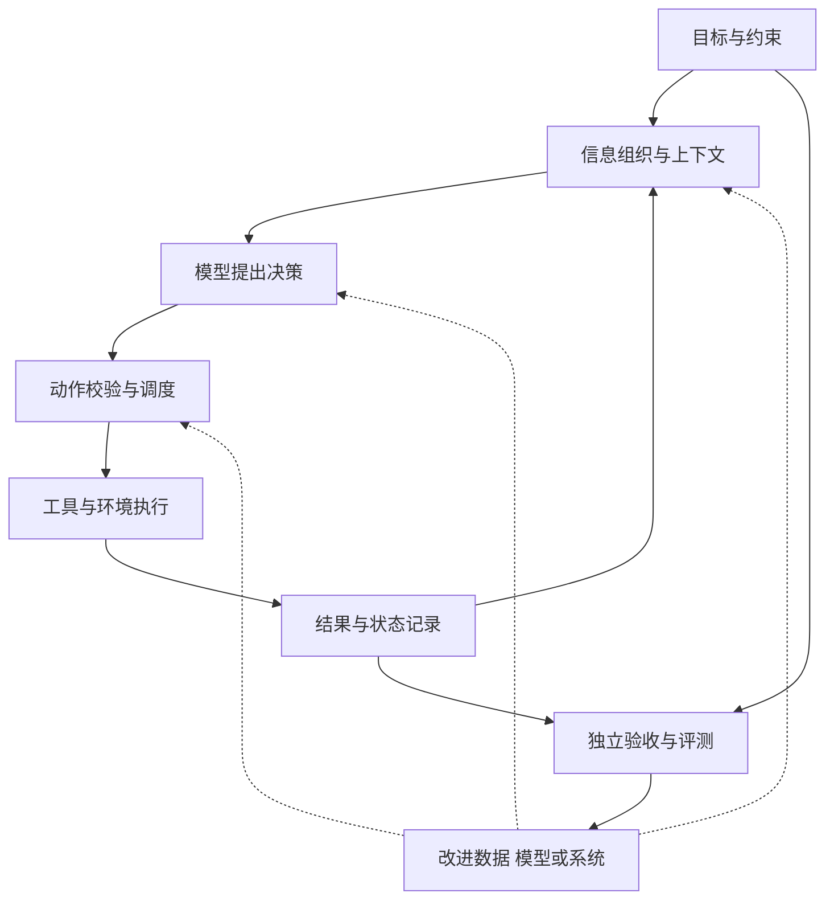
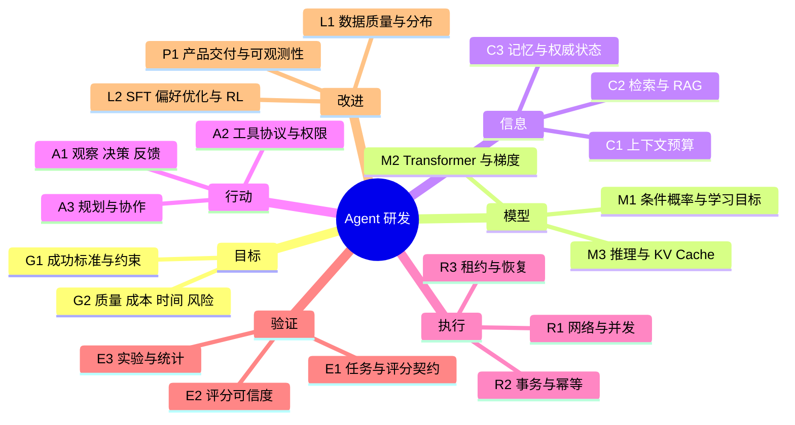
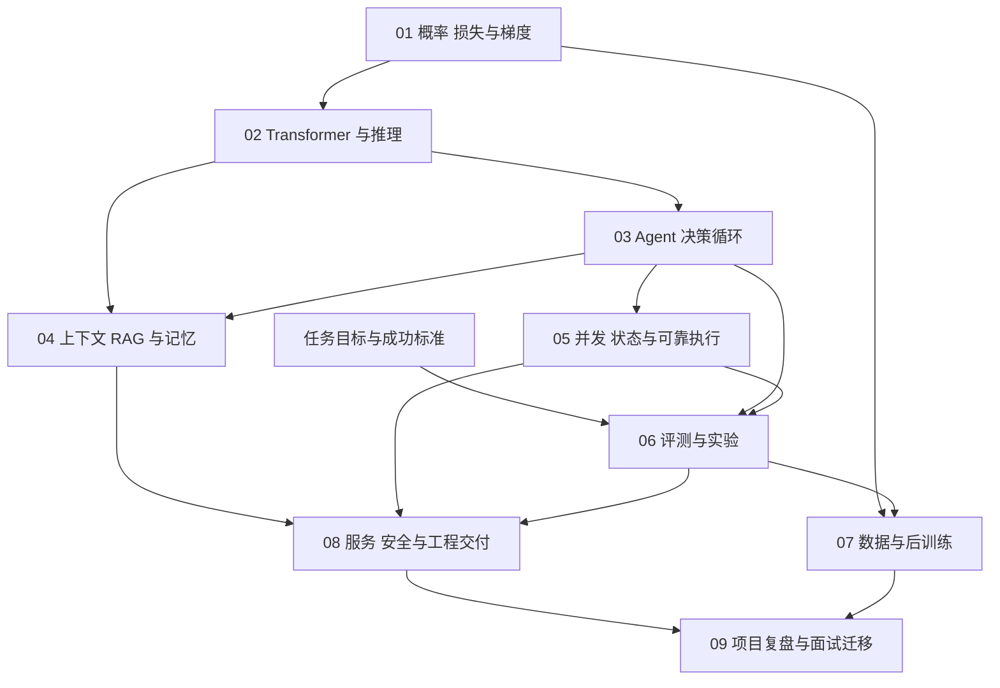

Agent 研发的核心，是让模型在有限信息、时间与成本下，通过工具作用于环境，交付可以验证的结果。理解这个系统，需要同时理解决策、信息、执行和证据之间的关系。

这份手册以科研 Agent 为贯穿案例，覆盖模型原理、Agent 设计、上下文与检索、可靠执行、评测、后训练和工程交付。正文中的“教学例子”和“练习”用于推导原理；项目复盘单独标明已有结果及边界。

## 章节导航

| 章节 | 核心问题 |
| --- | --- |
| [01 条件概率 学习目标与梯度](/learn/agent/01-model-foundations) | 理解条件概率 损失 梯度与泛化 |
| [02 Transformer 与推理成本](/learn/agent/02-transformer-inference) | 从注意力计算走到推理缓存与成本 |
| [03 Agent 决策循环与工具设计](/learn/agent/03-agent-loop) | 模型怎样通过工具获得反馈并行动 |
| [04 上下文 检索与记忆](/learn/agent/04-context-retrieval-memory) | 在有限预算内保留决策所需的信息 |
| [05 网络 并发 事务与任务恢复](/learn/agent/05-reliable-execution) | 处理网络不确定性 并发与副作用 |
| [06 评测可信度与实验设计](/learn/agent/06-evaluation-experiments) | 将真实目标转化为可信的评价证据 |
| [07 数据飞轮与后训练原理](/learn/agent/07-data-posttraining) | 从轨迹与标签走到模型行为改进 |
| [08 服务设计 安全与工程交付](/learn/agent/08-engineering-delivery) | 让任务系统可使用 可诊断和可维护 |
| [09 项目复盘 面试索引与学习实践](/learn/agent/09-projects-interviews-learning) | 把工程案例连接到机制 取舍与验证 |

## 始终记住的六个节点

先记住六个词：**目标、模型、信息、行动、执行、验证**。遇到新概念时，先确定它影响哪个节点，再思考它与上下游的关系。

读图时，沿着实线走一遍具体任务：读取要求，把当前事实放进上下文，模型提出下一步，程序检查动作，工具改变环境，系统记录结果，模型据此继续，最后独立验收。虚线表示下一轮研发可以改动的位置。

**模型决定尝试什么，环境决定实际发生什么，系统保存可追溯状态，评测判断是否达到目标。** 这四种责任的边界，是整本手册的主轴。

## 知识树与节点编号

树回答“它属于哪里”；依赖图回答“为什么必须先懂另一个东西”。二者配合使用：树帮助记忆位置，箭头帮助推理。

## 依赖关系图

箭头表示理解上的前置关系，适合安排学习顺序；真实研发可以在几条支线上交替推进。

例如，理解幂等性需要先看见“请求结果未知”；理解请求结果未知需要区分网络观察与远端真实状态；理解这一区别后，才能判断什么操作可以重试。只背“指数退避加重试”会跳过最关键的推导。

## 一条贯穿全书的任务

教学任务：给定科研问题和数据目录，Agent 需要查找必要资料、写代码、运行分析，并提交结果文件。成功要求包含计算结果、输出格式、证据来源以及时间和成本预算。

| 系统中的问题 | 要回答的原理 | 所在章节 |
| --- | --- | --- |
| 为什么会生成貌似合理的错误解释 | 语言概率与事实正确性不同 | 01 |
| 为什么上下文变长会增加推理成本 | 注意力计算与 KV 状态 | 02 |
| 为什么需要运行代码并读回错误 | 动作获取新观察并修正决策 | 03 |
| 为什么读过的日志仍可能被遗忘 | 决策上下文是有限的信息表示 | 04 |
| 查询超时后能不能重新启动任务 | 副作用可能已经发生 | 05 |
| 评分器故障该不该算零分 | 能力结论与观测缺失的区别 | 06 |
| 收集成功轨迹能不能直接训练 | 数据分布 标签与奖励质量 | 07 |
| 怎样从可运行变成可使用 | 接口 状态 安全与运维 | 08 |
| 面试时如何说明自己的判断 | 机制 取舍 验证与边界 | 09 |

## 三种阅读方式

**第一遍建立轮廓。** 阅读本页、每章开头的框图和结尾的自测。能说清“这章在整个系统中负责什么”即可，不急着记住公式。

**第二遍推导机制。** 依次阅读 01、02、03、04、05、06；对每个公式解释符号，对每个工程方案说出它保护的事实。07 与 08 用来连接算法改进和真实交付。

**第三遍沿问题逆向查阅。** 从 09 的面试题或自己的失败案例出发，回到相应节点，补充原理和实验。问题涉及多个节点时，把连接关系写下来。

每个节点的掌握程度可记为四级：能准确解释；能推演反例；能独立实现或设计实验；能用实际证据讨论取舍。这些是学习记录，不直接等同于工作经历。

## 如何持续补充而不让笔记再次变散

每次新增内容，先选择已有节点编号，例如 R2 幂等与事务；只有确实出现新的责任边界时，才新增一级节点。新知识至少连向一个前置节点和一个用途节点。

推荐使用下面的补充卡。无需每次都写很长，但“为什么”和“怎样验证”不能省略。

| 字段 | 要记录的内容 |
| --- | --- |
| 位置 | 例如 R3 原任务恢复 |
| 要解决的问题 | 什么情况下原方法会失败 |
| 前置知识 | 哪些概念使这个问题可理解 |
| 机制 | 状态 信息或计算如何变化 |
| 取舍 | 获得什么 又付出什么 |
| 反例与边界 | 什么条件下不成立 |
| 实验证据 | 输入 版本 对照 结果与未解决问题 |
| 可迁移场景 | 哪些其他任务存在同样结构 |
| 来源与日期 | 原始文档 论文 代码或自己的实验 |

例如，R3 的卡片可以连接 R1 网络超时、R2 幂等与所有权，以及 E3 故障注入实验。这样一个故障案例会成为知识网络中的连接点。

## 面试时的定位顺序

听到问题后，先定位对象：这是模型能力、输入信息、动作协议、执行状态，还是评测证据的问题。然后按“目标与约束 → 机制 → 方案取舍 → 失败情况 → 验证方法”展开。

不知道某个实现细节时，可以明确说出已知机制和需要验证的条件。例如：“如果远端已经接收请求，单靠本地超时无法断言失败；我需要查看是否有请求去重标识或可查询的执行 ID，再决定恢复还是重新提交。”这比猜测某个框架默认行为更可靠。

初版日期：2026 年 11 月 25 日。节点编号保持稳定，后续可以按编号继续扩展。
