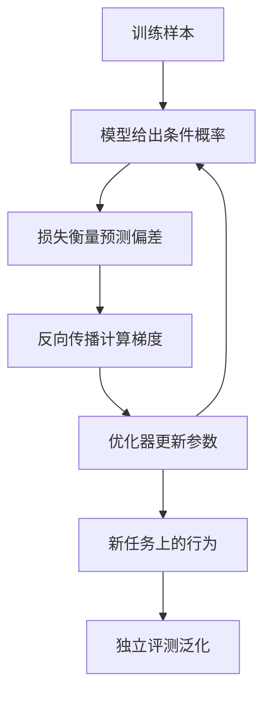

[返回总图与目录](/learn/agent)

**前置依赖：** 从总图开始即可。

**后续连接：** [02 Transformer 与推理成本](/learn/agent/02-transformer-inference) · [07 数据飞轮与后训练原理](/learn/agent/07-data-posttraining)。

本章解释模型怎样从数据学到条件分布，以及为什么“语言建模效果好”和“完成任务可靠”之间仍有距离。节点：M1。后续连接 02 的 Transformer、06 的统计判断和 07 的后训练。

## 从任务目标走到学习目标



假设文本是 token 序列 x1 到 xT。token 可以是词片段、字符片段或其他编码单元，不天然等于一个汉字或一个单词。概率链式法则把整个序列的概率写成各位置条件概率的乘积。

$$
P_\theta(x_{1:T})=\prod_{t=1}^{T}P_\theta(x_t\mid x_{<t})
$$

这不要求各 token 独立。恰恰相反，条件里包含了前缀，模型要利用前缀中与当前预测有关的信息。

生成代码或工具调用也可以使用同样的建模方式。模型生成字符序列后，宿主程序再把它解释成结构化动作。因此模型可以学到工具使用模式，但真正执行工具仍是系统的责任。

## 条件概率与真实性

P(某段文字出现｜当前上下文) 描述模型的预测；P(某个命题为真｜现有证据) 描述对现实命题的判断。训练和校准可以让两者在某些任务上相关，但不能直接把一个当成另一个。

教学例子：上下文里重复出现一条错误结论，模型可能更容易继续生成它。此时语言概率上升，现实中的证据没有增加。类似地，一个模型对罕见但正确的专业术语给出较低概率，也不能直接说明术语错误。

这条区别连接到评测：模型自述“我很确定”不是可直接使用的准确率；两个模型一致，也可能共享训练偏差。需要与有可信标签的样本比较，才能讨论置信度校准。

## 从最大似然到交叉熵

训练时，希望正确 token 获得更高概率。对概率取负对数，可以把序列乘积变成易优化的求和。

$$
L(\theta)=-\sum_t\log P_\theta(x_t\mid x_{<t})
$$

当正确 token 的概率分别是 0.8 和 0.2 时，对应负对数损失约为 0.223 和 1.609。模型越确信一个错误预测，通常会受到更大的损失惩罚。

如果目标是 one-hot 标签，交叉熵就取真实类别的负对数概率。更一般的软标签会对所有类别求加权和。交叉熵衡量预测分布与目标分布的差异，不能单独说明真实业务成功率。

模型训练经常按有效 token 数归一化。比较两个训练实验的 loss 时，要确认 tokenizer、样本分布、掩码和归一化口径是否一致。直接比较不同词表的 perplexity，解释通常很有限。

## 线性代数如何进入模型

一个隐藏向量可以看作一个 token 在当前上下文中的数值表示。矩阵乘法把这个表示变换到另一组特征坐标；点积度量两个向量在相应坐标上的匹配程度；非线性使多层组合能够表达超出单次线性变换的关系。

如果所有层都只有矩阵乘法，多个矩阵仍可合成一个矩阵。增加层数本身无法提供同样丰富的非线性表达能力。这就是激活函数、注意力权重随输入变化等机制的重要性。

学习时应能追踪形状：一批 B 个样本、每个 T 个 token、每个表示维度 d，对应张量 B×T×d。形状不是记号细节；错位的 mask、错误的广播或把 batch 维当序列维，都可能产生数值看似正常但语义错误的训练。

## 梯度如何改变行为

梯度描述参数的微小变化会怎样影响损失。最简单的更新形式是：

$$
\theta_{k+1}=\theta_k-\eta\nabla_\theta L(\theta_k)
$$

学习率 η 控制步长。过小可能进展慢，过大可能越过合适区域或使训练不稳定。反向传播使用链式法则，把最终损失对中间计算和参数的影响逐层传回。

PyTorch 的自动微分负责构建并求导计算图，优化器负责使用梯度更新参数。这两个动作需要区分。关于动态图、梯度累加和关闭梯度记录的具体行为，见 [PyTorch 自动微分教程](https://docs.pytorch.org/tutorials/beginner/basics/autogradqs_tutorial.html)。

```python
optimizer.zero_grad()
logits = model(inputs)
loss = loss_fn(logits, labels)
loss.backward()
optimizer.step()
```

这段代码表达四个阶段：前向计算、形成损失、反向求导、更新参数。真实语言模型还要处理 label shift、padding mask、梯度裁剪和数值精度等问题。

梯度默认可能累加，因此清零的位置有意义。做梯度累积时，需要让多个 micro-batch 的缩放与目标大 batch 的平均方式对应；序列长度不同且按 token 平均时，简单按 micro-batch 数平均不一定等价。

`model.eval()` 调整 dropout 等模块的行为；`no_grad()` 控制梯度记录。前者不自动关闭梯度，后者也不自动切换所有模块的训练行为。

## 学到规律与记住样本

训练集用于参数更新，验证集用于选择方案，测试集用于最后估计未见任务上的表现。如果反复查看测试集并据此改提示词，测试集也已经参与了开发过程。

过拟合表现为模型对训练分布中的细节适应过强，对未见样本迁移不足。数据多样性、正则化、早停和合适的模型容量可以影响它，但没有一种方法替代真正独立的测试。

在 Agent 场景，泄漏不只有“训练时见过原题”。把隐藏评分答案放进工具返回、检索库或调试提示里，同样会破坏评估。固定测试题反复人工优化几十轮，也可能造成对题集的适配。

## 随机性怎样影响判断

同一个问题的输出可能因采样、执行路径、外部资料变化和底层数值行为而不同。降低采样温度可以改变输出分布，但不能保证事实正确，也不自动保证跨所有环境的完全复现。

均值描述平均表现，方差描述波动。你要评估的是“换一个合理任务、再跑一次，表现是否仍然成立”，因此只挑一次最好结果会高估能力。

本章只建立这条联系：概率用于描述模型与实验中的不确定性；06 进一步解释重复试验、配对比较和置信区间。

## 把原理迁移到科研 Agent

如果 Agent 生成了错误公式，先区分：它是否缺少题目条件；是否被错误资料误导；是否在充分信息下仍推理错误；是否其实生成正确、却被执行或评分环节误判。只有第三类才直接指向模型决策能力，其余还涉及 04、05 和 06。

“换更强模型”是一项候选干预。要证明它有效，需要在相同输入、工具、预算和评分规则下比较，并记录它改善了哪些错误类别。

## 自测与推导练习

**为什么 loss 下降，任务成功率仍可能下降？** loss 在给定训练分布和标签上衡量局部预测；任务成功还依赖多步行动、外部执行和验收。训练分布偏移、标签错误或能力退化，都可能造成二者背离。

**如果两个 token 的概率变成 0.9 和 0.1，是否说明第一个事实有 90% 的真实性？** 不能。必须先明确随机变量是什么、概率是否经过相关任务上的校准。

**练习。** 用三个 token 构造一个小词表，手算 softmax、正确类别的负对数损失，再让一个 logit 增加，观察损失如何变化。能解释数值的方向，比先记住优化器的全部名称更重要。

继续连接：02 解释模型怎样从 token 计算这些概率；07 解释怎样让参数更新更贴近任务需求。
