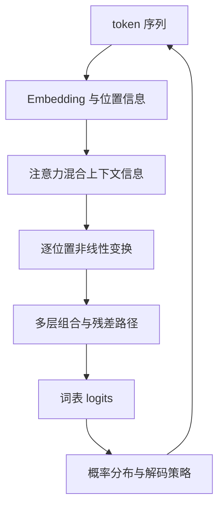
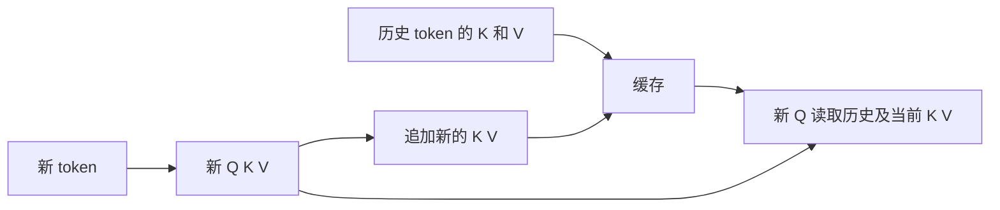

[返回总图与目录](/learn/agent)

**前置依赖：** [01 条件概率 学习目标与梯度](/learn/agent/01-model-foundations)。

**后续连接：** [03 Agent 决策循环与工具设计](/learn/agent/03-agent-loop) · [04 上下文 检索与记忆](/learn/agent/04-context-retrieval-memory)。

前置：01 的条件概率、矩阵乘法和梯度。本章把“模型根据上下文生成”拆成可解释的计算过程，再连接推理成本与长任务预算。节点：M2、M3。

## 从 token 到下一个 token

这里采用自回归 Transformer 的教学抽象。不同模型的归一化位置、位置编码、FFN 和注意力实现会不同；它们共享的主线是对上下文进行表示变换，再预测后续 token。

## 表示与位置

Embedding 把离散 token ID 映射为向量。一个 token 进入模型时只有初始表示，经过多层上下文计算后，它的表示会随语境变化。因此同一个词出现在不同句子里，不必具有相同的最终隐藏向量。

顺序对语言与程序都至关重要。若没有适当的位置信息，注意力本身不能充分区分不同排列。位置编码把顺序关系注入计算；例如 RoPE 通过位置相关旋转影响 query 与 key 的匹配，使其能够表达相对位置信息。这里先理解作用，具体旋转推导可以挂在 M2 下继续扩展。

## 注意力到底在计算什么

设输入表示 X 的形状为 T×d。将它投影为 Q、K、V；对于一个注意力头，Q、K 的形状是 T×dk，V 的形状是 T×dv。

$$
Q=XW_Q,\quad K=XW_K,\quad V=XW_V
$$

$$
\operatorname{Attention}(Q,K,V)=\operatorname{softmax}\left(\frac{QK^\top}{\sqrt{d_k}}+M\right)V
$$

QK 的转置乘积得到 T×T 的匹配分数：每个位置对其他位置分别打分。softmax 在每一行形成权重，再对 V 做加权汇总。Q 可以理解为当前要匹配什么，K 为候选信息提供匹配表示，V 承载被汇总的内容；这是解释计算角色的比喻，不代表每个维度都有固定人类语义。

因果 mask M 对允许读取的位置取 0，对未来位置取负无穷，使对应 softmax 权重为 0。除以根号 dk 是为了缓和点积尺度随维度增大而增长的问题，避免 softmax 过早变得过于尖锐。该注意力机制的原始定义见 [Attention Is All You Need](https://arxiv.org/abs/1706.03762)。

多头注意力使用多组投影并组合结果，允许不同的匹配和汇总方式共同参与表示。不能据此保证某个头固定负责语法、另一个头固定负责事实；具体功能需要观察和实验。

## 为什么还需要 FFN 残差和归一化

注意力主要负责跨位置的信息交互。FFN 在各位置上对特征作非线性变换，两者组合能够表达更复杂的模式。残差路径把输入与变换结果相加，让信息和梯度更容易跨层传播；归一化帮助控制数值尺度。

参数记忆分布在整个网络中，不能简单说“知识全部存于 FFN，注意力只负责查找”。这些模块共同产生最终行为。

## 训练可以并行而生成通常逐步进行

训练时，正确序列已经存在。对因果 mask 后的所有位置，可以一次计算各位置的 next-token 预测，再汇总损失。每个位置不能读取未来标签，但多个位置的计算可以并行。

生成时，下一个 token 尚未确定。选出它之后，才能形成下一步真正的前缀。标准自回归解码因此逐步推进。推测解码等技术能在一定条件下减少串行开销，但不改变最终需要满足的模型分布或校验条件。

## Prefill 与 Decode

Prefill 处理已有输入前缀，为各层建立表示与缓存。Decode 在前缀基础上不断生成新 token。长输入会增加 prefill 工作量；长输出会增加 decode 步数。端到端时延还包含排队、网络、工具执行和重试，不能只看模型 tokens/s。

温度通过缩放 logits 改变分布尖锐程度，top-p 根据累积概率保留候选集合。二者改变采样策略，不提供正确性保证。最大输出 token 数则是硬预算，可能影响长解释或工具参数能否完整生成。

## KV Cache 为什么有效

因果解码中，过去 token 在固定前缀下已经算过的 K、V 可以缓存。生成新 token 时，只计算新位置所需内容，再与历史 K、V 交互，避免每步重复计算全部历史投影。参见 [Hugging Face 缓存原理](https://huggingface.co/docs/transformers/main/cache_explanation)。

普通全量 KV 缓存的内存量，可用下面的近似式估算：

$$
\text{bytes}\approx 2\times L\times B\times T\times H_{kv}\times d_h\times b
$$

L 是层数，B 是批大小，T 是缓存长度，Hkv 是 KV 头数，dh 是每头维度，b 是每个数值的字节数。前面的 2 对应 K 和 V。实际实现还可能采用滑动窗口、量化、共享或分页，另有管理开销。

教学配置：32 层、batch 1、8192 token、8 个 KV 头、每头 128 维、每元素 2 字节，缓存约 1 GiB。这个计算不包含模型权重与其他工作区。

**KV Cache 保存模型计算中间状态；Agent 记忆保存任务相关信息；数据库保存执行事实。** 三者服务的对象不同，不能互相替代。

## 推理优化如何分类

FlashAttention 通过更合理地组织显存与片上存储之间的数据读写，减少中间大矩阵的物化和访存开销。它的精确稠密注意力版本没有把注意力的所有两两交互变成线性数量。见 [FlashAttention](https://arxiv.org/abs/2205.14135)。

PagedAttention 关注 KV 内存管理，用分页式组织减少碎片与不必要的预留，并支持某些共享方式；调度器可利用更有效的显存容纳并发请求。它解决的侧重点与注意力算子的计算组织不同。见 [PagedAttention](https://arxiv.org/abs/2309.06180)。

量化用较少位数表示部分数值，减少存储与可能的带宽需求；性能取决于硬件和算子支持，质量影响取决于模型、量化位置与校准。不能把“低精度”直接翻译成“同比例提速”。

## 将模型预算接到 Agent 任务

可用输入预算不仅取决于标称窗口，还取决于服务规则、输出预留、工具定义和运行框架的限制。工具返回和摘要会占用输入；一次超长日志也可能改变下一轮可用空间。

如果某模型调用输出了不完整的工具参数，可能与输出预算有关，也可能来自协议兼容、服务截断或流式拼装错误。需要保留 finish reason、原始分片与参数解析信息，才能缩小原因范围。

## 自测与练习

**为什么不缓存 Q 就足以支持普通逐 token 解码？** 当前步骤使用的是新位置的 Q；历史位置的 Q 不参与这个新位置的注意力加权，历史 K、V 则仍会被读取。

**长上下文为什么可能更贵但未必更准确？** 计算与存储随输入增长，新增内容的相关性和组织质量却没有保证；过期或冲突信息还可能干扰决策。后半部分由 04 展开。

**练习。** 给 3 个 token 构造二维 Q、K、V，手算因果 mask 后的权重；改变最后一个 token 的 Q，观察它从哪个历史位置取到更多信息。再按上式估算缓存长度翻倍的影响。

继续连接：03 把生成过程接到外部动作；04 选择值得放进窗口的信息；08 把推理指标接到服务体验。
