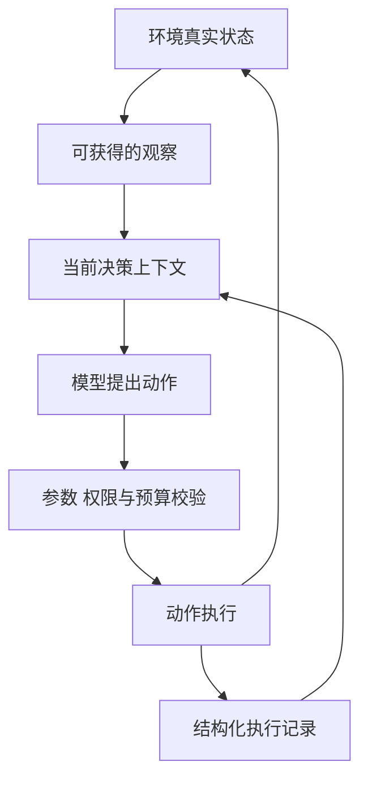
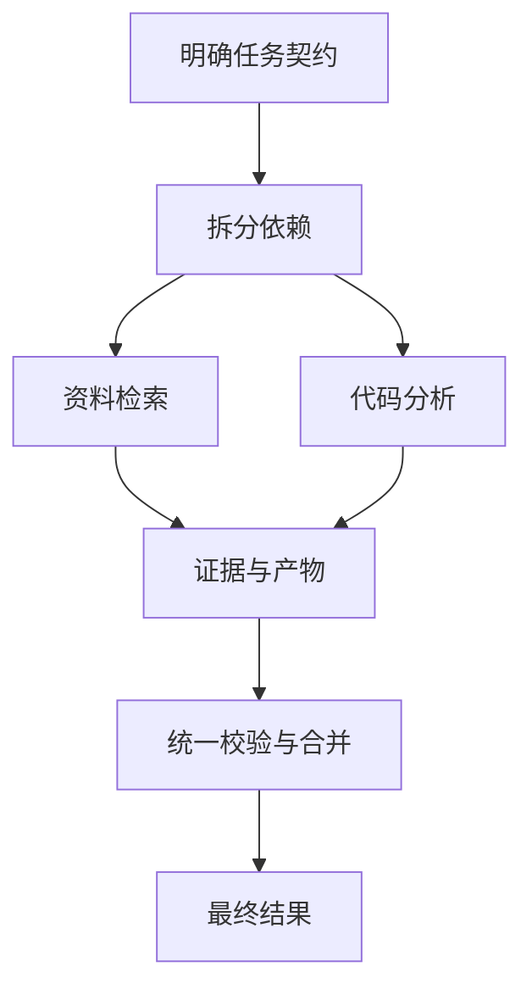

[返回总图与目录](/learn/agent)

**前置依赖：** [01 条件概率 学习目标与梯度](/learn/agent/01-model-foundations) · [02 Transformer 与推理成本](/learn/agent/02-transformer-inference)。

**后续连接：** [04 上下文 检索与记忆](/learn/agent/04-context-retrieval-memory) · [05 网络 并发 事务与任务恢复](/learn/agent/05-reliable-execution) · [06 评测可信度与实验设计](/learn/agent/06-evaluation-experiments)。

前置：01 的条件概率和 02 的生成过程。本章解释模型输出怎样成为外部动作，以及反馈为什么能提升任务完成能力。节点：A1、A2、A3。后续连接 04 的信息选择、05 的可靠执行与 06 的行为评测。

## Agent 的核心对象



环境真实状态可能是远端进程、文件内容或某个业务对象；观察是工具实际返回的信息；上下文是本次模型调用能看到的表示。这三者不能合并。读取超时意味着观察缺失，无法直接推出远端进程失败。

用 h 表示历史、g 表示上下文构造、π 表示决策策略，可写为：

$$
c_t=g(h_t),\quad a_t\sim\pi_\theta(\cdot\mid c_t),\quad s_{t+1}\sim P(\cdot\mid s_t,a_t)
$$

这里 P 描述环境转移，不是语言模型的 token 分布。调用程序会改变文件，检索会带回资料，查询状态会改变我们掌握的信息。系统设计要同时考虑“改变环境的动作”和“获取信息的动作”。

## 为什么行动能够修正推理

教学任务：脚本不能运行。仅在语言层面猜测，可能依次归因于依赖、路径、权限或数据。执行一次目录检查后，发现数据实际位于另一个路径，许多候选原因就被排除了。

这个过程体现信息的价值：一次动作不一定直接产出最终成果，但可以减少后续决策的不确定性。诊断动作值得执行的前提，是它带来的预期收益大于成本和风险。

把工具返回重新送回模型，只提供了修正机会，不保证模型一定会正确利用反馈。因此要保留明确的错误类型、关联文件和建议检查方向，避免只返回无法解释的“failed”。

## 从文本循环到程序状态机

最小的概念循环可以这样表达：

```python
while budget.remaining() and not state.terminal:
    context = build_context(goal, state, history)
    proposal = model.generate(context, tool_schemas)
    action = parse_and_validate(proposal)
    authorize(action, user_scope)
    observation = execute(action)
    record(action, observation)
    state = update_state(state, observation)
```

这是教学伪代码，真实实现还需要持久化、取消处理和副作用恢复。它刻意将模型建议、动作校验、授权、执行和记录拆开，便于看见每一步的责任。

“模型说完成”可触发验收，而不能直接替代验收。程序可以检查必须存在的文件、运行状态和输出契约；复杂质量再交给独立评分或人工复核。

## Workflow 与动态规划的选择

固定流程适合已知依赖、明确分支和可规则化的转换。动态 Agent 适合执行过程中才逐渐获得关键信息、需要据此选择工具的任务。两者可以组合：外层固定权限、预算与验收，内层允许模型探索。关于预定义工作流与模型动态控制的划分，可参考 [Building effective agents](https://www.anthropic.com/research/building-effective-agents)。

例如评测服务的“提交、排队、运行、评分、归档”适合显式状态机；解题过程中“该查论文、检查代码还是运行实验”则可能需要模型判断。把整个服务状态机交给语言模型，会把原本可确定的约束转变为额外的不确定性。

## ReAct 规划与反思各自改变什么

ReAct 常用来描述推理与行动交替的方式。它的价值在于让工具反馈进入后续决策。可观察的计划和解释可以用于调试，但不应把自然语言解释视为内部计算的完整、忠实记录。

Planner 与 Executor 分离，把较长目标拆成子任务，再由执行器逐项落实。优点是分工和进度清楚；代价是计划可能过早建立在错误假设上。因此需要允许执行证据触发重规划，并明确由谁更新计划。

反思或复核可以发现遗漏，但如果检查者没有新证据、不同约束或独立验证工具，它也可能只是重复原来的错误。设计复核时，要说明新增了什么信息或检查能力。

## 多 Agent 的收益来自任务结构

如果两个子任务独立、工具或知识不同、结果能明确合并，多 Agent 可能改善覆盖或缩短部分等待时间。若子任务高度依赖同一状态，协调成本、信息丢失和冲突可能占据收益。



合并需要明确产物接口、来源、版本和冲突规则。两个 Agent 同时改同一个文件，属于并发写入问题；让第三个模型“协调一下”并不能自动提供一致性保证。

评价多 Agent 时要控制总模型预算与工具预算。一个系统用了三倍调用量，成功率提高，说明整套方案在该预算下更有效，但不能单独归因于多 Agent 架构。

## 工具接口是行动空间的设计

过于底层的工具要求模型规划很多步骤；过于宽泛的工具会隐藏副作用和失败原因。合适的粒度取决于操作能否原子完成、能否清晰验收、是否需要中间决策。

一个可靠工具契约至少明确：输入字段和类型、业务约束、权限范围、输出结构、错误分类、超时与副作用、重复调用语义。例如“创建远端任务”应返回稳定执行 ID；“查询任务”应区分远端失败与查询本身失败。

JSON Schema 能约束结构，不能证明业务合法。`amount` 是数字不代表额度合理；`path` 是字符串不代表有权访问该路径。权限检查应来自用户身份和宿主策略，而不能由模型参数自我授予。

## MCP 的位置

MCP 为应用与工具或数据服务提供标准化连接方式。Host 是使用能力的宿主应用，Client 与 Server 建立协议交互，Server 暴露相应能力。它统一连接与交互形式，规划、业务授权与任务恢复仍由具体系统实现。见 [MCP 架构文档](https://modelcontextprotocol.io/docs/learn/architecture)。


理解这个位置后，面试中可以解释“用了 MCP”解决了什么，也能说明它没有自动解决哪些业务问题。

## 停止条件与预算

停止条件包括目标已经验收、预算用尽、出现不可继续的错误、需要用户决策、以及连续无进展。无进展可以观察相同动作和相同错误反复出现、产物未变化等信号，但这些都是具体策略，需要评测误判。

任务预算至少包含墙钟时间、模型 token 或费用、工具调用数和资源租期。总预算还要覆盖验收与产物回收，避免解题耗尽时间后无法交付。

## 自测与实验

**为什么 Agent 成功率低时不先增加反思轮数？** 需要先判断失败来自信息、决策、执行还是验收。增加反思可能改善推理，也可能放大成本或让正确结果被错误修改。

**练习。** 用本地文件和一个可控的假工具实现上述循环。安排“路径错误、格式错误、工具返回超时、重复动作”四种情况，检查模型策略与程序状态机各自负责什么。先使用固定响应验证控制逻辑，再接模型比较行为。

继续连接：04 决定每轮看到什么；05 处理动作已经发出之后的真实系统问题。
