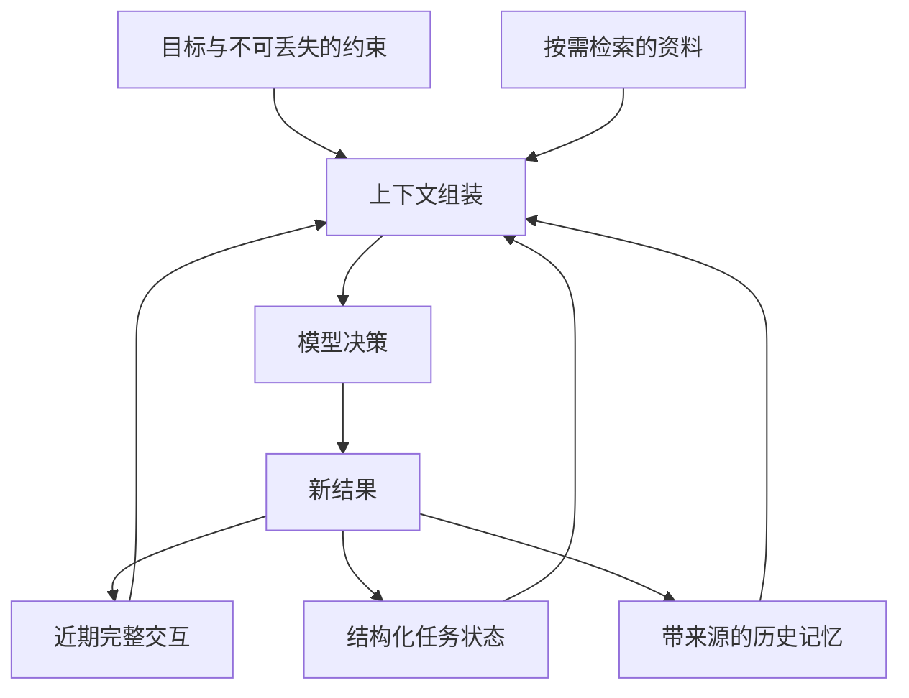
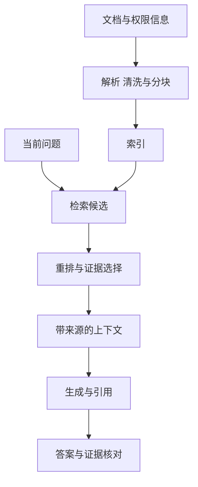

[返回总图与目录](/learn/agent)

**前置依赖：** [02 Transformer 与推理成本](/learn/agent/02-transformer-inference) · [03 Agent 决策循环与工具设计](/learn/agent/03-agent-loop)。

**后续连接：** [05 网络 并发 事务与任务恢复](/learn/agent/05-reliable-execution) · [08 服务设计 安全与工程交付](/learn/agent/08-engineering-delivery)。

前置：02 的上下文计算成本，03 的观察与决策循环。本章讨论如何在有限预算内保留决策依据。节点：C1、C2、C3。它同时连接检索算法、信息压缩和持久状态设计。

## 信息如何进入一次决策

上下文是本次决策可见的信息，不等于完整历史。上下文工程要决定信息的选择、顺序、格式和更新方式。它的目标是让必要证据在正确时机可见，同时控制成本与干扰。参见 [Effective context engineering](https://www.anthropic.com/research/effective-context-engineering-for-ai-agents)。

## 从充分信息到有损压缩

如果两个历史在当前摘要中看起来完全相同，却要求不同的正确动作，那么这个摘要丢掉了决策需要的信息。

教学例子：两次任务都被总结成“脚本运行过”。第一次运行成功生成结果；第二次运行失败且没有输出。若摘要相同，模型无法据此决定是验收还是修复。

因此压缩应优先保留目标、硬约束、当前有效产物、已验证事实、失败原因、尚未解决的问题，以及回到原始证据的指针。可删除的通常是可重建、重复或已经失效的细节。

理想上，我们希望压缩后的表示保留决定未来行为所需的信息；实际系统通常只能近似做到，所以必须能重新读取原始文件和日志。压缩质量应通过后续任务表现评估，不能只看摘要是否通顺。

## 三种记忆与一种权威状态

| 对象 | 保存什么 | 常见错误 |
| --- | --- | --- |
| 近期交互 | 尚在处理的工具调用与结果 | 截断后调用与结果失配 |
| 任务摘要 | 目标 进度 决策和未解决问题 | 省略约束或保存过期结论 |
| 跨任务记忆 | 可复用的偏好 经验和事实 | 错误经验长期传播 |
| 权威状态 | 执行 ID 状态 产物版本与摘要 | 被自然语言推测覆盖 |

“数据库里存了所有历史”不代表模型本次看到了它；“模型记得已经成功”也不能覆盖实际退出码。记忆提供信息，权威状态支撑程序决策。

跨任务记忆需要写入、读取、更新和失效机制。至少记录来源、时间、适用范围和可信程度。若旧接口已经下线，过去成功的调用方式需要失效或降低优先级，否则记忆会稳定制造错误。

## RAG 是外部信息进入上下文的管道

RAG 将外部检索与生成结合，使答案可以使用参数之外的资料。早期研究中的具体架构与今天的工程实现不完全相同，但“参数知识加可检索知识”的基本区分仍有帮助。见 [RAG 原始论文](https://arxiv.org/abs/2005.11401)。

每个阶段都可能成为瓶颈。PDF 解析把表格列打乱，即使检索准确也会给模型错误信息；关键句被分到缺少定义的块里，语义可能不完整；生成阶段忽略证据，则需要单独分析使用证据的能力。

## 分块的取舍

小块通常定位较精确、单块预算小，但可能丢失上下文。大块保留结构，却可能包含大量无关内容。重叠分块能减少边界信息丢失，但增加存储和重复召回。

应根据文档结构和问题类型选择策略。代码函数、论文段落、政策条款和表格，不适合机械地使用相同字符长度。可以检索小块，再返回其父段落或相邻上下文，兼顾定位与完整性。

不存在脱离语料、问题和预算的最佳 chunk size。比较分块方案时，应固定其他管道，观察证据召回与最终答案，而非只看 embedding 相似度。

## 词法检索与向量检索

词法检索擅长保留精确词项，例如错误码、函数名、材料编号。向量检索利用表示空间中的相似性，能处理部分措辞变化，但可能混淆语义接近而事实不同的内容。

BM25 一类方法会考虑词项匹配、词频饱和、文档长度和词项稀有程度。向量检索则需要明确相似度函数和索引近似策略。近似最近邻用检索精度换取时间与内存效率；它还不是最终业务相关性的保证。

混合检索常合并两类候选，再用重排模型或规则判断相关性。不同检索器的原始分数未必在同一尺度上，直接相加需要校准；也可以采用基于排名的融合。

## 检索指标如何连接答案质量

Recall@K 关注前 K 个候选覆盖了多少相关项。MRR 关注第一个相关结果出现的位置。NDCG 可以利用分级相关性，区分高度相关和部分相关。

$$
\operatorname{Recall@K}=\frac{\lvert\text{TopK}\cap\text{Relevant}\rvert}{\lvert\text{Relevant}\rvert}
$$

如果问题必须同时找到定义和例外条款，“第一个相关结果很靠前”仍不足以回答完整。指标必须对应需要的证据结构。多跳任务还需判断关联证据是否共同可得。

生成质量与检索质量应分开看。可以做三个对照：无检索、实际检索、人工提供正确证据。若正确证据下仍答错，问题更偏向理解或生成；若正确证据下能答对而实际检索失败，先改检索链路。人工正确证据的构造也需一致，避免额外暗示答案。

## 记忆压缩与检索如何组合

长期任务可以把大量日志留在文件中，只把当前摘要和文件指针放进上下文；当出现疑问时再按需读取。工具返回应优先暴露结构化摘要、错误位置和可定位原文，而不是默认灌入完整日志。

压缩时保留完整的工具调用关系，防止请求参数与结果对应错位。带副作用的动作更应保留稳定执行标识和结果状态，便于 05 的恢复流程使用。

## 检索内容的可信边界

文档中的文字是外部数据，其中可能含有错误、过期信息或要求模型执行操作的指令。引用来源不等于授权来源。身份与权限过滤应在数据检索和工具执行边界实施，不能依赖提示词让模型自觉隔离用户。

事实记忆也应区分用户明确提供的约束、工具观察到的事实和模型推断。把推断存成已确认事实，会使后续任务继承未经验证的前提。

## 自测与实验

**为什么扩大窗口不能直接替代记忆设计？** 它增加可容纳量，没有自动解决相关性、过期信息、事实冲突和状态权威的问题，成本也会变化。

**练习。** 设计十个本地文档问题，其中包含精确错误码、同义表达、跨段依赖和过期版本。分别记录候选、最终上下文、答案和引用。改变分块与检索策略时，先观察哪个环节发生变化。

**压缩实验。** 为同一批任务保存完整历史、简单摘要和结构化摘要三种条件，固定模型与预算，比较后续成功率、约束遗漏率和重新读取原文的次数。摘要更短只是成本信息，完成任务的表现才说明是否保留了有效信息。

继续连接：05 解释自然语言记忆之外必须持久保存什么；06 说明怎样判断这些信息策略真的改善了系统。
