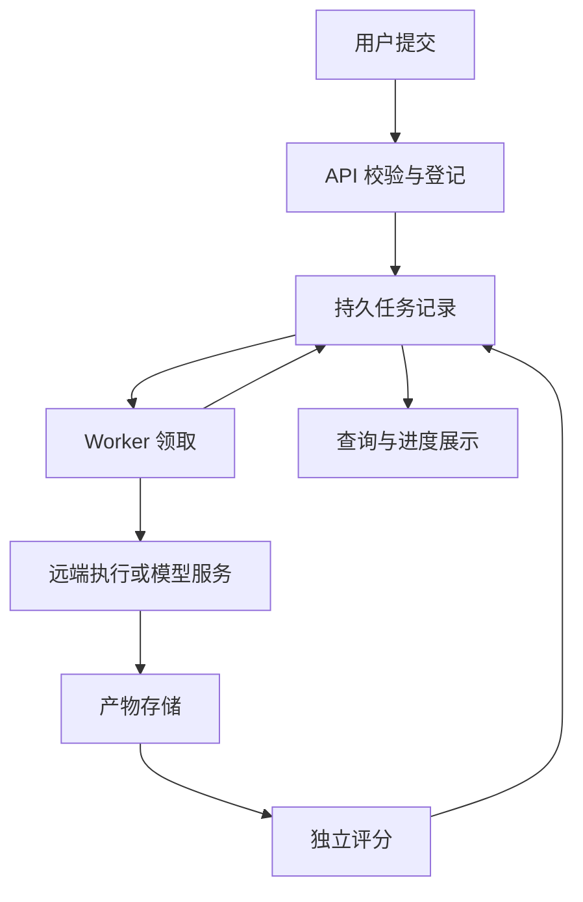
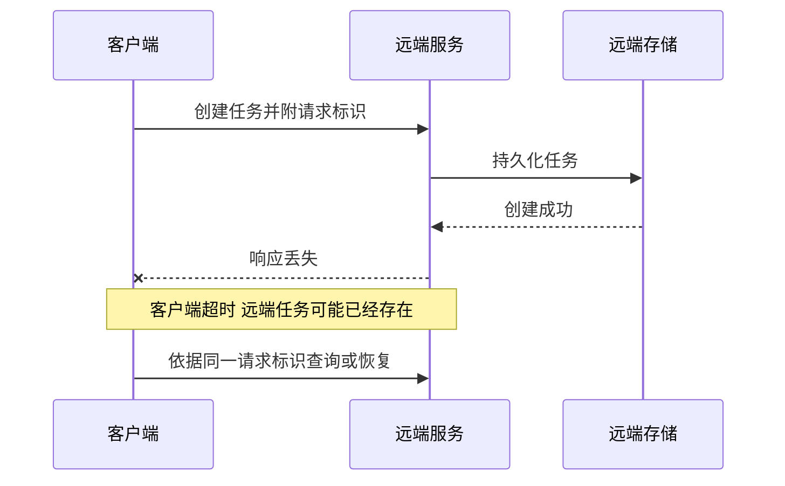
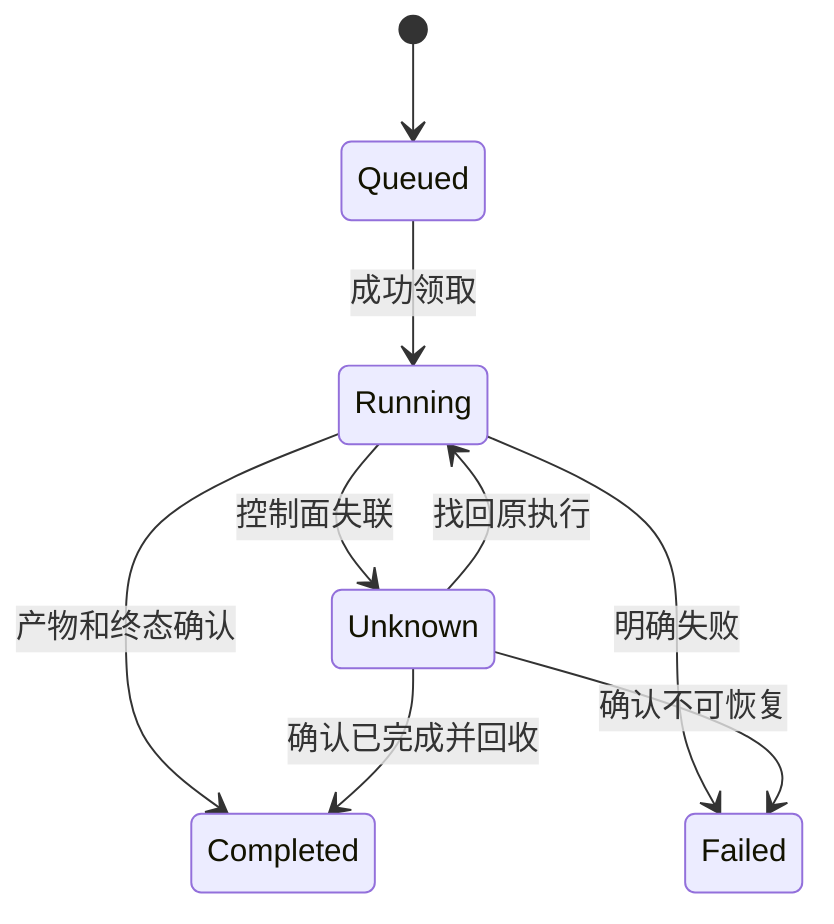

[返回总图与目录](/learn/agent)

**前置依赖：** [03 Agent 决策循环与工具设计](/learn/agent/03-agent-loop) · [04 上下文 检索与记忆](/learn/agent/04-context-retrieval-memory)。

**后续连接：** [06 评测可信度与实验设计](/learn/agent/06-evaluation-experiments) · [08 服务设计 安全与工程交付](/learn/agent/08-engineering-delivery)。

前置：03 的动作与环境、04 的摘要与权威状态。本章把网络、并发、数据库和恢复组织成一个问题：外部动作发生后，系统怎样保持可解释、可恢复的状态。节点：R1、R2、R3。

## 先看清真实执行链路

这是多个组件共同完成的一次逻辑任务。某个组件成功，不意味着整项任务成功；任意两步之间都可能中断。因此系统需要记录“哪一步已经确认完成，哪一步尚未确定”。

## 请求超时带来的是知识缺口

一次请求可以经历 DNS、连接、TLS、发送、服务端处理、读取和解析。在哪个阶段出错，决定我们对副作用知道多少。未能建立连接与发送后读取超时，不能采用完全相同的解释。

这种“结果未知”是分布式执行的常见结构。它不能靠捕获异常后立即重试来消除。首先要判断远端是否支持请求去重、是否有稳定执行 ID、能否查询事实。

## HTTP 与业务状态属于不同层次

HTTP 200 表明这次 HTTP 交互按相应服务语义成功返回；响应中仍可能描述业务失败。反过来，读取响应失败也不能证明远端业务没发生。

流式接口还要区分网络分片、协议事件和完整业务对象。一次读取可能包含半个事件，也可能含多个事件。工具参数可能跨多个增量片段形成 JSON，不能把每个网络 chunk 独立当成完整 JSON。

本地取消等待通常只能说明调用方不再等待。远端是否停止，需要取消协议和确认。将“页面关闭”直接解释成“任务已取消”，会造成状态误导。

## 并发从等待时间开始理解

线程是操作系统可调度的执行单元；进程通常有独立地址空间；协程在事件循环中协作切换。异步 I/O 允许等待网络时推进其他任务，并不自动把 CPU 计算并行化。

在常规带 GIL 的 CPython 构建中，纯 Python 的 CPU 密集计算通常不能靠多个线程获得对应的多核并行；释放 GIL 的扩展和其他运行模式需另行分析。多进程可隔离并利用多核，但增加通信、序列化和内存成本。

阻塞调用如果占住事件循环，心跳、超时处理和其他请求都会延迟。`asyncio.to_thread` 可用于移走部分阻塞 I/O；大量计算应根据实际实现选择进程或专门执行服务。具体取消与任务调度语义见 [Python 3.12 asyncio 文档](https://docs.python.org/3.12/library/asyncio-task.html)。

并发数限制同时在途的工作，速率限制单位时间启动多少工作，队列限制待处理积压。它们解决不同约束。20 个并发、平均每个 10 秒，在理想稳定条件下约对应每秒 2 个完成量；不能据此保证所有负载下都有该吞吐。

Little 定律可写为 L=λW：稳定系统中，平均在系统内的任务量等于到达率乘平均停留时间。接近容量边界时，排队会放大端到端时延，所以只测单请求耗时不足以解释上线后的 p95。

## 事务保护哪些事实

两个 Worker 同时看到一条 queued 任务，然后各自启动远端执行，会造成重复。解决思路是让领取过程在数据库中成为受约束的原子变化。

常见方法是在短事务中锁定待领取记录、更新所有者和状态，再提交。`FOR UPDATE SKIP LOCKED` 可让不同 Worker 跳过已锁行，适用于某些队列式访问；它得到的不是适合所有查询的一致视图。见 [MySQL 锁定读文档](https://dev.mysql.com/doc/refman/8.4/en/innodb-locking-reads.html)。

远端模型调用不应长时间占用领取事务。数据库回滚也不能撤销已经发生的远端调用。数据库原子性保护的是参与该事务的数据修改，不能自动覆盖所有外部副作用。

索引应对应查询条件与排序，例如状态、可领取时间和创建顺序；索引会增加写入与维护开销。是否有效要看执行计划和真实数据分布，而非“加了索引就快”。

## 幂等需要定义逻辑操作

幂等设计先回答：哪些重复请求实际上代表同一件事。请求标识要绑定调用者或业务空间、请求内容和必要版本，并由唯一约束防止并发重复登记。

同一个 key 与相同内容，可以返回同一运行；同一个 key 与不同内容，应明确冲突。去重记录的保留时间还要覆盖客户端可能重试的窗口。相关设计取舍见 [AWS 幂等 API 文章](https://aws.amazon.com/builders-library/making-retries-safe-with-idempotent-APIs/)。

API 去重只覆盖 API 边界。Worker 在远端启动后、写回本地之前崩溃，仍可能遇到未知结果。若远端也接受同一稳定标识，就能进一步去重；否则只能查询、对账、恢复或人工处理。

## 租约 所有权与迟到写入

租约是有时限的执行资格，心跳用来续约。租约过期意味着系统不再确认该执行者拥有资格，不代表旧进程已经物理停止。

设 Worker A 暂停，租约到期后 B 接手。A 恢复并晚到写回时，必须阻止它覆盖 B 的新状态。可以用所有者条件或单调增长的 fencing token 校验写入资格。fencing 只有在实际写入资源也检查 token 时才形成相应保护；仅在日志里记录 token 不够。

这是教学状态机。实际产品可以用其他状态名，但要保留“已确认失败”和“尚不知道结果”的语义差异。

## 重试策略是语义策略

只读查询通常更容易安全重试，但仍可能产生成本或压力。创建任务、扣费、发消息等操作，需要考虑重复副作用。指数退避和抖动控制重试节奏，不能让不安全的操作变得幂等。

还要设置整体截止时间。单次 30 秒、最多 10 次，叠加退避后可能超过资源租期。多层各自重试会放大请求数量，因此需要统一预算和可观察的重试记录。

错误信息中的 `retryable` 可以作为线索，但系统仍需要按已知错误类型和操作语义做判断；覆盖服务端分类时，应有明确范围和测试，避免把所有异常都当成临时故障。

## 恢复的四个层次

查询恢复是重新连接到原执行；产物恢复是取回已产生的文件；会话恢复是重建模型消息与工具结果；计算恢复是从中间状态继续算法或程序。它们需要不同的检查点。

恢复前应核对任务快照、输入摘要、执行环境和必要模型配置，避免把旧执行产物接到新任务上。同一路径存在文件不代表文件属于本次运行。

目录锁可防止同一主机的并发恢复，跨主机则需要共享的协调机制。锁的作用范围必须与可能竞争的执行范围一致。

## 验证可靠性的方法

先用 Mock 验证分支和不变量，再用隔离环境中的真实故障检查协议与时序。可以在“请求已接收、响应尚未返回”“远端结束、本地尚未保存”“租约刚过期”三个位置注入失败。

每项实验检查：是否重复启动、产物是否可恢复、旧所有者是否能写回、输入不匹配时是否拒绝、最终状态是否准确，以及增加了多少时间和成本。通过若干故障测试只证明覆盖场景成立，不能直接推导生产恢复成功率。

## 自测与练习

**为什么没有轻易可得的全链路 exactly once？** 客户端与服务端无法仅凭丢失的响应共同确认副作用；需要持久身份、去重和跨边界协调。描述保证时，应具体到哪个操作和哪个故障模型。

**练习。** 做一个本地“创建任务后故意丢响应”的假服务。先观察普通重试如何重复创建，再加入稳定请求 key。随后在远端创建与本地记录之间终止 Worker，验证 API 去重为何还不足以覆盖整个生命周期。

继续连接：06 区分系统失败与能力失败；08 将这些内部状态准确呈现给使用者。
