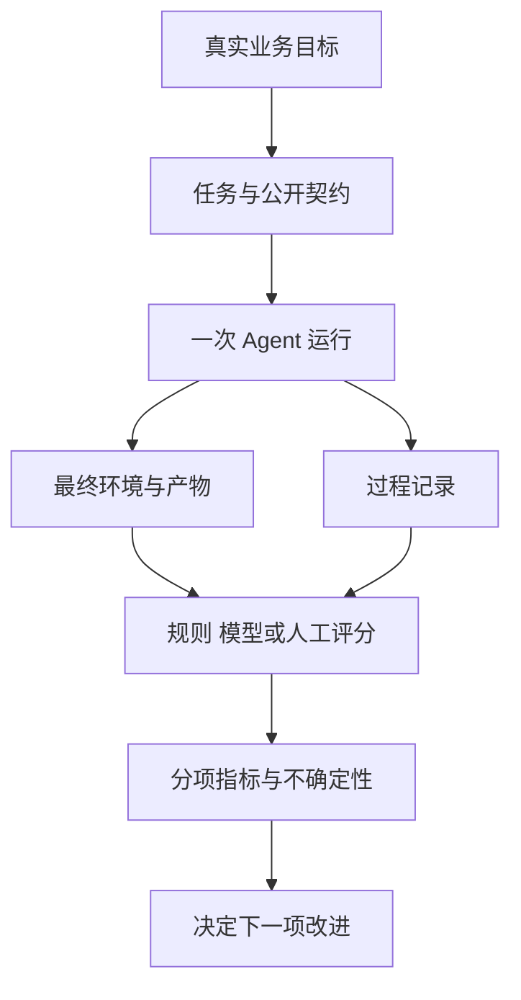
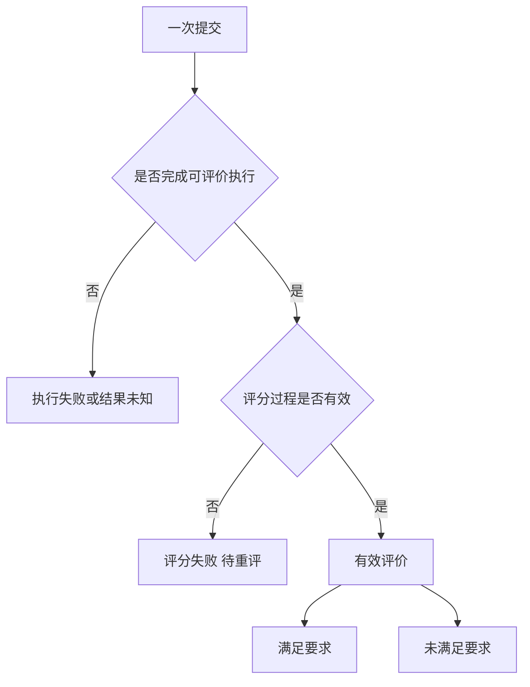

[返回总图与目录](/learn/agent)

**前置依赖：** [01 条件概率 学习目标与梯度](/learn/agent/01-model-foundations) · [03 Agent 决策循环与工具设计](/learn/agent/03-agent-loop) · [05 网络 并发 事务与任务恢复](/learn/agent/05-reliable-execution)。

**后续连接：** [07 数据飞轮与后训练原理](/learn/agent/07-data-posttraining) · [09 项目复盘 面试索引与学习实践](/learn/agent/09-projects-interviews-learning)。

前置：01 的概率与数据划分、03 的任务循环、05 的执行状态。本章解释怎样把真实目标转化为可测量证据，并判断一次改动是否有效。节点：G1、G2、E1、E2、E3。

## 从真实目标到可观察结果

真实目标可能是科学有效、用户问题得到解决或业务记录正确创建。评分器只能观察其中某些方面，所以它是测量工具，需要与目标之间有明确联系。

任务是输入和成功条件；一次尝试是 trial；轨迹记录过程；最终产物或环境状态记录结果。过程里写着“成功”，不能替代实际成功状态。有关这些对象的区分，见 [Agent 评测实践](https://www.anthropic.com/research/demystifying-evals-for-ai-agents)。

## 可验证的任务契约

任务应明确输入、环境、允许动作、输出格式、约束和成功标准。隐藏评分可以保留具体测试数据或参考值，但关键要求不应只能从隐藏检查中猜测。

例如要求提交坐标文件，就应公开必要字段、坐标系、单位和容许范围。否则失败可能反映契约不完整，无法公平解释为解题能力不足。

客观检查通常更稳定，但覆盖有限。精确匹配适合唯一格式，数值题需要合理容差，程序题可能需要测试与性质检查，开放问答可能需要证据与人工判定。科学任务还应考虑不变量、守恒关系或独立重算。

## 有效错误 与 无法评分

教学例子：100 个提交中，80 个得到有效评价，其中 60 个成功。可以报告已确认端到端成功比例 60%，有效评价内成功率 75%，评价覆盖率 80%。剩余 20 个的能力结果未知；如果业务 SLA 将不可交付计为失败，可以另报业务指标，同时保留原因分类。

不同指标服务不同问题。业务负责人可能关心提交后能否交付；模型研发可能关心排除基础设施故障后的能力。清楚保留分母，才能同时回答二者。

## 评分器也需要测试

正向控制应满足已知要求，负向控制应触发明确拒绝，空提交用于检查缺失结果的行为。它们能证明某些检查生效，不足以证明所有正确与错误情况都被覆盖。

还需构造边界案例：单位错误、字段重复、非有限数值、数组长度不符、缺少证据、非常接近容差边界的结果。变形测试可以检查某种变换后结果是否应保持不变，例如平移不应改变特定物理量。

使用同一评分实现重新得到相同分数，证明可复现性；使用独立实现或独立证据核对，才额外提供正确性证据。两种验证有不同价值。

## 模型评审的偏差

LLM Judge 可以处理开放式内容，但可能受答案顺序、长度、语言风格和题目歧义影响。评审提示、模型版本、工具权限和输出解析都会改变结果。

评分规则应拆成可观察维度，提供明确正反例，并用有可信标签的样本校准。需要查外部事实的评审，还要记录真正检索到的证据；模型说“查证过”不能替代工具回执。

多模型一致性衡量评审者之间的关系，准确性衡量与可信事实或标签之间的关系。把不确定样本全部弃权，可能降低冲突率，同时降低覆盖率。因此应一起观察正确性、冲突、弃权和覆盖。

## 版本为什么是实验的一部分

一次结果至少与任务输入、模型配置、Agent 代码、工具或环境和评分规则有关。评分器更新后重评旧答案，应保留原始产物并追加新的评价，而不是无痕覆盖历史。

内容摘要能帮助确认字节是否变化，不能证明语义正确或来源可信。版本 ID 与摘要配合，才能回答“这份结果基于什么条件产生”。

## 怎样比较两个方案

首先写出假设。例如：“结构化摘要通过减少约束遗漏，提高长任务成功率。”然后固定模型、任务、工具、总体预算和评分规则，只改变摘要方案，保留每个任务上的成对结果。

除了总体成功率，还要看预期机制是否发生：约束遗漏是否减少，是否增加原文读取，是否提升成本，哪些任务退化。如果成功率提升但预期机制没有证据，应重新考虑解释。

将开发集用于迭代，保留测试集用于最终比较。任务来源、模板或同一用户的近重复样本最好按组划分，防止相似内容跨集合泄漏。

## 波动与置信区间

二元成功率 p 的标准误差在独立同分布样本和适当样本量下近似为：

$$
\operatorname{SE}(\hat p)\approx\sqrt{\frac{\hat p(1-\hat p)}{n}}
$$

例如 n=100、成功率 0.8，标准误差约 0.04。一个粗略的正态区间会有约正负 8 个百分点的宽度，因此 80% 到 84% 未必说明稳定改善。小样本或接近 0、1 时应采用更合适的区间方法，不能机械套用该近似。

同一批任务比较两个方案，最好利用配对信息。教学例子：旧方案成功 80 题、新方案成功 84 题，可能是 4 题改善且没有退化，也可能是 14 题改善、10 题退化。净增都为 4 题，但稳定性和问题分布不同。

Bootstrap 可以按任务重采样估计差异的波动。如果每题跑多次，或样本来自同一用户、模板，需保留组内依赖，避免把相关运行都当成独立样本而夸大有效样本量。

## 多次尝试与预算

若单次成功概率为 p，且各次尝试相互独立且同分布，那么 k 次至少成功一次的概率为：

$$
1-(1-p)^k
$$

真实 Agent 的多次尝试常有相关性，不能默认使用这个公式估计表现。报告 pass@k 时必须说明 k、采样方式与预算，避免把多次机会的结果与单次交付直接比较。

同样，平均每次调用成本与每个成功任务成本回答不同问题。一个方案每次更便宜，却经常失败重跑，成功交付的总成本可能更高。

## 诊断顺序

遇到低分，先验证评分有效，再确认执行和产物完整，之后检查模型是否获得充分信息，最后分析决策是否合理。这个顺序能减少把基础设施问题误当成算法问题。

实际诊断可来回验证；图中的顺序表示一种高效起点。

## 自测与实验

**为什么 100% 评分复现率不等于 100% 评分正确率？** 相同实现可以稳定重复同一种错误。复现证明条件和结果一致，正确性还需要独立依据。

**为什么不能只报告提升百分比？** 80% 到 84% 是提升 4 个百分点，相对提升 5%；还需报告样本量、覆盖、重复次数和预算，才能理解证据强度。

**练习。** 构造一张逐任务结果表，记录旧方案、新方案、执行状态、评分状态、成本和错误类型。计算净改善、改善题数、退化题数、覆盖率和成功交付成本。再故意把评分故障填成 0，观察结论如何被改变。

继续连接：07 使用这些评价生成训练数据与奖励；09 将实验结果转化为可信的项目讲述。
