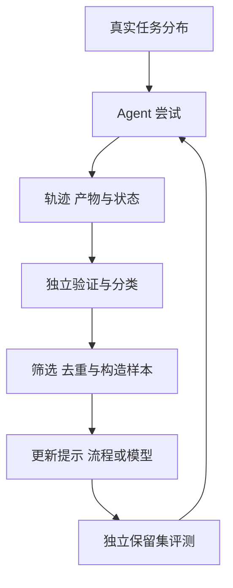

[返回总图与目录](/learn/agent)

**前置依赖：** [01 条件概率 学习目标与梯度](/learn/agent/01-model-foundations) · [03 Agent 决策循环与工具设计](/learn/agent/03-agent-loop) · [06 评测可信度与实验设计](/learn/agent/06-evaluation-experiments)。

**后续连接：** [09 项目复盘 面试索引与学习实践](/learn/agent/09-projects-interviews-learning)。

前置：01 的损失与梯度、03 的策略和环境、06 的有效标签与实验。本章解释系统经验怎样变成学习信号。节点：L1、L2。核心问题是数据或奖励究竟鼓励了什么行为。

## 改进闭环如何形成

“有轨迹”到“有训练价值”之间，至少需要确认任务是否有效、执行是否完整、标签是否可信、是否含有泄漏、样本是否重复，以及它代表什么分布。数据飞轮的价值取决于这些转换是否可靠。

## 三种不同的改进位置

改变上下文组织，相当于改变模型看见的信息；改变工具或控制流程，相当于改变可采取的动作和环境反馈；后训练则改变模型参数，使某些输出或决策更容易出现。

三者可以互补，但应先定位瓶颈。若检索根本没有找到必要资料，微调模型不一定能替代资料获取；若工具契约含糊，直接训练可能只是让模型记住特殊补丁。

## SFT 怎样利用示范

监督微调把期望的回答或行动序列作为目标，提高它们在给定输入下的概率。语言模型上的常见实现仍是条件负对数似然，只是数据分布和哪些 token 参与损失有所变化。

$$
L_{\mathrm{SFT}}=-\sum_{t\in\mathcal{T}_{\mathrm{target}}}\log P_\theta(y_t\mid x,y_{<t})
$$

对话中哪些角色、工具消息和 token 参与损失，要按训练目标明确设置。误把工具返回当成模型必须生成的目标，可能训练出不希望的行为；有些设计也会有意识地训练额外角色，不能脱离目标判断。

示范教会模型在示范状态下怎样行动，但模型部署时会遇到自己错误动作造成的新状态。只包含顺利路径的数据，可能缺乏恢复能力。因此失败诊断、纠错和重新验证也可能是有价值的训练片段，前提是标签可靠。

## LoRA 改变更新参数的方式

对于一个权重矩阵 W，可以冻结原权重，只训练低秩增量：

$$
W'=W+\frac{\alpha}{r}BA
$$

若 W 的形状是 dout×din，B 为 dout×r，A 为 r×din，可训练参数量是 r(din+dout)，而全矩阵为 dout×din。低秩约束降低更新自由度与训练存储需求，是否足够取决于任务和适配位置。见 [LoRA 原始论文](https://arxiv.org/abs/2106.09685)。

教学例子：4096×4096 的矩阵有 16777216 个参数，rank 8 的 A、B 合计 65536 个，为原参数数的 1/256。整个训练显存不会因此直接缩小到 1/256，因为仍有基础模型权重、激活和其他开销。

## 偏好数据与 DPO

偏好样本包含同一输入下较优与较差的回答。标准 DPO 以参考模型为基准，优化两者的相对概率差，不需要先单独拟合一个显式奖励模型再运行在线 RL。见 [DPO 原始论文](https://arxiv.org/abs/2305.18290)。

$$
L_{\mathrm{DPO}}=-\log\sigma\left(\beta\left[\log\frac{\pi_\theta(y_w\mid x)}{\pi_{\mathrm{ref}}(y_w\mid x)}-\log\frac{\pi_\theta(y_l\mid x)}{\pi_{\mathrm{ref}}(y_l\mid x)}\right]\right)
$$

yw 是偏好的回答，yl 是另一回答，β 控制该相对差异在目标中的尺度。阅读公式时应关注“同一输入、两个候选、相对参考模型、偏好标签”四个对象，而非只记缩写。

如果偏好标签偏爱冗长，模型可能学到冗长；如果两个回答使用了不同信息或预算，偏好差异也未必只反映决策质量。构造偏好对要检查这些条件。

## 强化学习关心行动的后果

强化学习把策略产生的动作与环境反馈连接起来，目标通常是提高期望回报。Agent 任务中，最终成功、工具成本和约束违反都可能进入奖励或约束设计。

$$
J(\theta)=\mathbb{E}_{\tau\sim\pi_\theta}\left[\sum_t\gamma^t r_t\right]
$$

τ 是一次轨迹，γ 控制未来奖励的折扣。对有限长任务也可以使用不折扣的终局奖励。奖励并不自动等同于真正目标，尤其在科学有效性难以自动验证时。

策略梯度的一种基本思想是：对于回报好于基线的动作，提高其概率；对于更差的动作，降低其概率。长轨迹的困难在于信用分配：最后失败，究竟是哪一步造成的？简单把同一个终局分数分配到所有步骤，可能带来高方差或错误归因。

## PPO 与 GRPO 的核心差别

PPO 使用新旧策略概率比与裁剪式代理目标等机制，限制一次更新的变化幅度；常见实现结合价值函数估计优势。它提供实用的更新约束，不保证每一步都真实改善任务表现。见 [PPO 原始论文](https://arxiv.org/abs/1707.06347)。

GRPO 的原始方法对同一问题采样一组回答，以组内奖励构造相对优势，从而减少对单独价值模型的依赖。见 [DeepSeekMath](https://arxiv.org/abs/2402.03300)。

$$
A_i\approx\frac{r_i-\operatorname{mean}(r)}{\operatorname{std}(r)+\epsilon}
$$

这个简化式只解释组内相对信号，不代表全部训练目标。若一组奖励全部相同，来自奖励差异的信号很弱或为零；其他正则项是否仍有梯度，要看具体实现。题目难度、采样多样性和奖励质量都会影响学习。

## 奖励漏洞为什么会被放大

如果评分器只检查文件存在，策略可以学会快速创建空文件；如果只奖励表面格式，策略可能优先满足格式而没有完成业务。随着优化更有效，代理目标与真实目标之间的差距可能更加明显。

因此需要独立检查、保留集、异常轨迹审查和对约束的明确表达。终局奖励与过程检查可以互补；过程奖励也可能把一种固定解法当成唯一正确路线，限制有效的新策略。

## 训练数据应保留的字段

样本需要关联任务版本、输入、模型与工具配置、可观察轨迹、最终产物、执行状态、评分版本和标签来源。仅有最终分数时，难以判断低分来自能力、故障还是评分缺失。

重复轨迹与重复产物会改变样本权重。只保留高分任务也会改变难度和领域分布。筛选后应比较来源、任务类型、难度、长度和错误类别，避免某些能力被无意排除。

训练、验证和测试应按任务来源或模板隔离，防止相似轨迹跨集合。包含私有评分内容、密钥或不应传播的个人信息的样本，需要在实际使用前按权限和数据规则处理。

## 训练实验怎样才有解释力

先建立未训练基线，固定评测和预算。记录可训练参数、数据规模与组成、更新步数、有效 token、学习率与随机设置。比较整体结果，也比较关键分项和原有能力是否退化。

一次训练成功运行只证明流程打通；训练 loss 下降只证明对训练目标的拟合；独立任务表现改善才提供迁移证据。三种成果可以分别汇报。

## 自测与练习

**为什么高分轨迹未必适合 SFT？** 可能利用泄漏、评分漏洞或不可复现的环境信息，也可能包含大量无效动作。先验证高分代表的行为和证据。

**为什么 GRPO 之前必须先学评测？** 策略会沿奖励信号优化；奖励若把故障当失败、把格式当科学正确，就会把测量问题写进模型行为。

**练习。** 从教学任务生成十条轨迹，分别标记真实成功、格式通过但内容错误、执行失败、评分失败与泄漏。先决定哪些能用于 SFT、偏好对或奖励学习，再解释选择依据。此练习不要求启动训练。

继续连接：06 定义信号是否可信；09 说明如何把评测与数据经验讲成实际能力，而不声称自己完成了尚未开展的训练。
