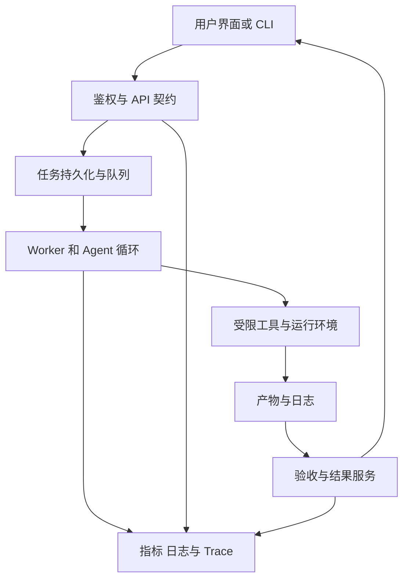

[返回总图与目录](/learn/agent)

**前置依赖：** [03 Agent 决策循环与工具设计](/learn/agent/03-agent-loop) · [04 上下文 检索与记忆](/learn/agent/04-context-retrieval-memory) · [05 网络 并发 事务与任务恢复](/learn/agent/05-reliable-execution) · [06 评测可信度与实验设计](/learn/agent/06-evaluation-experiments)。

**后续连接：** [09 项目复盘 面试索引与学习实践](/learn/agent/09-projects-interviews-learning)。

前置：03 的控制边界、04 的信息链路、05 的可靠执行和 06 的测量。本章把代码基础、服务设计、安全与可观测性接到一次真实交付。节点：P1，并连接 A2、R1、R2、E3。

## 一次产品请求的完整路径



用户最终关心能否提交、能否知道进度、能否拿到可信结果，以及失败后该怎么办。内部算法和系统状态必须通过清楚的接口映射到这些需求。

## Python 基础如何影响正确性

变量赋值绑定对象，并不自动复制对象。浅拷贝只复制外层容器，嵌套可变对象仍可能共享。假设两个任务共享 `config['tools']` 列表，一个任务追加工具，另一个任务也会看到变化，导致配置污染。见 [Python copy 文档](https://docs.python.org/3/library/copy.html)。

```python
base = {"tools": ["search"]}
a = base.copy()
b = base.copy()
a["tools"].append("python")
assert "python" in b["tools"]
```

修复应根据数据模型选择不可变配置、显式构造或合适复制，不能对所有对象无条件深拷贝；连接、锁和外部资源可能需要共享或独立管理。

异常应带足够上下文，并在合适边界转换成业务状态。把所有异常吞掉并返回空列表，会使“没有结果”和“读取失败”失去区别。上下文管理器可以管理文件、连接和锁的释放，但释放策略仍需考虑远端执行是否正在继续。

类型标注和数据模型帮助表达接口，不会自动证明运行时输入合法。边界处需要验证，内部通过明确类型降低误用。

## 数据结构与算法在哪里用

| 结构或方法 | 在系统中的用途 | 需要理解的取舍 |
| --- | --- | --- |
| 哈希表与集合 | 请求去重 缓存与结果归并 | 平均查找效率 内存与键的定义 |
| 队列与双端队列 | 待处理任务与滑动窗口 | 顺序 背压与饥饿 |
| 堆 | 优先任务或下一次重试时间 | 动态排序成本与公平性 |
| 图与拓扑排序 | 工作流依赖 | 检测环与确定可执行节点 |
| 二分查找 | 单调条件下寻找预算边界 | 单调性是否真的成立 |
| 动态规划 | 有重叠子问题的预算或路径问题 | 状态定义 转移与空间复杂度 |

复杂度是随着输入规模增长的趋势，实际时延还受常数、I/O、缓存和并发影响。面试练习应能解释边界与复杂度；项目里应结合真实数据测量瓶颈。

## API 契约与前后端状态

长任务通常适合返回稳定任务 ID，让客户端查询或订阅进度，而不是让一个 HTTP 连接承载整个生命周期。创建成功可以表示“已经接受并登记”，并不表示任务完成。

进度事件最好带运行 ID、序号和时间。断线重连时，客户端需要知道如何补齐或重新获取快照；若只显示一个不断增长的文本串，很难准确恢复业务状态。

错误响应应区分输入错误、权限不足、资源限制、执行失败与状态未知。用户能否重试、会不会创建新任务、原结果是否仍可找回，应由接口语义明确表达。

分页也有一致性取舍。任务持续新增时，偏移分页可能重复或跳过记录；基于稳定排序键的游标有助于连续浏览，但需要处理排序字段变化及过滤条件。

## Linux 与容器的基本责任

诊断时先区分进程是否存在、是否存活、是否有输出，以及输出是否有效。退出码、标准输出、标准错误、工作目录、文件权限和环境变量都是不同证据。进程存在但没有进展，需要进一步观察等待、资源使用和日志。

容器把应用及依赖组织为可分发运行环境，通常共享宿主内核；虚拟机有不同的隔离边界。镜像减少环境漂移，但相同镜像仍可能因输入、硬件、挂载、外部服务和随机性而产生不同结果。见 [Docker 容器概念](https://docs.docker.com/get-started/docker-concepts/the-basics/what-is-a-container/)。

固定镜像 digest 比只记录可变 tag 更有利于追溯。产物若只保存在短生命周期容器里，清理容器就可能丢失；因此需要定义回收和持久化时机。

## 安全从信任边界推导

模型可能读到用户文本、网页、仓库注释和工具结果。这些来源可以提供信息，却不自动拥有修改系统权限的权力。模型生成的工具参数也需要宿主校验。


权限应限制文件目录、网络访问、可用凭证、进程与资源额度；有重要副作用的动作需要按产品规则控制。提示词可以表达规则，实际权限边界应由系统实现。容器本身也不等于对任意不可信代码的完整安全方案。

多租户系统尤其需要在数据库查询、对象存储和检索阶段实施隔离。仅在页面上隐藏别人的数据，不等于后端访问被禁止。

## 日志 指标与 Trace

日志记录具体事件，指标描述聚合趋势，Trace 把跨服务调用串成一次请求的路径。三者各有作用，可参考 [OpenTelemetry 信号概念](https://opentelemetry.io/docs/concepts/signals/)。

Agent 轨迹与系统 Trace 也不同：前者关注模型消息、动作和观察；后者关注服务调用、时间与错误。通过运行 ID、调用 ID 和产物引用关联，才能从用户的错误结果定位到具体步骤。

时延可以拆成排队、上下文构造、模型、工具、评分与回收。假设总耗时 100 秒，其中模型占 20 秒，即使把模型阶段减半，总耗时也只是降到 90 秒。优化必须从实际占比和关键路径出发。

日志不应无限记录全文或凭证。摘要、脱敏与原文受控访问需要兼顾诊断价值、成本和权限。只有错误码而无关联上下文不够，未经选择地保存全部敏感内容也不是必要条件。

## 从测试到部署

单元测试验证局部逻辑；集成测试验证真实组件接口；端到端测试覆盖完整交付；故障测试验证中断与恢复语义。关键问题应选择能发现真实错误的层次，避免只测试 Mock 返回了自己设定的值。

部署时记录代码、配置、镜像、数据与评分版本。配置变化可能与代码变化一样影响结果。回滚代码后，已迁移的数据结构和已运行中的任务未必自动回滚，因此需要兼容设计和运行版本标记。

优雅关闭应停止领取新任务，并明确等待、移交或保存当前任务的方式。直接终止所有进程可能损失产物，永远等待又可能阻塞发布，需要结合租期与任务语义设计。

## FDE 与应用交付增加了什么

FDE 工作通常还要求把客户流程变成可实施的需求，识别接口与数据限制，协调验收，并让非研发用户理解结果。学习时可把同一个 Agent 服务包装为可提交、可查看、可恢复的完整流程，再用实际用户任务检验。

面对运营优化类任务，还要区分可行性与最优性。一个排程满足所有硬约束，只证明可行；是否接近最优需要基线、界或求解器证据。模型可以生成候选方案，程序检查约束，求解器提供可比较基线。这条支线连接 G1 与 E1。

## 自测与练习

**为什么接口很快但用户仍觉得慢？** 创建接口可能只完成入队，实际排队和执行很长；首个 token 快也不代表最终文件交付快。需要测量用户真正等待的区间。

**练习。** 用本地假 Agent 实现提交、查询和结果下载三个接口，设计清楚的任务状态。加入可控延迟与失败，让客户端在断线后恢复查看。同一任务重复提交时观察去重，服务重启后观察状态和产物是否仍可获得。

继续连接：09 把这些机制与自己的具体项目、岗位能力和可展示证据连接起来。
