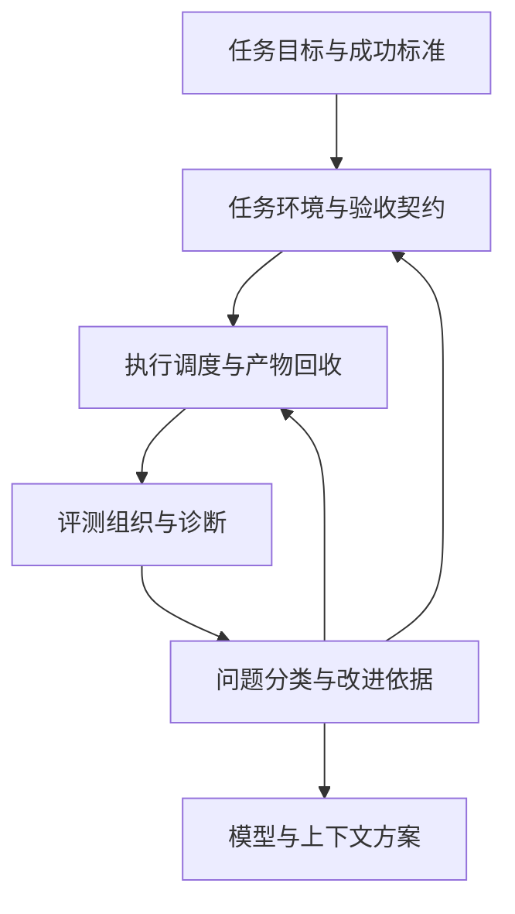
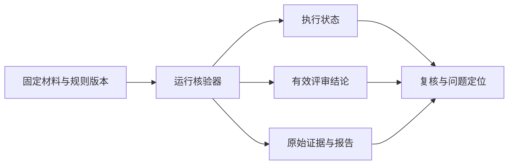
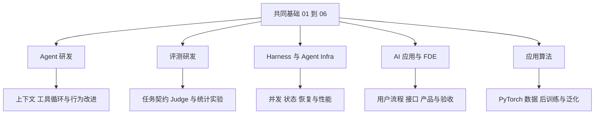

[返回总图与目录](/learn/agent)

**前置依赖：** [03 Agent 决策循环与工具设计](/learn/agent/03-agent-loop) · [04 上下文 检索与记忆](/learn/agent/04-context-retrieval-memory) · [05 网络 并发 事务与任务恢复](/learn/agent/05-reliable-execution) · [06 评测可信度与实验设计](/learn/agent/06-evaluation-experiments) · [07 数据飞轮与后训练原理](/learn/agent/07-data-posttraining) · [08 服务设计 安全与工程交付](/learn/agent/08-engineering-delivery)。

**后续连接：** [Agent 研发原理与实践学习手册](/learn/agent)。

前置：模型、信息、行动、执行和评测。本章使用三个教学案例，把原理接到工程判断与面试表达。案例中的系统与故障是用于推演的场景，不对应某个公司的内部实现或个人履历。

## 三种工作属于同一条任务链路

任务工程定义什么算完成；执行系统保证动作与结果可追踪；评测系统提供比较与改进依据。一个人可以深入其中一段，同时理解上下游的接口。

## 教学案例一 科研题目核验

假设平台让模型判断科研问题是否清晰、可解，并把证据交给人工复核。题目材料、规则和模型都会变化，因此每次评价应绑定明确输入与配置。否则旧结果与新结果的差异可能来自评价对象变化。

如果模型服务超时，系统得到的是一次未完成评价，而非题目不合格。重试前还要考虑远端是否已经处理、是否产生费用、是否支持请求去重。结果未知时，保留原执行与证据比无条件重新提交更容易解释。

评价这种平台，可分别测量有效评价覆盖、人工判定一致性、错误分类质量和复核耗时。冲突率下降不能独立证明准确率提高，因为系统也可能增加弃权。

面试讲述应包含输入版本、状态分类、重试边界与验证方法。若没有可信人工标签，就应把准确率实验列为后续工作，不能把报告数量当成质量提升。

## 教学案例二 远端长任务恢复

假设 Agent 在沙箱中运行分析，控制端查询超时，但远端任务仍可能执行。若客户端立即删除沙箱，就会同时失去运行与产物。根因是把“没有得到观察”当成“远端明确失败”。

方案应保存稳定执行 ID，将控制面错误与执行终态分离。对适合重试的查询设置截止时间；恢复时核对输入摘要与环境，再回收原任务产物。并发恢复还需要与执行范围匹配的锁或所有权机制。

恢复对象必须具体：重新监控、回收文件、重建模型会话、继续数值计算，各自需要不同检查点。只实现文件回收，不能声称任意计算都支持断点续跑。

实验可以在请求已接收但响应未返回的位置断开连接，检查是否重复启动、是否找回原产物，以及旧执行者是否还能覆盖新状态。Mock 验证分支，真实隔离环境验证接口和时序；二者的证据范围不同。

## 教学案例三 科研任务在线验收

假设任务要求模拟一段物理过程并提交结果。格式检查能确认文件可解析，却不能确认科学内容。评分器可以增加独立重算、不变量检查、容差与边界条件，同时保持公开契约足够完整。

正向控制应通过，特定错误样本应被拒绝，空提交应有明确行为。对于开放问答，需要将客观判分与模型评审分开，并保存评分失败状态。冻结原实现重算可证明复现，独立证据才额外支持正确性。

如果平台已有用户提交，可以测量完成交付比例、异常类型、评分覆盖和复核成本。平台使用量、评分复现和科学有效性是不同维度，汇报时应分别说明。

一个好的反例实验是同时设计“错误但格式完整”和“有效但解法不同”的答案，观察是否存在漏判和过度约束。

## 把三个案例还原成可迁移能力

| 已讨论的问题 | 基础机制 | 可以迁移到哪里 |
| --- | --- | --- |
| 评分故障混入有效统计 | 观测缺失与能力结论分离 | LLM Judge 数据筛选 在线质量监控 |
| 材料变化导致结果难复核 | 不可变输入与版本绑定 | 实验平台 CI 数据流水线 |
| 查询失败后产物丢失 | 观察与真实状态分离 | 长任务调度 云作业 Agent Runtime |
| 恢复时复用错误输入 | 身份与快照一致性 | 缓存 断点恢复 任务去重 |
| 格式有效但科学 QC 失败 | 代理指标与真实目标区别 | 自动验收 奖励建模 模型评测 |
| 模型意见一致但可能共同错误 | 一致性与准确性区别 | 多评审者系统 合成数据质量 |

这些连接可以成为自己的理解。个人完成的工作、团队设计和阅读后理解的机制，应在表达中自然区分，才能经得住代码、决策过程和验证记录的追问。

## 用同一张图回答面试问题

| 问题入口 | 先定位节点 | 回答时必须解释的机制 |
| --- | --- | --- |
| 为什么模型会幻觉 | M1 C2 E2 | 条件分布 信息缺失与外部验证 |
| 为什么要 Q K V | M2 | 匹配与内容汇总的计算角色 |
| 为什么需要 causal mask | M2 | 预测位置不能读取未来信息 |
| 为什么训练与推理速度不同 | M2 M3 | 已知目标并行计算与逐步生成 |
| KV Cache 与记忆什么关系 | M3 C3 | 计算中间状态与任务信息 |
| 长上下文是否替代 RAG | C1 C2 | 预算 相关性 更新与证据定位 |
| RAG 效果差先查什么 | C2 E3 | 解析 召回 重排与生成分离 |
| 为什么检索高召回仍答错 | C2 A1 | 证据完整性与使用方式 |
| 为什么多 Agent 不一定更好 | A3 E3 | 分解 合并 协调与预算 |
| MCP 解决了什么 | A2 P1 | 标准连接与业务控制的边界 |
| 工具参数合法是否就能执行 | A2 P1 | 结构校验 业务条件与权限 |
| async 是否提高 CPU 并行 | R1 | 协作调度与计算资源的区别 |
| 并发控制是否等于限流 | R1 | 在途数 启动速率与积压 |
| 超时为什么不能立即重试 | R1 R2 | 副作用已发生但响应未知 |
| 幂等 key 怎样设计 | R2 | 请求身份 内容与作用域 |
| 数据库事务是否覆盖模型调用 | R2 | 原子性边界与外部副作用 |
| 租约过期旧 Worker 会怎样 | R3 | 所有权与迟到写入 |
| 如何恢复长任务 | R3 C3 | 恢复对象 检查点与一致性 |
| 评分失败是否算零分 | E1 E2 | 业务指标与能力未知分开 |
| 为什么提升 4 个百分点不够 | E3 | 样本 波动 配对与预算 |
| 重评一致是否说明评分正确 | E2 | 复现与独立正确性证据 |
| 高分轨迹能否直接训练 | L1 E2 | 标签 泄漏 去重与分布 |
| LoRA 为什么省资源 | L2 M2 | 低秩更新与训练开销组成 |
| SFT DPO RL 怎样选 | L2 E3 | 示范 偏好与环境奖励 |
| GRPO 为什么依赖奖励质量 | L2 E2 | 组内相对信号与代理目标 |
| 如何证明平台能稳定运行 | R3 P1 E3 | 真实故障 长期观测与验证范围 |

回答时先给机制，再用自己的一个案例说明取舍。被追问到陌生实现时，可以明确假设并推导需要验证什么，避免编造框架默认值。

## 面向不同岗位的深入路线

这些是能力路径，具体招聘条件仍需对照申请时的 JD。

Agent 研发主线应能独立完成循环、工具协议、上下文与错误处理，并做一次有对照的效果改进。评测方向进一步深入评分器有效性、任务覆盖和实验解释。Harness 方向需要真实故障、并发和性能证据。FDE 需要把技术接到用户流程、限制和验收标准。应用算法需要实际训练或有算法解释力的实验。

推理算子、分布式训练、强化学习研究可作为后续扩展支线：它们分别依赖体系结构与并行计算、通信与优化、概率与序列决策。当前理解接口和瓶颈，不能直接等同于已掌握这些专门岗位。

## 将知识变成证据的四阶段练习

**阶段一 画图与推演。** 闭卷重画六节点总图，用一项任务解释每条箭头。然后手算一个 softmax、一个注意力例子、一个 KV 预算和一个配对结果表。验收标准是每个符号和分母都能解释。

**阶段二 最小运行系统。** 在本地教学环境实现任务登记、假模型或固定策略、两种工具、产物保存和独立评分。先让控制逻辑可预测，明确每个状态转换。验收标准是重复提交、失败与状态查询有清楚语义。

**阶段三 三组对照实验。** 分别比较上下文方案、故障恢复方案与评分器方案。每组只改变所关注因素，保存逐任务数据，记录改善和退化。验收标准是能够解释结果、成本和未覆盖情形。

**阶段四 面试复盘。** 将一个实验写成“原问题 → 为什么发生 → 候选方案 → 选择依据 → 实际验证 → 未解决部分”，同时附上代码入口和最小复现。这样的材料既支撑简历，也支持深入追问。

以上是练习设计，尚不代表这些实验已经完成。可先使用本地模拟组件；需要调用付费模型或公司环境时，再按实际授权与预算执行。

## 每周如何维护这份手册

选择本周最重要的一个错误或不理解的问题，把它定位到节点；补一段机制解释、一个反例和一项可以检验的预测。更新后，尝试在不看笔记时沿总图讲回完整链路。

若新增概念只能作为一个孤立名词存在，就继续追问：它解决了什么限制，依赖什么前提，改变哪个状态或信息，怎样证明有效。直到能够连上至少一条前置关系和一条用途关系。

下一次讨论可以直接使用节点编号，例如“展开 R3 的租约与迟到写入”“推导 M2 的注意力维度”“给 E3 增加一个配对实验”。主图位置保持稳定，细节沿分支增长。
