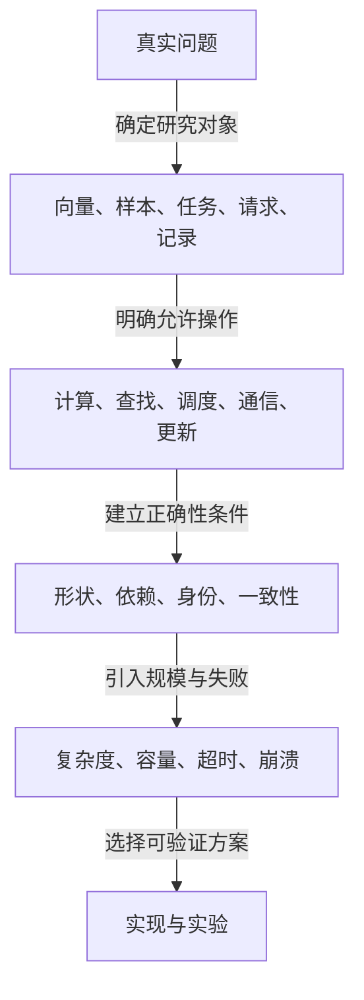

## 为什么基础知识不能只放在附录

大模型系统里常见的问题，最终会落到通用对象上：注意力是张量计算，任务依赖是一张图，工具调用跨越网络，恢复依赖持久化状态，比较效果需要统计推断。基础知识的价值在于让你能重新推导方案，而不是多背几个岗位关键词。

本组按“对象—操作—不变量—失败边界”组织学习。对象是什么决定表示，操作是什么决定算法，不变量决定正确性，边界决定什么时候原来的结论不再成立。

例如，“并发查询更快”只在独立性、资源容量和等待可重叠等条件下有意义。算法告诉你有没有依赖，操作系统告诉你实际如何调度，网络告诉你结果何时可知，数据库告诉你并发更新是否会冲突。缺少其中一层，结论就容易变成口号。

## 推荐的补基础方式

先用 F1 手算矩阵与梯度，再用 M1 理解学习信号。工程支线则从 B1 的结构和算法进入 B2 的运行与通信，再到 B3 的持久化。碰到异步等待看 R1，碰到重复操作看 R2，碰到恢复看 R3。

不要把所有基础按学期顺序全部学完才做应用。选择一个问题，把解释所需的前置补齐，并写下条件。随后换一个输入规模或失败方式，检验自己的解释是否还能成立。

## 一个练习串起四种基础

实现一个小型任务分析器：用字典按 ID 保存任务，用图表示依赖，使用有界队列调度独立任务，将状态存入数据库。安排一次进程退出，观察哪些状态会丢失；再安排一次查询超时，观察哪些结果仍然未知。

第一版可以使用固定的假工具，无需调用收费模型。这样失败更容易复现。等你能解释每个状态变化，再接真实模型，才能区分程序错误和模型决策问题。
