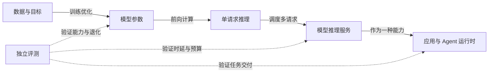

## 同一个“模型”背后有不同阶段

模型研发先决定数据、结构与学习目标，通过优化改变参数；推理在给定参数下根据输入生成输出；推理服务再将许多用户请求映射到有限的计算和缓存资源。Agent 运行时位于更外层，把多次模型与工具调用组织成任务。

图中的阶段有联系，但优化对象不同。训练 loss、每秒 token 数和任务完成率不能相互替代。一项改进可能提高前者却损害后者，因此评测要覆盖实际关心的对象。

## 三种 Infra 怎样区分

| 层次 | 被调度的对象 | 主要状态 | 常见瓶颈 |
| --- | --- | --- | --- |
| 训练基础设施 | 数据分片与张量计算 | 参数、梯度、优化器、数据位置 | 显存、通信、数据供应 |
| 模型推理基础设施 | 请求与 token | 请求队列、KV Cache、模型权重 | 带宽、计算、缓存容量、排队 |
| Agent 基础设施 | 长任务与工具动作 | 执行身份、事件、产物、权限与租约 | 外部等待、恢复、一致性、任务预算 |

这些是学习边界，不是公司组织必须采用的划分。一个团队可能同时负责多层，但面试中必须说明自己在哪一层做了什么。

## 沿机制学习

从 M4 的 token 与向量进入 M2 的注意力；用 M1 明确优化目标；再看 M5 的预训练和 L2 的后训练。推理支线从 M3 的单次生成进入 I1 的服务调度；训练支线从学习目标进入 I2 的状态与并行。

若无法解释一项优化节省了哪种计算或内存，不必急着背框架参数。先把一次前向、一次更新或一次请求的对象画出来，再追踪哪些东西被复制、缓存、分片、重算或等待。
