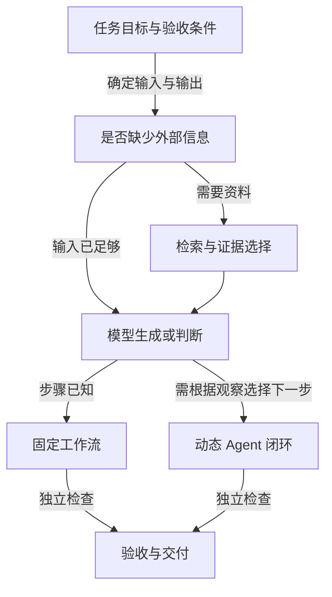

## 不是所有应用都需要相同的自主性

给定文本做分类、根据文档回答问题、按固定流程处理工单、探索未知代码仓库，是四种不同任务。它们可能使用同一个模型，却需要不同的信息来源、控制逻辑和执行权限。

先问目标能否被明确验收、步骤是否预先已知、执行中是否会出现决定下一步的新信息、动作是否有副作用。然后再决定哪些步骤交给普通程序，哪些步骤需要检索、模型判断或动态工具选择。

这是选型讨论图，不是严格互斥分类。工作流可以包含 Agent 子步骤，Agent 也会调用确定性的程序。重要的是每层自由度为什么必要，以及怎样验证它带来的收益。

## 提示、信息和行动不能混成一个开关

提示改变模型看到的条件；RAG 增加可用证据；记忆改变跨轮信息保留；工具让系统获取新观察或作用于环境；运行时提供状态和恢复。它们解决的不是同一问题，因此不能简单按“加上功能越多越高级”排列。

例如报告答错可能因为指标定义未给出、检索没有找到资料、上下文压缩丢掉单位、模型计算错误或执行用了旧文件。先定位因果链，再决定修改提示、数据、工具还是执行机制。

本组深读先用 A4 从需求构造完整架构，再用 A0 区分提示、示例和结构化输出。随后进入 C1/C2/C3 与 A1/A2/A3，把选型落到信息与行动机制上。
