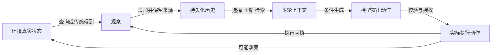

[回到知识图中的 A1](/learn/agent?node=A1) · [本组导读](/learn/agent/03-agent-loop)

## 先看问题：模型已经说完成，任务为什么还没完成

假设我们做一个研究助理：读取实验数据，选择分析方法，运行脚本，最后提交报告。这是贯穿本节的教学案例，不是某个公司的真实项目。一次执行中，模型写道“分析已完成”，但远端计算仍在运行；另一次模型收到超时，却有一个已经启动的进程继续消耗资源。两种故障都来自同一个混淆：把模型当前相信的事，当成环境实际发生的事。

本节属于大模型应用中的 Agent 控制机制。理解它先需要条件概率和程序状态的概念；并不要求先学强化学习算法。学完后，你应能把一次任务拆成真实状态、观察、历史、上下文和动作，并解释为什么工具反馈能改进决策、为什么它又不能保证正确。

## 先走完一次正常任务

教学任务是“读取 experiments.csv，比较两种温度下的平均产率，并保存结果”。用户口头提到 `temperature`，文件实际列名却是 `temp_C`。模型并不能从任务描述预知这个差异。

| 这一步 | 实际环境与工具返回 | 下一轮模型看到什么、决定什么 |
| --- | --- | --- |
| 读取表头 | 文件存在；返回 `temp_C, yield_pct` | 看见真实字段，改用 `temp_C`，而不是继续猜列名 |
| 读取数据 | 返回四行：20°C 下 70、74；30°C 下 78、82 | 确认分组和单位，提出按温度求均值的脚本 |
| 执行脚本 | 脚本实际运行；写出两行均值 72、80，返回文件路径和退出码 | 根据运行回执请求检查结果文件 |
| 验收与结束 | 检查器读取文件，核对两组均值、行数和字段 | 验收通过后，系统记录完成并交付文件 |

每次返回的是**观察**；四行数据和文件是否真的存在是**环境状态**；累积回执是**历史**；被挑选送进下一次模型调用的部分才是**上下文**。模型提出的脚本是动作建议，执行器校验后才真的启动进程。

这条链里，如果模型直接猜列名，第一步就可能错；如果跳过验收，第四步就没有依据。后面讨论超时与恢复，是在这条正常链中插入故障，而不是先记一组抽象名词。

## 五个容易混为一谈的对象

**环境状态**是世界里正在成立的事实：文件实际存在吗、进程是否仍在运行、数据库记录是否已经提交。记为 $s_t$。环境不必是物理世界，一台远程机器也可以是环境。

**观察**是某次接口带回的信息，记为 $o_t$。例如状态接口返回 `running`，只是我们在某个时刻获得的一次观察。它可能有延迟、遗漏或错误。若接口超时，我们得到的是“没有取得这次查询的答案”，不是“任务已经失败”。

**历史**是系统保存下来的动作和观察，记为 $h_t$。它可以包括用户要求、工具调用、返回值、时间戳与产物引用。完整历史不一定都送进模型。

**上下文**是本次模型调用实际看到的表示，记为 $c_t$。它由历史、当前任务、检索结果等构造而来。上下文有长度限制，也可能经过删减；所以“系统记录过”不等于“这轮模型看到了”。

**策略**是根据当前信息选择动作的规则，记为 $\pi$。在语言模型 Agent 中，模型生成工具调用和回复，是策略的一部分；程序中的固定路由、预算和权限检查，也参与决定最后能执行什么。



这幅图中有两个不同方向：环境产生观察，动作影响环境。上下文夹在两者之间，是决策的信息入口，而不是环境本身。框架常将跨步骤保存的数据称为 state；这通常指程序状态，而不是已经完整掌握的世界状态。LangGraph 的官方状态设计示例也强调保留原始数据，再按需构造提示。[状态设计示例](https://docs.langchain.com/oss/javascript/langgraph/thinking-in-langgraph)

## 为什么需要循环：一次回答无法预知尚未发生的结果

普通生成可以把“输入问题，输出答案”视为一次映射。执行任务时，这个映射不够：模型还不知道脚本运行后会出现哪种错误，也不知道检索工具会找到哪篇资料。这些信息必须通过行动才能取得。

一个最小表示是：

$$
c_t=g(h_t),\qquad a_t\sim\pi_\theta(\cdot\mid c_t),\qquad
s_{t+1}\sim P(\cdot\mid s_t,a_t)
$$

$g$ 是上下文构造过程，$\theta$ 是模型参数，$P$ 是环境变化规律。这里最关键的是：$\pi_\theta$ 生成动作的概率，与 $P$ 描述动作实际造成的结果，是两件事。模型生成“保存成功”这几个字，不会自动让文件写入磁盘。

新状态又产生新观察，追加到历史，构造下一轮上下文。循环的意义因此不是“让模型多想几遍”，而是让先前不可知的信息进入后续决策。ReAct 的研究把推理与行动交替组织，行动可以从外部环境取得新信息；它是这种闭环的一种组织方式，并不意味着所有循环都必须采用同一种自然语言格式。[ReAct 原论文](https://arxiv.org/abs/2210.03629)

## 用一个数字例子理解“获取信息”也是行动

假设脚本失败有两种候选原因：路径错误和缺少依赖，暂时各占一半可能性。直接重装依赖可能很慢，而一次目录检查只需很短时间。假设教学环境中，若真是路径错误，目录检查出现“目标文件不存在”的概率为 0.95；若是缺少依赖，出现同样观察的概率为 0.05。

获得“文件不存在”的观察后，用贝叶斯公式更新：

$$
P(\text{路径错误}\mid\text{文件不存在})
=\frac{0.95\times0.5}{0.95\times0.5+0.05\times0.5}=0.95
$$

目录检查没有直接完成分析，却改变了应该采取哪个下一步。原来的不确定性是两个原因各占一半，现在倾向于先找正确路径。真实模型不会自动维护这样一个精确的两项概率表；这个例子用于解释诊断动作的价值，不能把模型口头给出的 95% 当成校准后的概率。

还要注意，信息不是越多越好。如果诊断需要十分钟而重跑只需一秒，或者查询本身会暴露无关数据，就未必值得。动作的价值要同时考虑信息收益、执行成本和风险。是否该查询、重试或停止，最终要回到目标和预算。

## 从概念循环变成一个可检查的程序

下面是概念伪代码，用来展示责任边界；它不是可直接部署的完整执行器。

```python
while not run.is_terminal():
    if run.budget_exhausted():
        run.request_collection_and_stop()
        break

    context = build_context(run.goal, run.records, run.latest_observations)
    proposal = model.propose(context, available_tools)
    action = validate_schema_and_business_rules(proposal)
    authorize(run.user, action)

    intent = persist_intent(run.id, action)
    observation = execute_or_observe(action, intent.id)
    persist_observation(intent.id, observation)

    if proposal.requests_finish:
        run.apply_verdict(independent_acceptance_check(run))
```

为什么先记录意图？因为执行器可能在调用工具之后、记录返回值之前崩溃。持久化意图让恢复逻辑知道有一个需要核查的动作；但仅记录意图仍不能保证不会重复执行，副作用去重还需要幂等键、事务或可查询的执行标识。

为什么把完成建议交给独立验收？因为“我觉得做完了”与“结果满足要求”属于不同责任。模型可以建议结束，但输出文件、字段、数值约束和运行状态应由相应检查器验证。若任务质量无法完全程序判定，可以再引入人工或独立模型评价，并明确其不确定性。

## 哪些地方适合固定，哪些地方需要模型决定

输入是否合法、访问权限是否足够、预算是否耗尽，是可以由程序稳定决定的约束。下一步查哪篇资料、错误可能由什么原因导致，则可能需要模型利用当前证据做选择。把二者分开，可以减少模型承担的无谓自由度。

这不意味着固定规则总是更好。过于刚性的错误路由可能错过新的故障类型；允许模型动态诊断也可能增加调用次数。因此应记录每次分支的证据，对“固定路由”和“模型路由”进行同一任务集上的比较，而不是根据流程图复杂程度判断先进性。

对于没有工具和外部反馈的写作任务，一次生成加人工修改可能已经够用。Agent 是应用架构的一种选择，不是所有大模型应用都必须经过的阶段。

## 自测：先自己推演，再展开答案

<details>
<summary>状态查询超时后，为什么不能把任务状态直接改为 failed？</summary>

超时说明本地没有按时获得观察；远端可能还没启动、正在运行、已经成功，或者确实失败。应区分“执行状态”和“最近查询结果”：例如执行状态保留 running 或 unknown，查询记录标记 timeout，随后在预算内继续观察。只有取得足以证明失败的证据，才应进入相应终态。

</details>

<details>
<summary>日志里有数据路径，模型却反复询问，应该先改模型吗？</summary>

先检查构造出来的实际上下文：路径是否被截断、是否埋在过长工具输出中、是否被摘要改写、是否属于旧任务版本。若信息没有正确进入本轮上下文，换模型可能只掩盖数据路径问题。只有确认必要证据进入上下文后，才进一步评估模型是否能正确使用它。

</details>

<details>
<summary>增加反思轮数，为什么可能降低最终成功率？</summary>

如果反思没有新增证据，模型可能重复原有误解，也可能把已经正确的结果修改错误；新增调用还会消耗验收和产物回收预算。应该比较同预算下的成功率，并区分反思修复了什么故障、引入了什么回归。更长的轨迹不是更可靠的证据。

</details>

## 把本节放回总图

概念归属：本节是**应用架构中的 Agent 控制循环**。先修依赖：条件概率解释策略输出，程序状态解释跨步骤保存。应用联系：上下文选择决定 $g(h_t)$ 是否保留了关键信息；工具契约限制动作空间；可靠执行处理动作发出后的事实；评测验证最后是否满足目标。它们互相作用，但不因此都成为 Agent 的下级概念。

## 位置与下一步

**知识归属：** 应用与 Agent。归属表示研究对象，不表示运行先后。

**理解前置：**

- [G1 · 任务契约与成功标准](/learn/agent/deep/task-contract)：先知道验收目标，才能判断动作是否使任务向前推进。

**后续用途：**

- [A3 · 规划、反思与协作](/learn/agent/deep/planning-coordination)：先掌握单个反馈闭环，再讨论如何拆分、调度与合并多个闭环。

**跨层联系：**

- [A2 · 工具契约与 MCP](/learn/agent/deep/tool-contracts)：先区分模型建议与外部动作，再设计二者之间的校验接口。
- [C1 · 上下文选择与压缩](/learn/agent/deep/context-selection)：上下文的价值取决于它是否足够支持下一步决策。
