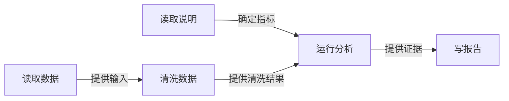

[回到知识图中的 B1](/learn/agent?node=B1) · [本组导读](/learn/agent/10-foundations)

## 数据结构不是一组背诵题

一个研究助理系统需要保存任务、从大量候选文档里保留最相关的几条、安排有依赖的工具执行，还要避免无限循环。这些问题分别连接哈希表、堆、图和搜索。选择数据结构的依据不是“这个名字高级”，而是系统最频繁执行什么操作，以及希望保持什么性质。

本节用一组教学任务解释这些联系。它不会替代完整的算法训练；目的是让你在看到工程问题时，能主动识别它属于查找、排序、依赖调度还是状态搜索。

## 先写操作，再谈复杂度

假设已有 n 个任务，要按 task_id 查询状态。把所有任务放进列表，每次从头比较，最坏需要看 n 个对象，复杂度为 O(n)。使用哈希映射，通常能在平均或期望意义上以 O(1) 完成查询，但需要额外空间，也依赖哈希和冲突处理；不能把平均常数时间理解成任何情况下严格一步完成。

Big-O 描述输入规模变大时的增长阶，不是具体毫秒数。O(n) 的连续扫描在小数据上可能比常数开销很大的结构更快；缓存、对象大小、语言运行时和磁盘 I/O 也影响实际表现。应先用复杂度排除规模上明显不合适的方案，再通过测量选择实现。

哈希表还需要相等性定义。若同一逻辑任务被编码成两个不同键，查询和去重都会失效。反过来，如果只用问题文本作为键，不同数据版本的任务可能被误合并。数据结构的键把业务身份落实成了程序规则。

## Top-k 为什么适合用堆

假设有一百万个候选分数，只需要最大的 k=10 个。完整排序需要约 O(n log n) 的比较，而维护一个容量为 k 的最小堆，可以在扫描时保留最大的 k 个：堆顶是当前保留集合中最小的分数，也就是新候选进入榜单需要超过的门槛。

以 k=3、分数序列 7、2、9、5、8 为例。先保留 7、2、9，堆顶为 2；遇到 5，替换 2；遇到 8，替换 5，最后保留 7、8、9。堆只保证父子间的局部顺序，不保证底层数组完全有序。因此最终若要按分数展示，还需要对这 k 个对象排序。

```python
import heapq

def largest_k(values, k):
    if k <= 0:
        return []
    heap = []
    for value in values:
        if len(heap) < k:
            heapq.heappush(heap, value)
        elif value > heap[0]:
            heapq.heapreplace(heap, value)
    return sorted(heap, reverse=True)
```

这个教学实现需要 O(k) 额外空间，扫描更新为 O(n log k)，最后展示排序为 O(k log k)。Python 官方 [heapq 文档](https://docs.python.org/3/library/heapq.html)解释了最小堆不变量和相关接口。若 k 接近 n，或需要多次按不同条件排序，选择完整排序可能更简单。

堆不会让候选分数本身更准确。它解决“已知分数怎样高效保留”，不解决“语义相关性怎样计算”。这个边界把 B1 和 C2 的检索模型分开。

## 任务依赖是一张图

假设任务包括：读取数据 A、读取说明 B、清洗数据 C、运行分析 D、写报告 E。若 C 依赖 A，D 依赖 B 和 C，E 依赖 D，可以画成有向图。边表示“必须先完成”，不是时间长度，也不是数据量。



A 和 B 可以并行，D 必须等待两个前置条件都满足。这就是为什么简单启动五个协程不等于正确并行。正确性首先来自依赖图，执行效率才来自调度。

对于无环依赖图，可以维护每个节点的未完成前置数量，也叫入度。把入度为零的节点放入就绪队列，完成一个节点后，减少它的后继入度；降到零的后继才可执行。拓扑排序能检查是否存在一条合法的依赖顺序，但并不保证实际执行一定成功，失败和重试仍需要运行时管理。

如果 A 等待 B，B 又等待 A，会形成环。计划系统不能只把它打印成漂亮列表，应检测循环依赖或明确采用迭代语义。某些算法确实需要循环，但这时应定义迭代状态与收敛/终止条件，而不是假装它是一次性 DAG。

## 并行收益由关键路径限制

给上面的教学任务分配耗时：A=10、B=20、C=15、D=30、E=5 秒。A→C→D→E 的路径总长为 60 秒，B→D→E 为 55 秒。资源足够、没有额外开销时，整个任务也不可能短于最长路径 60 秒。

把 Worker 从 2 个增加到 20 个，不会使 D 提前于 C 完成。反而可能增加调度和通信开销。这是分析多 Agent 效率时很有用的起点：先找独立工作和关键路径，再问增加执行者是否有帮助。

真实系统还有共享资源限制，比如只有一个 GPU、数据库连接数有限。关键路径是理论下界之一，不是线上延迟保证；资源排队和故障会让实际时间更长。

## 搜索与规划：状态不是日志字符串

当下一步不完全确定时，可以把任务看成状态空间搜索：一个状态包含已知事实、完成的子目标和资源，动作把它转成另一个状态。广度优先搜索按层探索，在无权图中适合找最少边数路径；深度优先搜索更深入一个分支，但可能很晚才看到另一条较短路径。

Agent 实际上未必显式枚举整个状态空间，却同样需要解决重复探索和终止问题。若它不断重试同一失败工具，应检查状态是否真的改变，是否获得新信息，以及是否有必要继续。直接用整段对话文本作为状态键，常会因无关文字变化而漏掉逻辑上的重复。

状态压缩又有风险：若只记录“已读数据”，忽略数据版本，不同世界状态可能被错误视为同一个。这把算法问题连接到了 C3 的记忆表示和 R3 的恢复一致性。

## 怎样选择，而不是套用

需要按唯一标识查找，先考虑映射和合适的键；需要处理到达顺序，考虑队列；需要按优先级取下一个，考虑堆；需要表示前置依赖，考虑图；需要探索未知路径，才考虑搜索策略。一个系统可能同时使用这些结构，它们承担不同责任。

还要检查数据是否只在一个进程中。如果多个 Worker 都需要任务状态，一个 Python 字典不能提供跨进程持久化和一致性。此时要把身份、索引和事务落到数据库或其他共享存储，回到 B3 和 R2。内存数据结构的正确性并不自动覆盖分布式边界。

## 自测与答案

<details>
<summary>最小堆为什么能保留最大的 k 个数？</summary>

因为我们只在堆中保存当前最大的 k 个，堆顶是这组数中最小的一个。新数只有大于堆顶才有资格进入集合。最小堆的“最小”指被保存集合中的门槛，不表示最终要找全体最小值。
</details>

<details>
<summary>任务都可以启动，是否说明它们可以并行？</summary>

不一定。启动是程序能力，依赖满足才是业务正确性。需要先确认数据依赖、共享写入和资源约束。忽略这些条件会把串行等待变成并发错误。
</details>

<details>
<summary>面试问 Top-k，怎样连回真实应用而不牵强？</summary>

先说明输入是否已有分数、是否流式、n 与 k 的关系，再解释堆或排序的复杂度。最后以检索候选保留为例，并主动划清边界：Top-k 选择不负责生成相关性分数，也不保证召回全集中的真正最相关项。
</details>

## 把知识接回系统

B1 为 A3 的任务分解、C2 的候选处理和 R1 的调度提供结构；B3 让这些结构跨越进程寿命；E3 则要求用真实工作负载测量收益。能把数据、操作、不变量和规模说清，比只背一个复杂度结论更有迁移价值。

## 位置与下一步

**知识归属：** 计算机与软件基础。归属表示研究对象，不表示运行先后。

**跨层联系：**

- [A3 · 规划、反思与协作](/learn/agent/deep/planning-coordination)：任务依赖可以表示成图，调度和并行收益受图结构约束。
- [C2 · 检索与 RAG 链路](/learn/agent/deep/retrieval-pipeline)：哈希、倒排和近邻索引决定检索候选生成的复杂度与召回边界。
