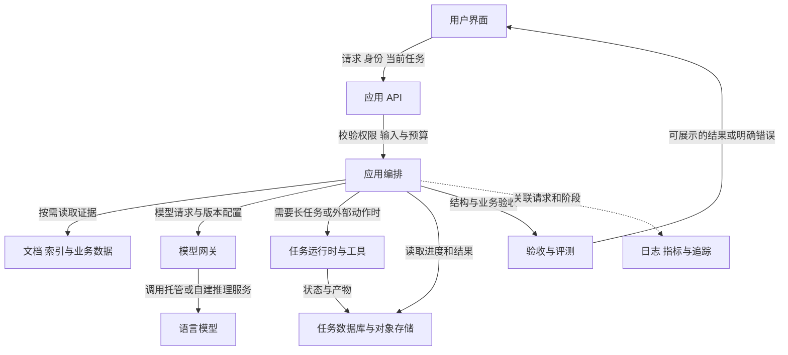

[回到知识图中的 A4](/learn/agent?node=A4) · [本组导读](/learn/agent/12-application-design)

## 先看问题：需求出现时，为什么不应先选 Agent 框架

假设需求是“上传一份研究报告，回答问题并给出引用”。如果报告足够短、问题一次性完成，一次带原文的生成就可能满足要求。若资料很多，需要检索；若必须按固定步骤抽取、校验和归档，需要工作流；若执行中才知道该查什么、运行什么实验，才出现动态 Agent 的理由。

本节是大模型应用架构的入口。先修是请求—响应、模型输入输出和基本数据存储；它不要求先掌握所有 Agent 技术。学完后应能从需求推导最小架构，并解释前端、后端、模型服务、数据、执行与评测的边界。以下系统和验收样本均为教学假设。

## 用“缺少什么能力”选择架构

| 当前瓶颈 | 可先考虑的结构 | 新增的主要责任 |
| --- | --- | --- |
| 输入充分，输出可一次完成 | 单次模型生成 | 提示、结构校验、质量评测 |
| 必要知识不在当前输入中 | 检索增强 | 文档解析、索引、检索、引用 |
| 多步骤依赖明确 | 固定工作流 | 状态转换、错误分支、阶段验收 |
| 下一步依赖运行时新信息 | 动态 Agent | 工具选择、预算、反馈与停止 |
| 独立子问题可并行合并 | 并行工作流或多 Agent | 产物接口、协调、冲突与合并 |

这些结构可以组合，不是必经的五级成长路线。RAG 可以位于固定工作流中，也可以成为 Agent 的工具；一个工作流可以并行执行普通函数，无须因此引入多个模型角色。关于预定义路径和模型动态控制的区分，可以参考一线应用团队对工作流与 Agent 的架构讨论。[Building effective agents](https://www.anthropic.com/research/building-effective-agents)

选择复杂结构应有可验证的理由。例如固定流程遇到未知数据格式时频繁失败，且无法用少量规则覆盖；动态诊断在相同任务集上改善了失败率，增加的成本也可接受。反过来，如果一次生成已经满足目标，增加循环可能只引入更多故障点。

## 完整应用不只包含模型调用

这是一张职责图，不要求每个框都部署为独立服务。初期可以在一个后端中实现应用 API、编排和模型适配层。分开责任的意义是明确发生变化时该改哪一层，而不是过早拆成很多微服务。

前端负责让用户理解任务是否被接收、是否仍在运行、结果依据在哪里；后端负责身份、资源范围和业务规则。模型网关统一模型版本、请求格式、费用与超时管理，但不能把所有失败都当作可安全重试。外部任务运行时负责真实副作用和恢复；数据库与对象存储保存状态和产物；评测提供质量反馈。

## 从一次请求走完链路

仍以研究报告问答为例。用户上传文档后，后端首先检查访问身份、类型和大小，保存文档版本与原始文件引用。解析产生带页码或段落位置的文本；问题到来时，编排层读取用户有权访问的版本，选择必要片段，并构造模型输入。

模型返回答案后，程序解析字段，检查引用是否对应本次可访问的文档片段。若材料不足，应有“证据不足”的结果类型，而不是把所有分支都伪装成完整答案。最终前端展示答案及可打开的依据，并保留请求 ID，便于用户反馈问题时定位执行链。

如果解析或分析需要较长时间，不宜把一个短 HTTP 请求当成整个任务生命周期。可以先创建任务，返回任务 ID，前端查询或订阅进度。HTTP 的 `202 Accepted` 表达请求已接受处理，而不是处理已经成功；应用仍需定义后续状态与结果读取方式。[RFC 9110 的 202 语义](https://www.rfc-editor.org/rfc/rfc9110.html#name-202-accepted)

流式输出也要分清语义。页面出现第一个字，只说明开始返回内容，不代表答案已经验收；流连接断开，也不必然意味着后端任务停止。用户可见进度、实际执行状态和传输连接状态，应分别设计。

## 可靠性和质量为什么要分开看

一个请求返回 200、JSON 完整且延迟很低，仍然可能引用错误版本。另一个请求的模型回答正确，却因为产物上传失败而无法交付。前者偏质量问题，后者偏执行与交付问题。若只看“接口成功率”，两者都会被错误描述。

可以同时维护三类结果：系统是否完成执行、产物是否通过契约检查、内容是否满足质量标准。它们可以关联，但不应压成一个没有解释的布尔值。对于需要人工评价的质量，记录待评估状态，比立即将其视为成功或失败更准确。

日志用于记录事件细节，指标用于观察总体变化，追踪用于关联一次请求跨越的阶段；OpenTelemetry 对这些信号给出了标准化的概念和实现接口。[OpenTelemetry Signals](https://opentelemetry.io/docs/concepts/signals/)

教学系统至少可以记录文档版本、模型与提示版本、检索片段 ID、阶段耗时、token 使用和结果类型。原文内容不必无差别写进日志；保留受控的引用和必要字段，既能定位问题，也能减少无关材料的传播。

## 最小垂直切片应该切到用户结果

“先把向量库搭好”是一个横向技术模块，不一定能证明需求成立。更有用的最小垂直切片是：一个用户上传一种明确支持的文档，提出一个问题，得到有引用的答案或清楚的证据不足说明。它贯穿界面、后端、数据、模型和验收，但每一层都可以先保持简单。

可以准备 20 个教学验收问题：其中包含直接可回答、需要两处证据、资料未提供、旧版本干扰和无权访问等类型。这里的 20 是用于演示的测试规模，不是生产充分性保证。先查清最小系统在哪类问题上失败，再决定补什么。

若主要失败是文档解析，先改解析；若短文档一次输入可答好而大库检索答不好，重点查索引与召回；若需要多次工具探索才有答案，再试动态 Agent。每次增加模块，都应指向一个已观察到的限制，并用相同验收集合确认修复与回归。

## 从可运行到可交付，需要什么取舍

模型越大未必是最合适的服务选择。要看质量、首字时间、总时长、价格、可用性和数据要求。可以把简单分类与复杂分析分开处理，但路由错误本身也要评测。缓存可以减少重复成本，但缓存键必须覆盖会影响答案的文档、权限和模型配置，否则可能返回错误版本甚至越权结果。

容错也有代价：重试可能增加费用与尾延迟，降级模型可能改变质量，多副本增加资源成本。应先说明目标服务水平和失败边界，再选择机制。一个能稳定交付有边界结果的简单系统，通常比无法解释失败的复杂系统更容易继续改进。

## 自测与解释

文档问答用了检索和大模型，是否就是 Agent？

不一定。若程序固定执行检索、拼接上下文和生成，这是一条检索增强工作流。若模型根据观察动态决定是否继续检索、换查询或调用其他工具，则包含 Agent 控制。判断依据是控制路径如何产生，不是是否使用了某个框架。

为什么模型网关不能包办业务校验？

网关可以统一模型通信、配额和通用限制，但通常不知道某个文档版本是否属于当前任务、某个分析结论是否满足领域要求。业务规则应在拥有相应数据和责任的应用或服务层执行，不能因为请求成功到达模型就省略。

从零做应用，最先交付哪个里程碑更有意义？

一个可验收的最小用户任务闭环：输入进入系统，必要数据被正确使用，结果可展示并能判断成功或失败。它能暴露各层真实接口问题。只分别搭完数据库、队列和模型服务，仍可能没有证明这些模块能够共同解决用户问题。

## 放回总图

概念归属：本节是**大模型应用架构**；Agent 只是其中一种控制方式。先修依赖：HTTP、数据存储、模型生成与接口设计。应用联系：模型本体提供能力，Infra 提供可用的执行与推理，RAG 和记忆提供信息机制，评测提供质量证据。它们应在总图中通过职责和依赖相连，而不是都被放进 Agent 的子树。

## 位置与下一步

**知识归属：** 应用与 Agent。归属表示研究对象，不表示运行先后。

**理解前置：**

- [G1 · 任务契约与成功标准](/learn/agent/deep/task-contract)：架构选择服务于真实的交付目标，而不是预先选定某个框架。

**跨层联系：**

- [P1 · 服务、可观测性与交付](/learn/agent/deep/service-observability)：架构中的每个组件要成为可观测、可运维的交付对象。
