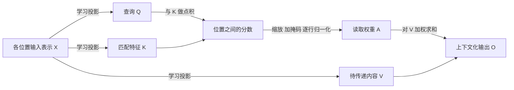

[回到知识图中的 M2](/learn/agent?node=M2) · [本组导读](/learn/agent/02-transformer-inference)

## 先看问题：同一个词为什么会有不同含义

**教学例子：** “把苹果切成两半”和“苹果发布新电脑”包含相同的词，但后续预测需要不同的信息。词表里给“苹果”保存一个固定向量，只能提供初始表示；模型还需要根据这一次上下文，重新组织它的含义。这就是从 embedding 走到 contextual hidden state 的需要。

注意力解决的基本问题是：**当前位置应该从哪些可见位置读取多少信息？** 本节位于“模型结构”层。读完应能沿矩阵形状手算一次注意力，解释 Q、K、V 的分工，以及为什么训练可以并行而自回归生成仍有串行依赖。

## 一、先给计算对象确定形状

先忽略 batch，只考虑一条包含 n 个 token 的序列。每个位置的输入表示有 d 个数，堆起来得到矩阵 X，形状为 `n × d`。X 的每一行对应一个位置，每一列对应一个表示维度。维度通常不是人工指定的“物理”“化学”等语义标签，而是训练得到的分布式表示。

对一个注意力头，使用三个可学习投影矩阵：

$$
Q=XW_Q,\qquad K=XW_K,\qquad V=XW_V
$$

W_Q 和 W_K 的形状是 `d × d_k`，因此 Q、K 均为 `n × d_k`；W_V 的形状是 `d × d_v`，所以 V 为 `n × d_v`。

Q 可以理解为“当前位置用什么特征寻找信息”，K 是“各位置用什么特征接受匹配”，V 是“被选中后实际传递什么信息”。这只是帮助理解的角色解释，不表示模型真的创建了可读的数据库字段。三个投影由训练共同确定；它们不是程序员预先写好的查询语句。

为什么不能只留一个矩阵？因为“是否值得读取”和“读取的内容”是不同的函数。比如一段实验记录可能因日期和样品编号与问题匹配，但我们需要取回的是测量数值。分离 K 与 V，允许网络在不同表示空间中完成这两件事。

## 二、从匹配到加权读取

计算 QK 的转置乘积后，得到 `n × n` 的分数矩阵。第 i 行第 j 列是位置 i 对位置 j 的匹配分数。归一化必须沿每一行进行，因为我们要回答的是“固定一个查询，在所有可读位置之间如何分配权重”。

$$
S=\frac{QK^\top}{\sqrt{d_k}}+M,
\qquad A=\operatorname{softmax}_{\text{row}}(S),
\qquad O=AV
$$

M 是掩码。允许读取的位置填 0，不允许的位置填负无穷；softmax 后不允许位置的权重变成 0。O 的形状为 `n × d_v`，它的每一行是各个 V 行的加权和。标准缩放点积注意力的定义与因果掩码可对照 [Transformer 原论文第 3 节](https://arxiv.org/html/1706.03762v7)。

箭头表示计算依赖，而不是生成 token 的时间顺序。Q、K、V 的投影可以批量计算，得到权重后才知道怎样混合 V。

缩放项也可以推导。在一个简化统计假设下，q、k 每一维独立、均值为 0、方差为 1，则它们点积的方差约为 d_k。维度增大时，分数尺度也会增大，softmax 更容易过于尖锐。除以平方根后，分数的方差保持在较稳定的量级。实际训练表示未必满足独立假设，这个推导解释了尺度选择的动机，并不是对每层分布的精确描述。

## 三、手算一个三位置例子

假设 X 的三行分别为 `[1,0]`、`[0,1]`、`[1,1]`，W_Q、W_K 为单位矩阵，W_V 为两倍单位矩阵。于是 Q=K=X，而 V 的三行为 `[2,0]`、`[0,2]`、`[2,2]`。这是用来核对运算的人工数值，不是某个真实词向量。

对于第三个位置，q 为 `[1,1]`，与三个 k 的点积为 `[1,1,2]`。因为 d_k=2，缩放后约为 `[0.7071,0.7071,1.4142]`。第三个位置可以看见前两个位置及自身，softmax 权重约为 `[0.2483,0.2483,0.5035]`。因此：

$$
o_3=0.2483[2,0]+0.2483[0,2]+0.5035[2,2]
\approx[1.5035,1.5035]
$$

再看第二个位置。它与前三个位置的原始点积为 `[0,1,1]`，但在因果语言模型中，第三个位置还属于未来，必须在 softmax 前屏蔽。权重变为 `[0.3302,0.6698,0]`，输出约为 `[0.6605,1.3395]`。

这一步揭示常见实现错误：如果先对三个分数做 softmax，再简单把第三个权重乘成 0，剩余权重通常不再加起来等于 1，所得运算也不是上述注意力。掩码的数值形式、维度和应用时机都属于模型语义，而不只是工程细节。

## 四、为什么已经看到整条训练文本，却没有偷看答案

训练数据中可以同时提供所有位置，但每个位置允许读取哪些输入，由掩码决定。对位置 i，只允许读取 `j ≤ i` 的 token，然后用该位置的输出预测第 i+1 个 token。目标标签向后移动一位，注意力连接也被限制为因果方向，这两件事必须同时正确。

例如用“我 喜欢 科学”训练时，位置“我”的输出预测“喜欢”，不能读取后面的“喜欢”；位置“喜欢”的输出预测“科学”，可以读取“我”和“喜欢”。多个位置的目标都已知，因此可以在一次矩阵运算中计算各自损失。

推理时则不同：在没有生成“喜欢”之前，无法把它作为下一步输入。因此训练并行与推理串行并不矛盾。串行依赖来自“后一个输入包含前一个生成结果”，不是因为 GPU 一次只能处理一个 token。

## 五、注意力为什么还不等于完整 Transformer

单个注意力头只完成了一次有条件的信息混合。多头注意力让不同投影学习不同的匹配方式，把各头结果拼接后再投影回模型维度。不要把每个头简单命名为“语法头”“事实头”：某些头可能出现可分析的模式，但不存在普适的一头一功能保证。

还需要逐位置前馈网络，把已经聚合的信息进行非线性变换；需要残差连接，给信息和梯度提供短路径；需要归一化，控制各层数值尺度。一个常见的 Pre-Norm 模块可示意为：

$$
H'=H+\operatorname{Attention}(\operatorname{Norm}(H)),
\qquad
H''=H'+\operatorname{FFN}(\operatorname{Norm}(H'))
$$

这是结构示意，不代表所有模型都使用相同归一化位置、激活函数或 FFN 形式。关键是把两种作用分开：注意力跨位置交换信息，FFN 主要在每个位置内部变换特征。

此外还要表达位置。一个没有位置信息、没有因果掩码的 self-attention，对输入位置的共同重排会产生相应重排后的输出，不能仅靠内容识别任意语序区别。因果掩码限制了可见范围，但不等于提供完整、可控的位置表示。RoPE 对 Q、K 应用随位置变化的旋转，使点积带有相对位置关系；这解释了它为什么作用在匹配计算上。[RoFormer 原论文](https://arxiv.org/abs/2104.09864)

## 六、从原理推出边界

注意力让信息“可被读取”，不保证模型“会正确读取和使用”。相关段落在上下文中、注意力权重较高、最终结论正确，是三个不同事件。某层某头的热图可以辅助分析，但不足以单独证明答案的因果来源。

完整注意力需要考虑位置之间的匹配，核心分数规模随 n² 增长；投影和 FFN 还有各自与模型宽度相关的计算，因此不能说整个 Transformer 所有成本都只有 n²。M3 会进一步解释，推理缓存虽然避免重复计算旧 token 的 K、V，仍需要读取越来越长的历史。

加入 batch 与多头之后，Q 的常见逻辑形状是 `B × H × n × d_k`，注意力分数为 `B × H × n × n`。这里 batch 之间是不同样本，头之间是不同投影；模型不应该因张量拼接错误而让两个用户请求互相读取。还要把 padding 掩码与因果掩码组合，确保填充位置不参与信息读取。形状正确只是一层检查，可见范围正确同样重要。

若做检索增强，C2 改变的是送进 X 的材料；若做上下文压缩，C1 改变的是保留哪些 token 与信息；若做注意力内核优化，改变的是同一计算怎样映射到硬件。这三种优化不在同一层，应该分别验证内容质量、模型行为与运行性能。

## 自测与答案

1. QK 转置后为什么是 n × n，而 O 又变回 n × d_v？

Q 为 n × d_k，K 转置为 d_k × n，相乘得到每个查询与每个位置之间的分数。A 的每一行是一组读取权重，再乘 n × d_v 的 V，就把所有位置的内容混合为一个 d_v 维向量。每个查询得到一个向量，因此输出共 n 行。

2. 三位置例子中，第一位置的注意力输出是什么？

因果掩码使它只能读取自己，因此权重为 `[1,0,0]`，输出为 V 的第一行 `[2,0]`。这与自身匹配分数的具体大小无关，因为只剩一个合法候选。

3. 为什么旧 token 的 K、V 可以缓存，而不必保存旧 Q 来生成下一个 token？

在固定参数、位置规则和前缀的因果模型里，旧位置不会读取新出现的未来 token，因此其表示和 K、V 不随追加 token 而改变。新位置用自己的 Q 匹配旧 K，并读取旧 V；旧 Q 对应的是旧位置曾经要读什么，生成新位置时不需要重新计算旧位置的输出。改变前缀或模型参数后，这个复用前提可能失效。

## 在知识树上的下一步

向下到 **M1** 可以理解这些投影如何通过梯度学习；向上到 **M3** 可以推导缓存与推理成本；向应用层 **C1/C2** 可以判断为什么“放进上下文”只是提供可用信息。若要亲自实现，先用三位置算例检查形状、掩码和结果，再增加 batch、多头与真实位置编码。

## 位置与下一步

**知识归属：** 大模型本体。归属表示研究对象，不表示运行先后。

**理解前置：**

- [M1 · 概率、损失与梯度](/learn/agent/deep/probability-learning)：先理解概率输出和可训练参数，再看 Transformer 怎样计算这些输出。
- [F1 · 向量、矩阵与导数](/learn/agent/deep/math-representations)：矩阵乘法和向量内积解释注意力的形状与相似度。
- [M4 · Token 与向量表示](/learn/agent/deep/tokenization-representation)：注意力接收的是 token 表示序列，需要先理解输入怎样形成。

**后续用途：**

- [M3 · 生成过程与 KV Cache](/learn/agent/deep/inference-budget)：缓存的是各层注意力的 K/V，先看懂张量才能推算显存和计算。
