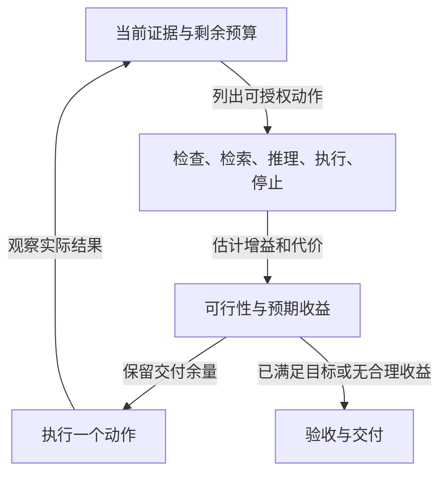

[回到知识图中的 G2](/learn/agent?node=G2) · [本组导读](/learn/agent/03-agent-loop)

## 为什么“再想一次”不是免费的改进

假设研究助理已经拿到初步分析结果，还剩 90 秒。它可以再查一篇资料、再调用一次强模型，也可以直接复算关键指标并整理产物。哪一种选择更合理？只问“哪个动作可能让答案更好”不够，因为动作会占用时间、模型预算和资源租期，也可能引入新错误。

本节建立一个可操作的想法：**预算分配是在不确定信息下选择下一步，而不是在任务结束后统计花费。** 下面的概率、费用和收益均为教学假设，不能当作线上测量值。

## 将预算拆成几种不同的资源

墙钟时间是从用户提交到拿到结果的实际时间。两个独立调用并行执行，可以减少部分等待，但不能把总模型费用也自动减半。

模型消耗通常随输入和输出分别计量；不同服务有不同计价、缓存和限流规则。因此这里不使用固定价格，只记每个动作的预计成本。工具也可能使用 GPU、数据库连接或远端沙箱，它们的稀缺性未必能简单换算成同一种 token 数。

还有风险预算：有的动作可以反复读取，有的会改变业务状态。即使额度充足，也不代表可以不断执行有副作用的尝试。权限属于硬边界，不能因为“收益可能很大”而越过。

把一次动作写成 a，至少考虑成本 c(a)、耗时 t(a)、成功收益和可能损失。总预算可以表示成一组约束，而不是一个单数：

$$
\sum_a c(a)\le C,\qquad T_{\mathrm{wall}}\le D,\qquad a\in\mathcal{A}_{\mathrm{authorized}}.
$$

并行任务的墙钟时间不等于所有动作耗时之和，而由依赖图和资源竞争决定。这就是预算问题为什么会连接到算法、并发和推理服务。

## 一个最小的期望收益算例

假设正确交付的价值记为 100，直接提交成功概率为 0.7，暂不考虑其他损失，则期望收益为 70。增加一次检查，预计能把成功概率提高到 0.8，额外成本为 4 个同尺度价值单位。改进后的净期望收益为 80−4=76，高于 70。

但如果检查耗时 70 秒，而验收和归档还需要 30 秒，剩余只有 90 秒，那么这个动作违反截止约束。一个在无限时间下合理的动作，在当前状态下不再可行。

更一般地，比较下一步可以用：

$$
\Delta(a)=\mathbb E[U\mid a,\text{当前证据}]-\mathbb E[U\mid\text{现在停止}]-c(a).
$$

这里没有要求你精确知道每个概率。现实中通常通过历史测量、任务类别和保守估计做近似。公式的意义是迫使你说明：你期待获得哪种改进、根据什么估计、牺牲了什么，而不是给策略披上数学外衣。

## 信息动作为什么也有价值

查询一项任务状态看上去不会生成报告，却可能改变后续选择。如果远端分析已完成，应回收结果；如果尚未启动，应重新提交或修复；如果结果未知，应继续查询而不是盲目重复创建。查询的价值来自避免错误决策。

设环境有“任务已完成”和“任务未启动”两种可能。当前不知道真实状态，直接重启可能重复花费。一次低成本查询能区分这两个分支，就可能比一次高成本模型推理更值得执行。注意查询也可能失败，因此不能把获取信息想象成必然消除不确定性。

图中的决策不断更新。最初合理的计划，可能因为一次运行耗时异常或一个关键事实被推翻而需要改变。固定计划和动态预算不是对立的：可以固定资源上限和最终验收，让内部动作根据证据调整。

## 把总时间拆开，才能知道优化哪一段

一个典型任务的时间可能包括排队、检索、模型 prefill、逐 token 生成、工具执行、重试等待、验收与归档。仅看 API 总时长，无法判断应该缩短提示、减少输出、增加 Worker 还是优化工具。

例如教学测量为：排队 20 秒、模型 10 秒、工具 60 秒、验收 10 秒。把模型速度翻倍只节省 5 秒，总时间从 100 变为 95 秒。它可能仍值得做，但不是 50% 的端到端提升。这里用的是分段加和的串行例子；存在并行重叠时，应分析关键路径，不能重复扣减重叠时间。

另一方面，提高吞吐可能增加单请求等待。更大的批次可能更好利用 GPU，却让新请求等待组批；更多并发可能加重数据库和工具服务的排队。优化目标必须写清是每秒完成量、首 token 时间、单任务完成时间，还是固定预算下的成功率。

## 为完成动作保留预算

一个常见错误是把所有预算用于“思考和执行”，最后没有时间写产物、校验或回收沙箱。解决办法并不是随意设置一个 20% 余量，而是根据交付阶段的测量分布估计需要保留多少时间，并为高波动步骤采用更保守的余量。

可以将截止时间传递给每个子调用：子调用可用时间等于总剩余时间减去后续必要步骤的预算。这样内部重试就不会无限延长任务。若重试层层叠加，调用数量会成倍放大；应明确由哪一层负责重试，并限制次数、退避和总时限。AWS 对 [超时、退避、抖动及副作用重试的讨论](https://aws.amazon.com/builders-library/timeouts-retries-and-backoff-with-jitter/)提供了服务端视角；具体阈值仍需用自己的分段时延测量确定。

## 取舍不只有换更强的模型

当失败来自找不到证据，增加模型推理预算可能收益很小；当输入已有证据但模型无法组合，改善检索也未必有效；当结果已正确但评分器崩溃，更换解题模型属于误判。

先做失败分类，再选干预：信息缺失去看 C2，表示丢失去看 C1，决策问题去看 A1 或模型能力，执行问题去看 R2/R3，测量问题去看 E1/E2。预算优化应该围绕瓶颈，而不是围绕最熟悉的组件。

## 自测与答案

两个模型各跑 30 秒，并行以后是不是既省时间也省钱？

若它们互不依赖且资源充足，墙钟等待可接近 30 秒而不是 60 秒，但两次调用的资源消耗仍然存在。加入协调、重复输入和合并后，总费用还可能增加。是否值得取决于质量增益和截止约束。

为什么不把每一步都设置同一个超时？

各步骤的时延分布、失败后果和剩余任务不同。最后只剩 20 秒时，再给一个工具 60 秒的等待额度没有意义。端到端 deadline 应约束局部 timeout，局部 timeout 又要考虑该调用是否可能已经发生副作用。

怎样验证一个“自适应预算”策略有效？

冻结任务与版本，以相同总预算比较固定策略和自适应策略，同时报告成功率、成本和时延分布。检查策略是否只把预算偏向容易题而降低困难题覆盖，也检查是否因增加验收余量而改变了完成口径。

## 从这里继续

M3 和 I1 解释模型时间与显存从哪里来；A3 和 B1 解释任务依赖决定的并行空间；R1 解释排队和资源竞争；E3 帮你证明优化带来的净收益。预算是这些层共同作用后的决策条件，不是一个独立的“省 token 技巧”列表。

## 位置与下一步

**知识归属：** 应用与 Agent。归属表示研究对象，不表示运行先后。

**理解前置：**

- [G1 · 任务契约与成功标准](/learn/agent/deep/task-contract)：没有成功标准，就无法定义多花一次调用的收益。

**跨层联系：**

- [M3 · 生成过程与 KV Cache](/learn/agent/deep/inference-budget)：输入长度、输出长度和并发共同决定时间与显存预算。
- [A3 · 规划、反思与协作](/learn/agent/deep/planning-coordination)：多 Agent 的协调和重复上下文也消耗预算，不能只看单个子任务耗时。
- [I1 · 模型推理服务](/learn/agent/deep/inference-serving)：服务侧排队和批处理会改变应用感知的总时延。
