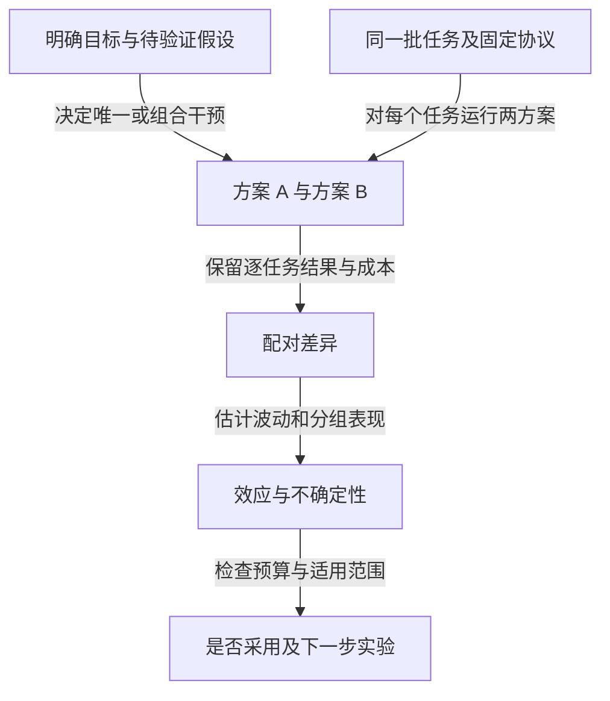

[回到知识图中的 E3](/learn/agent?node=E3) · [本组导读](/learn/agent/06-evaluation-experiments)

## 从一个不能直接相信的提升开始

旧版研究助理完成率为 60%，新版为 72%。这听起来像改进，但如果新版使用了更强模型、更多 token、不同题目和新的评分器，我们只能说“两个完整配置在各自条件下得到了不同结果”，还不知道哪个改动产生了作用。

本节研究如何从一次观察走向可信比较。它连接统计、因果推断与工程实验，适用于训练方法、检索器、推理服务和 Agent 架构。读完后，应能设计配对对照、解释消融回答什么、理解置信区间的边界，并把成功率与预算一起比较。

## 先把要回答的问题写成具体干预

“新系统是不是更好”太宽。可以拆成：“在相同模型、任务、最大调用预算和评分规则下，新增检索重排是否提高答案正确性？”这里的干预变量是重排，其他条件尽量固定。

如果实际产品目标是“同样价格买到更好结果”，则预算固定更重要，模型和架构可能一起变化。那时比较的是完整产品方案，不能把收益单独归因于某个算法。实验设计没有唯一模板，关键是结论与干预范围一致。



这里的箭头不是“跑完就能证明”。每一步都有可能破坏推断：题目选择偏差、评审错误、环境波动、缺失样本、重复调参和结果选择。

## 为什么同一批题做配对比较

任务难度差异很大。若 A 恰好运行更多容易题，平均分更高并不能说明 A 更强。让每个任务同时拥有 A、B 的结果，可以把比较单位变成“同一道题因改动发生了什么”。

设第 $i$ 个任务得分分别为 $a_i,b_i$，定义：

$$
d_i=b_i-a_i,\qquad \widehat\Delta=\frac{1}{n}\sum_{i=1}^n d_i
$$

$\widehat\Delta$ 是当前样本上的平均差异。二元成功任务中，双方都对、双方都错的任务贡献 0；B 独对贡献 1；A 独对贡献 −1。这个表示让回归和改善都能被看见。

教学例子中有 10 道题：双方都成功 3 道；只有 A 成功 2 道；只有 B 成功 3 道；双方都失败 2 道。A 成功率为 50%，B 为 60%，差异为 10 个百分点。但真正决定净变化的是 5 道分歧题中 B 赢 3、输 2。样本很小，不能仅凭净多一道就宣布稳定提升。

“提升 10 个百分点”与“相对提升 20%”都可从这个例子算出，前者是 $60\%-50\%$，后者是差异除以旧值。报告时写清口径，并优先展示原始值，避免把不同分母混用。

## 不确定性来自哪里

即使模型完全确定，当前十道题也只是未来任务分布的一部分。换一批题，平均差异会变。若模型采样、远端负载或工具反馈还会变化，同一任务重复运行也会波动。任务间差异与任务内随机性是不同层级，不能通过对一道题重复一千次来替代一千道独立任务。

少量运行只报告点估计，容易让排序显得比实际更确定。关于跨任务与少量随机运行的评估，Agarwal 等人的研究强调区间估计与结果分布的重要性；它讨论的是强化学习实验，但其中对不确定性报告的要求也适用于这里。[统计不确定性研究](https://arxiv.org/abs/2108.13264)

置信区间是一个抽样程序的长期覆盖性质，不是“真值有 95% 概率落在当前这个固定区间”的直接频率学解释。更实用的理解是：当前证据允许多大范围的效应仍然与数据相容。区间包含零不证明两方案完全一样；区间不包含零也不证明提升足够有业务价值。

## 用配对 bootstrap 保留题目之间的对应关系

Bootstrap 的直觉是：把当前任务集当作对目标分布的经验近似，反复有放回抽样任务，计算每次的平均差异，观察结果分布。配对比较必须让 A、B 使用同一组抽样索引，否则会破坏“同一道题”的关系。SciPy 的 `paired=True` 正是按共同索引重采样。[SciPy bootstrap 文档](https://docs.scipy.org/doc/scipy/reference/generated/scipy.stats.bootstrap.html)

```python
# 教学演示：百分位法展示过程，不是所有场景的最佳区间方法。
import random

d = [0, 0, 0, -1, -1, 1, 1, 1, 0, 0]
rng = random.Random(7)
means = sorted(
    sum(rng.choices(d, k=len(d))) / len(d)
    for _ in range(10000)
)
print(sum(d) / len(d))
print(means[249], means[9749])
```

这段教学代码在上述固定种子下得到均值 0.1、百分位区间约为 [−0.3, 0.5]，即从下降 30 个百分点到提高 50 个百分点，范围很宽。它不是实际项目实验结果，而是在展示十道题不足以精确判断小差异。增加重采样次数只能减少蒙特卡洛近似误差，不能凭空增加独立题目。如果样本存在同模板、同文档或同项目的相关性，应在这些簇层级抽样，或采用能体现数据层次的设计。任务与运行种子各自如何抽样，也应与希望推广的总体一致。

Bootstrap 还依赖当前样本有代表性。若测试集全是短英文题，无论抽多少次都无法推断中文长文任务；若结果大量缺失，重采样已观测者也不会自动纠正选择偏差。

## 基线和消融分别回答什么

基线给出“与一个合理替代方案相比是否值得”的参照。最简单的可用方法很重要，因为复杂系统可能用更多调用实现一个直接模型已经能完成的任务。

消融则有目的地移除一个组件，观察变化。例如在同一框架中移除重排、记忆或复核。它有助于检验组件贡献，但也有边界：组件之间存在交互，移除后其他参数可能不再合适；一次消融不能证明该组件在所有配置下都必要。

若同时更换模型、提示、检索和预算，最终提升可以是有价值的工程结果，但需要额外实验才可分别归因。不要为了得到好看的“提升比例”临时选择一个很弱或配置不公平的基线。

## 预算、长尾和成功率要放在同一张表里

假设 B 用两倍模型调用把成功率从 70% 提到 75%。这不自动说明 B 更高效。可以在固定费用或固定延迟上限下比较质量，也可以画不同预算对应的质量曲线，寻找在目标约束下更好的方案。

至少保留每个任务的总输入输出 token、工具次数、墙钟时间、失败类型与实际成本。并发可能降低整批完成时间，却不减少总算力；缓存可能降低费用，却改变冷启动表现。均值之外，还应检查 P95 等尾部、超时比例和不同任务类型，而不是只看成功样本的耗时。

生产环境随时间变化时，可交错或随机安排 A、B 的运行顺序，避免让一个版本都在低负载时运行。做不到严格控制时，就明确环境差异，并避免把全部变化归于代码。

## 测试集为什么会被“用坏”

开发过程中反复查看失败样本、修改提示，再继续在同一测试集上选择最高分方案，会对这组题过拟合。即使没有把答案放进训练数据，人工选择过程也已经从测试集提取了信息。

应区分开发集、用于选择方案的验证集和最终保留集；对于近重复任务，按源文档、模板或项目分组划分。最终评估次数、主要指标和关键分组尽量预先确定。尝试了很多方案再只报告最好的一个，会低估选择带来的乐观偏差。

## 自测：把结论写到证据允许的位置

<details><summary>同一任务运行 100 次，能不能说有 100 个独立测试样本？</summary>

可以说有 100 次运行，但不能自动当成 100 个独立任务。它更适合估计这道题上的随机性。要推广到新的任务，还需要覆盖任务之间的变化，并在统计方法中尊重题目和运行的层级结构。

</details>

<details><summary>新版本平均提高，但部分难题退化，是否一定应该上线？</summary>

取决于目标分布和错误代价。需要看退化集中在哪些群体、是否触犯硬性约束、能否通过路由或回退控制。总体均值把不同任务加权混在一起，不能代替上线决策的约束检查。

</details>

<details><summary>把 bootstrap 次数从一千增到百万，能否让置信区间足够窄？</summary>

只能让所估计的区间更稳定，不能改变原始数据提供的信息量。真正减少抽样不确定性通常要增加有效独立样本、降低测量噪声或改善配对设计；如果样本有偏，增加同类样本也未必解决外推问题。

</details>

## 回到知识图：从比较走向迭代

概率与统计提供抽样语言，E1 固定目标和分母，E2 校准评审，E3 设计对照并量化变化，数据治理防止泄漏。最后再把可靠结论交给训练、推理优化或应用开发。一次好实验不只是得到更高分，还应缩小“为什么有效、在哪些条件下有效”的不确定性。

## 位置与下一步

**知识归属：** 评测与持续改进。归属表示研究对象，不表示运行先后。

**理解前置：**

- [E1 · 评测契约与统计口径](/learn/agent/deep/evaluation-contracts)：比较需要相同的任务、版本和统计口径，否则差值没有共同含义。

**后续用途：**

- [L1 · 数据反馈与分布](/learn/agent/deep/data-feedback)：先识别真实失败与改进，才能避免把测量噪声采入训练数据。

**跨层联系：**

- [L2 · 后训练目标与算法](/learn/agent/deep/post-training)：训练效果必须回到冻结评测和预算一致的对照中验证。
- [P1 · 服务、可观测性与交付](/learn/agent/deep/service-observability)：日志、指标和轨迹为对照实验提供可追溯的测量证据。
- [A0 · 提示与结构化输出](/learn/agent/deep/prompting-structured-output)：提示改动同样需要固定评测和对照，不能靠挑选例子。
