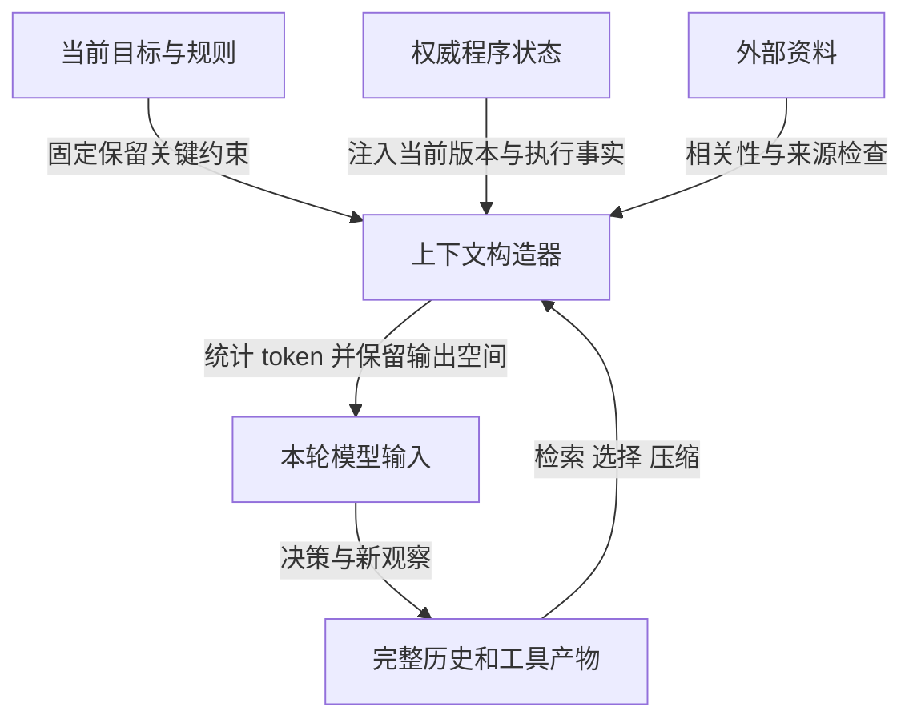

[回到知识图中的 C1](/learn/agent?node=C1) · [本组导读](/learn/agent/04-context-retrieval-memory)

## 先看问题：输入得下，为什么仍然答不好

假设一个研究助理已经读过几十页资料，运行过数十次分析。现在它需要写结论，我们把所有聊天、搜索结果和日志一并放进模型。请求没有超长，却把旧数据中的单位当成当前单位，漏掉了最后一次实验失败。

这说明上下文有两个不同的问题：一是能否放进模型允许的输入空间，二是其中的信息能否支持当前决策。本节属于大模型应用的通用信息组织机制，适用于问答、写作、分类、检索增强和 Agent。先修是 token、条件生成和注意力；学完要能设计一次上下文的来源、预算、压缩与验证，而不只是背“长上下文不够好”。

## 上下文不是“聊天记录”的另一个名字

一次模型调用可能包含任务指令、用户问题、示例、工具描述、搜索片段、历史消息和当前状态。它们都影响条件分布，但职责不同。规则说明什么行为被允许，问题说明当前目标，证据支持事实判断，工具 Schema 描述可调用接口。把这些东西无区别地拼接，会失去来源和权威等级。

可以把上下文构造写为：

$$
c_t=g(\text{任务},\text{程序状态},\text{历史},\text{外部证据};\ B)
$$

$g$ 不只是模板填空。它还负责选取、排序、去重、压缩和标注来源；$B$ 是可用预算。模型看到的是 $c_t$，并不会因为数据保存在数据库里，就自动知道数据库中有哪些事实。



图中的选择发生在模型调用之前，也可能由一个专门的模型辅助完成。但“用模型压缩”没有消除工程责任：仍需规定哪些信息不可删、压缩如何校验、原文如何找回。

## 先算硬预算，再讨论信息价值

假设某个教学服务要求输入与生成共同不超过 16,000 token。计划为输出保留 3,000，系统规则和工具定义占 2,000，当前请求占 1,000，留给历史和证据的空间就是：

$$
B_{\mathrm{history+evidence}}=16{,}000-3{,}000-2{,}000-1{,}000=10{,}000
$$

若最近日志有 8,000 token，检索结果有 3,000，就已经超出这一安排。不能等服务报错后再随机截断，也不能默认把输出空间挤到零。实际模型和服务对输入、输出以及隐藏开销的定义不同，应以对应接口的预算规则计算；这里的数字只用于说明预算分配。

token 不是中文字数，也不是英文单词数。不同分词器对同一文本的计数可能不同，代码、路径和特殊符号也会改变计数。工程上应使用目标模型匹配的计数方式，并给协议和格式开销留余量。

硬预算解决“装得下”，但没有告诉我们哪些内容值得保留。一段 5,000 token 的成功日志，可能不如一条 20 token 的失败状态重要；一段重复背景，可能不如一个单位约束重要。因此选择应围绕下一步要回答的问题，而不是只按长度或时间排序。

## 为什么摘要会丢掉恰好最重要的信息

设原记录为 $x$，摘要为 $z=f(x)$。摘要通常把多个不同的原始记录映射成相同表达。例如“数据处理完成”可能对应“清洗完成但检验未过”，也可能对应“清洗和检验都成功”。一旦压缩把这两者合并，后续模型只看摘要就无法恢复区别。

所以摘要质量不是语言是否流畅，而是是否保留当前任务所需的区分。对于报告生成，单位、版本和未解决异常可能是关键；对于客服续聊，用户目标与已完成操作可能更重要。不存在一种固定摘要能对所有后续任务都保持同样充分。

可以先定义不可丢的信息：当前目标与约束、已确认事实、尚未确认的假设、未完成事项、关键执行 ID、证据位置以及冲突。然后让摘要围绕这些字段组织。下面是教学例子：

```text
当前目标：比较两种分析方法的误差
有效输入：dataset-7，version=3，单位=mg
已确认：方法 A 已运行，产物位于 artifact://run-42/result
未确认：方法 B 的状态查询超时，不能认为运行失败
下一步：查询 run-43，取得结果后使用同一评分版本比较
原文证据：event-108、event-113、dataset-manifest-3
```

这个记录仍然是派生信息，不应覆盖运行数据库中的事实。假如数据库表明 `run-43` 已完成，应由更新后的权威状态修正上下文。摘要和原文冲突时，需要回查来源，而不是让生成得更流畅的一方获胜。

## 选择、压缩和按需读取解决不同问题

选择是决定哪些材料进入本次调用；压缩是改变材料的表达；按需读取是先给索引或摘要，待需要时获取原文。三者可以组合，但代价不同。

如果只需要定位错误，把完整日志留在产物存储中，先给错误类型、附近几行和日志路径，通常比直接总结全部日志更可检查。当问题需要精确引用时，应取回原始片段。若压缩已删除来源标识，后续即使意识到不确定，也可能无法有效补证据。

Anthropic 的上下文工程实践讨论了按需获取资料、压缩和外部笔记等策略。它们可以作为设计选项，具体是否有效仍取决于任务和评测，而不是通用的最优配方。[上下文工程实践](https://www.anthropic.com/research/effective-context-engineering-for-ai-agents)

## 长窗口与有效使用是两个指标

模型能够接收长序列，不等于每个位置的证据都能稳定被使用。注意力提供了信息交互通道，但具体使用哪些信息仍由训练后的参数、位置、任务和其他干扰决定。不能把“看见所有 token”理解为“准确理解所有事实”。

《Lost in the Middle》在其测试的模型与任务上观察到证据位置影响结果。这个研究提醒我们检查位置和干扰效应，但不能把它的具体效果直接外推到所有新模型。[原论文](https://arxiv.org/abs/2307.03172)

更可靠的做法是为自己的应用做对照：保持关键证据不变，改变其位置；加入无关但相似的片段；放入过期版本；观察答案、引用和下一步动作是否改变。这样才能区分窗口容量问题、排序问题、检索问题和模型利用证据的能力问题。

## 一个可执行的构造顺序

先载入当前任务及稳定规则，再注入当前权威状态；根据本轮问题检索必要材料，去除重复与过期片段；在预算内选择证据；对较长历史生成保留来源的摘要；最后实际计数并校验关键约束仍在。

这里的排序是教学设计，不是所有任务的固定模板。对于需要逐句翻译的任务，原文顺序本身很重要；对于代码修复，定义与调用关系可能比对话时间更重要。构造器应保存选择日志，让人知道哪个原始对象被纳入、被摘要或被丢弃。否则模型出错时，很难区分它看错了，还是根本没有看到。

## 自测与解释

<details>
<summary>把所有历史都保存下来，是否就解决了遗忘？</summary>

只解决了存储问题。后续还需要找到相关历史、识别有效版本、把必要信息送进当前上下文，并由模型正确使用。存储、检索、上下文构造和模型决策是不同环节，应分别检查。

</details>

<details>
<summary>摘要比原文短 80%，是否能证明压缩做得好？</summary>

不能。压缩率只说明体积变化。还要检查目标、单位、版本、异常、待办和来源是否保留，并在相同后续任务上比较决策和最终结果。丢掉关键条件的短摘要可能更便宜，却让任务彻底失败。

</details>

<details>
<summary>模型答错了一个已经检索到的事实，下一步该查什么？</summary>

检查事实是否真的进入最终上下文，而不仅是检索候选列表；检查是否被截断或摘要改写，是否存在冲突版本，是否保留了适用条件。再用只含必要证据的对照输入测试。如果对照能答对，问题更可能在信息组织；若仍答错，则需要进一步研究模型或问题定义。

</details>

## 放回知识体系

概念归属：上下文构造是**通用大模型应用机制**，并非 Agent 专有模块。先修依赖：token 与生成预算、注意力和条件分布。应用联系：RAG 提供外部候选证据，记忆提供跨轮信息，模型推理决定成本，Agent 循环不断产生新的上下文需求，评测检验选择是否保留了任务能力。这些是作用关系，不是父子分类关系。

## 位置与下一步

**知识归属：** 应用与 Agent。归属表示研究对象，不表示运行先后。

**理解前置：**

- [M4 · Token 与向量表示](/learn/agent/deep/tokenization-representation)：先区分 token 序列、模型表示与文本，才能讨论上下文长度和内容选择。
- [M1 · 概率、损失与梯度](/learn/agent/deep/probability-learning)：上下文改变条件输入而不是直接改权重，需要区分生成条件与训练目标。

**后续用途：**

- [C2 · 检索与 RAG 链路](/learn/agent/deep/retrieval-pipeline)：检索负责补充缺失信息，召回数量必须服从上下文和证据预算。
- [C3 · 记忆与权威状态](/learn/agent/deep/memory-state)：先理解本轮输入的有限性，再讨论跨轮、跨任务的信息保存。

**跨层联系：**

- [A1 · 观察—决策—反馈](/learn/agent/deep/agent-state-loop)：上下文的价值取决于它是否足够支持下一步决策。
