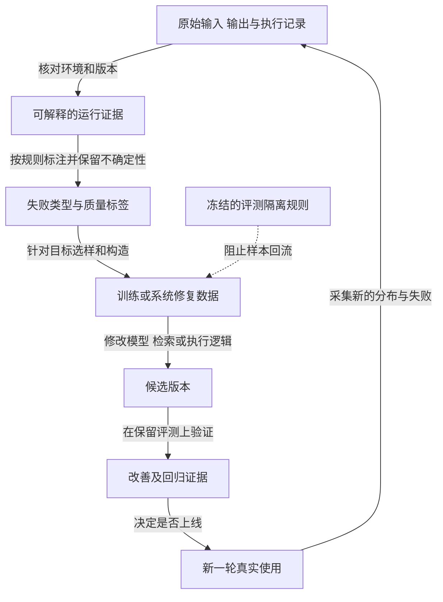

[回到知识图中的 L1](/learn/agent?node=L1) · [本组导读](/learn/agent/07-data-posttraining)

## 问题不是“有没有日志”，而是日志能支持什么判断

**教学假设：** 一个模型应用运行了一万次，团队保存了输入、输出、评分和工具轨迹。有人提议“把高分轨迹筛出来微调，形成数据飞轮”。这个方向可能有效，但有三个尚未回答的问题：高分是否意味着真实成功？成功样本代表未来请求吗？失败是否由模型造成？

本节位于“数据与改进”层，连接评测、数据工程和训练。读完应能把一条运行记录转化为可解释、可追踪、适合特定学习目标的数据，并识别选择偏差、标签污染与测试泄漏。闭环的核心是**根据可靠反馈改变系统，再用独立证据判断改变是否有效**。

## 一、先区分四种对象

原始记录保存发生了什么，包括输入、模型版本、工具请求、返回值、产物和时间。标签是在某个规则版本下，对记录作出的解释，例如任务成功、检索缺失或格式不合格。训练样本是为了某种目标从记录中构造的输入与监督信号。评测样本则用于估计某种能力或系统行为。

这四者有关系，但不能相互替代。一次失败的完整日志可能含有一个很好的纠错步骤，适合作为局部训练样本；一次最终成功的轨迹可能有大量无效尝试，不一定适合逐 token 模仿。一次评分器崩溃只说明标签缺失，不能直接生成“模型回答错误”的标签。

每条实线都应回答“进行了什么判断”。若从日志直接跳到训练，中间缺少的判断会以错误监督的形式进入梯度。

## 二、从症状推断原因，要补哪一步证据

“回答错误”只是结果。假设模型回答了过时价格，可能因为知识源未更新、检索没有召回新资料、重排把旧资料放前面、上下文截断删除了日期，或模型忽略了日期。它们对应不同干预位置。

先列可观测证据：新资料在索引里吗？相关文档进入候选集了吗？最终提示词含有它吗？输出引用指向哪里？然后构造最小干预。例如，把正确且带日期的证据直接提供给模型，观察同一批问题是否恢复；若恢复，说明“获得信息”可能是关键瓶颈，但仍要继续区分召回、重排和截断。若不恢复，再分析理解、指令和输出约束。

不能仅凭一条轨迹断言唯一根因。真实失败可能有主因与促成因素，例如检索不完整和过早停止同时发生。标注体系可以保存主分类、辅助分类、证据位置与“尚不能判断”。强迫每个样本选一个确定原因，会把猜测变成监督信号。

对 Agent 还应区分模型决策、工具实现、运行环境和验收。查询超时后任务状态未知，首先需要执行证据，不能直接把这次轨迹放入“模型不会调用工具”的负样本。评测中保留轨迹与最终环境结果的不同作用，可参考 [Anthropic 的 Agent 评测说明](https://www.anthropic.com/research/demystifying-evals-for-ai-agents)。

## 三、一个分母错误怎样污染整个闭环

**教学数据：** 100 个任务中，20 个因基础设施故障没有获得有效结果；其余 80 个中，48 个通过验收。

如果要描述有效执行条件下的任务成功比例，是 48/80=60%。如果要描述用户提交后实际拿到合格结果的比例，是 48/100=48%。还有 20% 的请求受基础设施故障影响。这些数字回答不同问题，应同时保留合适的分母。

把 20 个未知结果全部标为模型能力失败，会让训练数据含有错误负标签；从产品质量报告中完全删掉它们，又会掩盖真实交付问题。正确做法不是选择一个“好看”的分数，而是记录有效性、故障类型、结果和任务目标，使后续可以回答各自的问题。

数据表至少应能连接 `task_family`、输入快照、模型与提示词版本、工具与环境版本、原始产物、评分器版本、标签来源、标注时间和有效性状态。不是每个场景都需要同样多字段，但任何会改变标签含义的条件都应可追溯。Datasheets for Datasets 的价值正是要求说明数据为何、如何被收集，以及适用范围和限制。[Datasheets for Datasets](https://arxiv.org/abs/1803.09010)

## 四、为什么只保留成功轨迹会改变学习问题

设部署时遇到的任务分布为 p(x)，我们把“被选入训练集”记为 S。筛选后的数据来自 `p(x | S=1)`，它通常不再等于 p(x)。如果容易任务更容易成功，只收集成功轨迹会自动偏向容易任务；如果长轨迹成本高而被丢弃，会进一步偏向短任务。

一个具体算例：旧评测包含 50 道容易题与 50 道难题，分别通过 45 和 20 道，总成功率 65%。新评测包含 80 道容易题和 20 道难题，通过 72 和 8 道，总成功率 80%。看起来提高了 15 个百分点，但两类题的成功率仍然分别为 90% 和 40%，没有任何组内改善。

若未来业务仍是一半容易、一半困难，按目标比例加权后的新成功率依旧为：

$$
\hat p_{target}=0.5\times0.90+0.5\times0.40=0.65
$$

因此比较版本时，要么保持相同任务集合并作配对比较，要么明确目标分布并报告分层结果。不能把任务组合变化算成模型能力变化。同理，优先收集失败或高不确定样本可以提高学习效率，却不能直接用这个偏置采样集估计整体线上成功率。

“成功样本越多越好”还忽略了行为质量。一个最终得分正确的轨迹可能碰巧猜中、访问了不应可见的答案，或靠高额预算穷举成功。是否学习它，应取决于未来允许的工具、信息、成本和行为约束。

## 五、怎样把反馈转成合适的学习信号

如果失败是工具参数格式不稳定，可以收集经验证的输入—调用示范；如果两个完整答案都可接受，但一个更有证据、更简洁，可以构造有理由的偏好对；如果任务结果能由可靠程序判定，且模型已有基本解题能力，可以考虑在线采样与奖励优化。

如果故障来自过期索引、权限检查或任务恢复，则先修系统。把这些故障都交给微调，会要求模型通过文本习惯弥补外部状态错误，而且换环境后可能再次失效。

对每条训练样本，应能回答：模型输入时能看到哪些信息？目标答案依据什么得出？哪些 token 或动作应被学习？是否保留失败后的恢复而不是只保留最终答案？标签来自程序、人工还是另一个模型？有分歧时如何处理？

模型生成的标签不是天然独立证据。同一家族模型同时出题、作答和评分，可能共享盲点。可以先抽取分层人工审查集，覆盖高分、低分、长轨迹和边界案例，检查标签偏差；若采用多位标注者，不仅记录多数结论，也记录争议发生在哪条规则上。标注规范的修订要有版本，避免同一标签名在不同时间代表不同标准。

## 六、切分要发生在“信息家族”，而不只是数据行

假设同一道原题生成了五个改写版本。随机按行划分训练和测试，可能把四个版本放入训练、一个放入测试；表面没有文本重复，解题模板与答案信息却高度共享。类似情况还包括同一代码仓库的相邻函数、同一文档的片段，以及同一会话的不同轮次。

应先定义未来真正要泛化的单位：新题型、新文档、新用户、未来时间，还是同一分布中的新实例。然后按相应家族或时间划分。精确去重可以去掉字节级重复，语义去重帮助发现近似内容，但也可能误删本来不同的样本；数据来源和父子关系通常是更可靠的补充。

还需要把开发反馈集与最终保留集分开。反复查看错误、修改提示词、重做数据再回测，同一个集合逐渐成为开发集。公开基准成绩与新构造同类题之间的差异，是研究数据污染与过拟合的一种方法，但观察到差异本身不总能唯一证明污染原因。[GSM1k 研究](https://arxiv.org/abs/2405.00332)

## 七、一个可执行的改进回合

先冻结候选版本、基线和评测口径。按业务分布抽取任务，保留故障与无效标签；检查高影响失败类别，再选择一个可干预假设，例如“日期信息在上下文压缩中丢失”。构造最小修复，并同时测试目标类别与其他类别的回归。

若结果支持修复，再把相关记录按用途送入知识源更新、系统回归测试或训练数据。记录每个训练版本使用了哪些样本和标签版本，确保发现错误标签后可以定位受影响的模型，而不只删除数据文件。

一轮闭环的成果可以是“减少某类失败，其他指标未明显退化”，也可以是“排除了训练方向，证据显示问题在工具状态”。有效闭环不要求每轮都训练一个新模型，但要求每轮结论能改变下一步决策。

## 自测与答案

1. 十万条高分轨迹是否一定比一万条人工核对轨迹更适合训练？

无法仅凭数量判断。要比较标签可靠性、任务覆盖、重复程度、行为质量和训练目标。大量重复或错误高分轨迹会放大偏差；较小高质量集也可能覆盖不足。应先分析分布，再用固定预算和独立评测比较。

2. 去掉故障任务后成功率上升，能否宣布模型升级有效？

不能。首先要分清分母变化、基础设施改善和模型行为改善。可以同时报告端到端交付比例、有效执行条件下的成功比例及故障率，并对同一批可比任务做配对分析。排除规则应预先确定，不能看到结果后选择性删样本。

3. 为什么训练集和测试集没有完全相同的字符串，仍可能泄漏？

相同知识或答案可以通过改写、共享模板、近似代码、同源文档和轨迹片段传播。需要检查家族和来源关系，而不只是字符串哈希。反复根据测试结果挑模型也是另一种信息回流，即使没有复制任何测试文本。

## 在总图中的位置

本节从 **E1/E2 的可靠标签** 接收反馈，用 **E3 的实验设计** 判断是否改善，再向“预训练数据”或 **L2 后训练** 提供不同形式的信号。它也可以直接连接检索和软件修复。理解这一点后，“数据飞轮”就不再是“日志越积越多”的同义词，而是一条有证据和隔离规则的改进链。

## 位置与下一步

**知识归属：** 评测与持续改进。归属表示研究对象，不表示运行先后。

**理解前置：**

- [E3 · 对照实验与不确定性](/learn/agent/deep/causal-experiments)：先识别真实失败与改进，才能避免把测量噪声采入训练数据。

**跨层联系：**

- [L2 · 后训练目标与算法](/learn/agent/deep/post-training)：训练目标无法弥补数据来源、标签和分布设计中的根本错误。
- [E2 · 模型评审与校准](/learn/agent/deep/judge-calibration)：错误评审会变成错误训练标签，形成越训练越偏的反馈。
- [M5 · 预训练与规模规律](/learn/agent/deep/pretraining-scaling)：数据分布问题同时存在于预训练和应用反馈数据。
