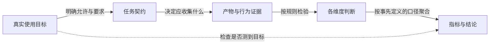

[回到知识图中的 E1](/learn/agent?node=E1) · [本组导读](/learn/agent/06-evaluation-experiments)

## 一个分数为什么可能回答了错误的问题

设想研究助理的目标是读取数据、执行分析并提交可复核的报告。评分器却只检查报告有没有写“分析完成”。模型学会输出这四个字就能满分，但实际工作可能没有发生。代码完全正常，评分也非常稳定，问题出在测量对象与指标之间的关系。

评测首先是测量设计，然后才是自动运行脚本。读完本节，你应能把业务目标拆成可观察证据，区分结果质量、系统可靠性与评分器故障，并解释为什么同一个实验可以需要多个分母。相关原理适用于分类器、生成模型、RAG 和 Agent；Agent 因为会行动并改变环境，需要额外观察最终环境状态。

## 从目标到证据，中间不能跳过哪一步

教学任务的真实目标是“给出可靠的数据结论”。这句话太宽，无法直接写成判断函数。需要先约定任务允许的输入、可用工具、预算、必须提交的产物，以及什么证据足以支持结论。

例如，把成功定义成：输出指定格式的结果文件；数值能由给定数据和代码重算；报告中的结论与数值一致；引用能定位到原始资料；运行在时间和资源限制内。各项条件并不完全能由同一种评分器判断。文件格式适合确定性校验，数值适合独立计算，证据支持关系可能需要语义评审或人工复核。

最后这条虚线是有效性检查：指标提升是否真的意味着目标更好地实现？它不能靠函数没有报错来证明。HELM 的多维评测思路提醒我们，不同场景和准确性、效率、鲁棒性等维度不能都被一个方便计算的分数取代。[HELM 论文](https://arxiv.org/abs/2211.09110)

## 三层结果必须分开记录

第一层是执行事实：程序启动没有、运行多久、退出码是什么、产物在哪里。第二层是产物判断：格式是否正确、数值误差多大、引用是否支持结论。第三层是实验推断：与旧方案相比，质量和成本是否改善。

执行成功不保证产物正确；产物正确也不能证明新方法整体优于基线。甚至评分成功都不表示评分器测对了东西。对 Agent，轨迹帮助诊断行为，最终环境或产物帮助判断目标；两者的职责不同。Anthropic 的评测说明将任务、试验、轨迹、结果与 grader 分开，适合建立这样的记录结构。[Agent 评测结构](https://www.anthropic.com/research/demystifying-evals-for-ai-agents)

一个最小记录可以包含：任务版本、输入摘要、模型与提示配置、工具环境版本、执行 ID、原始产物、执行状态、评分器版本、各项分数和失败原因。它不是为了堆元数据，而是为了让“哪个条件变了”有证据可查。

## 用 100 个任务说明分母为什么重要

下面所有数字都是教学假设。预先安排 100 个任务：70 个成功完成并通过验收；15 个正常提交了错误答案；10 个因执行基础设施故障未产出答案；5 个有产物但评分器崩溃，暂时无法判断。

如果问题是“用户提交任务后，当前系统能保证交付多少成功结果”，保守的已验证交付成功率是 $70/100=70\%$。执行失败与评分故障都意味着用户尚未得到可确认的成功交付，应同时报告各类故障占比。

如果问题是“在执行与评分均有效的样本上，方案答对多少”，条件成功率为 $70/85\approx82.4\%$。但这个结果不能改名为“总体准确率”，因为被排除的任务可能更难，或者新方案更容易在难题上触发故障。排除缺失样本可能引入选择偏差。

对于那 5 个评分缺失样本，不能把未判断当作已经判错。若只考虑这部分未知，已验证成功比例为 70%，把这 5 个全视为成功时上界为 75%；这是一种针对当前记录的敏感性范围，不是统计置信区间，也没有消除那 10 个执行失败的影响。

$$
\text{条件质量}=\frac{\text{有效评分中的成功数}}{\text{有效评分数}},\qquad
\text{评分覆盖率}=\frac{\text{有效评分数}}{\text{计划评测数}}
$$

这些口径各自回答不同问题。报告它们时，应把分子分母和排除原因写清，再通过修复基础设施、对配对任务补测或预先约定的缺失处理规则缩小不确定性。把所有异常变成零分会污染能力结论；把所有异常删掉则可能美化系统效果。

## 历史结果为什么要绑定历史题目与评分器

假设昨天题目要求输出摄氏温度，今天改成开尔文。拿今天的评分器去评价昨天的答卷，会把原本正确的结果判错。更隐蔽的变化包括字段名字、依赖库、容差、参考答案以及模型评审提示。

因此，每次实验应该冻结输入与评分定义，不能只保留会变化的“最新版本”路径。重评时保留原答卷，追加新评价，并记录评分器从哪个版本变到哪个版本；如果目标定义变了，应明确这已经是新的测量口径。不可变的原始产物让你区分“模型换了”与“尺子换了”。

这也解释为什么评分器与被评系统要隔离。若被评 Agent 能读取隐藏答案或修改测试脚本，分数就包含了利用评测环境的能力。隔离不是保证题目永远保密，而是确保当前结论对应原本声明的能力。

## 怎样验证评分器自身

先写一份确定正确的正例，再构造能击中不同约束的负例：空提交、字段齐全但数值错误、数值对但单位错误、引用存在但并不支持结论、只复制预期关键词而没有真实产物。正例检验可达成性，负例检验评分器是否拒绝伪满足。

还应构造边界例。数值容差为某个阈值时，阈值附近的行为应可解释；开放式答案存在多种合理写法时，不能只接受一个措辞。这里的重点不是凑很多测试，而是每个例子都对应一条“为什么成功或失败”的契约。

如果评分器使用模型，再进入 E2：需要校准其判断、核查证据和测量拒判覆盖率。对于可程序验证的部分，应优先独立计算，而不是让模型主观确认另一个模型写的“结果正确”。

## 分数如何聚合，取决于你允许哪些交换

把格式、正确性和引用各给权重再相加，隐含了一种交换关系：某项严重失败可以被另一项高分补偿。如果真实业务要求“任何越权行为都不允许”，就不适合让内容质量高分抵消越权。

可以把必要约束设成门槛，再在合格结果中计算连续质量；也可以保留多维指标而不硬凑单分。平均分掩盖的失败类型，往往正是上线后最重要的风险。选择聚合方式时，先问“哪些差异允许互相补偿”，再选公式。

## 自测：你的分数到底说明了什么

评分器报错后先填 0，后续再修，为什么危险？

因为下游统计容易把 0 当成真实的错误作答，训练数据也可能把它当负反馈。应该用明确的缺失状态和错误类型，评分值保持不可用；如果产品成功率口径把未完成计入失败，也仍应保留原因，避免把交付失败直接解释为模型不会解题。

所有历史答卷都复现了原来的分数，能说明评分器正确吗？

只能说明在相同输入和规则下结果可重复。若原规则有系统性错误，复现也会重复错误。还需要独立正负例、人工或其他外部依据验证规则是否覆盖真实目标。可重复性是必要证据之一，不是有效性的替代物。

成功率从 70% 变为 85%，但评分覆盖率下降，应该怎样解释？

先核对是不是只在有效评分子集上计算的条件成功率，再看丢失了哪些任务。若难题更容易被拒判或发生故障，分数升高可能主要来自样本选择。应报告全量交付、条件质量和覆盖率，并补齐配对任务或给出缺失敏感性分析，不能直接宣布总体能力提升。

## 回到知识图：测量是研发闭环的接口

目标定义决定证据，执行系统决定能否可靠产生证据，E1 决定如何把证据转成指标，E2 校准语义判断，E3 才比较方案差异。后训练会消费这些标签，因此评分口径污染不仅影响报表，还会改变模型学到的行为。先把测量对象讲清楚，才能讨论“优化了多少”。

## 位置与下一步

**知识归属：** 评测与持续改进。归属表示研究对象，不表示运行先后。

**理解前置：**

- [G1 · 任务契约与成功标准](/learn/agent/deep/task-contract)：评分逻辑需要落实已定义的成功标准，不能反过来用容易测的量替代目标。

**后续用途：**

- [E2 · 模型评审与校准](/learn/agent/deep/judge-calibration)：先固定评分对象和证据，再讨论模型评审的偏差与可靠性。
- [E3 · 对照实验与不确定性](/learn/agent/deep/causal-experiments)：比较需要相同的任务、版本和统计口径，否则差值没有共同含义。

**跨层联系：**

- [C2 · 检索与 RAG 链路](/learn/agent/deep/retrieval-pipeline)：端到端失败需要分解到召回、排序和生成，才能定位责任。
- [R3 · 租约、所有权与恢复](/learn/agent/deep/leases-recovery)：区分执行失败、未观测与作答错误，才能给评测结果正确归因。
- [B4 · 测试与交付链路](/learn/agent/deep/testing-delivery)：软件测试和模型评测互补：前者约束程序，后者测量分布上的行为。
