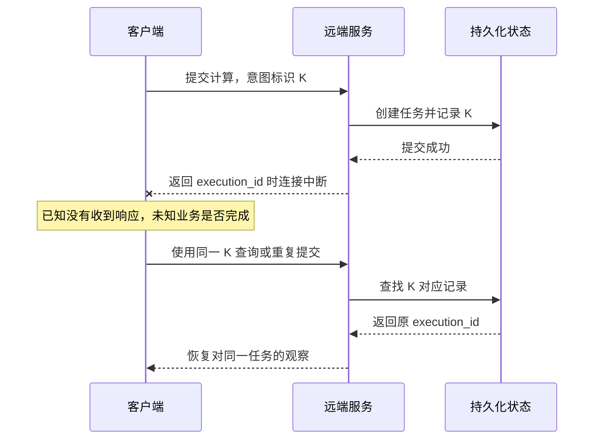
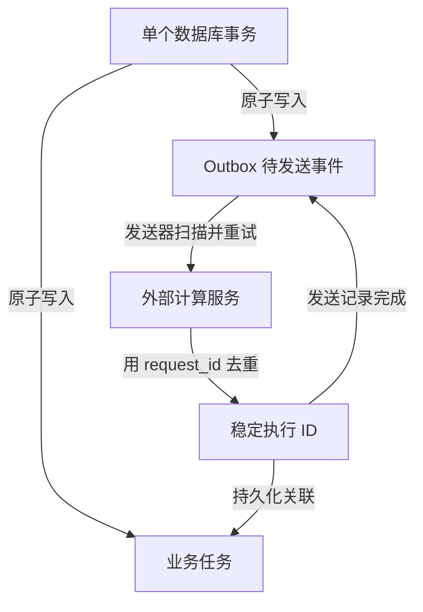

[回到知识图中的 R2](/learn/agent?node=R2) · [本组导读](/learn/agent/05-reliable-execution)

## 先看一个无法靠本地异常判断的问题

假设一个分析服务向远端提交付费计算，请求已经发出，本地却在等待响应时超时。调用栈抛出了异常，但这时至少存在三种真实情况：远端没收到请求；远端收到且仍在运行；远端已经完成，只是响应丢了。三个世界在本地都表现为同一个 `TimeoutError`。

这一节的目标是从这种不可区分性推导出幂等请求、业务事务与对账机制。它是订单、支付、任务调度共同面对的问题；Agent 只是会更频繁地自主发起这些操作。读完后，你应能说明：“请求失败”“业务失败”“结果未知”为什么必须分开，以及一个数据库事务为什么不能自动保护远端动作。

## 请求不是动作，动作也不等于响应



图中第二次发送的是同一个业务意图，而不是“再做一份新计算”。这个区分需要被接口明确表达，否则服务只能把每次收到的请求都当成新操作。

数学上，幂等常用 $f(f(x))=f(x)$ 表示重复应用不再改变结果。工程里更实用的契约是：在约定的范围和保留期限内，同一个意图标识的重复请求不产生额外的业务副作用，并返回与原操作语义一致的结果。这不要求日志完全相同，也不意味着重复请求没有网络和计算开销。[AWS 幂等 API 设计](https://aws.amazon.com/builders-library/making-retries-safe-with-idempotent-APIs/)

## 为什么不能直接把参数散列当成幂等键

教学例子中，用户今天和明天都提交同一份输入，希望独立运行两次，以观察随机性。参数相同，意图不同。如果系统只用参数哈希去重，第二次合法运行会被误认为重试。

反过来，客户端重试时重新生成 UUID，又会把同一个意图变成两个业务请求。因此，业务意图 ID 应在首次提交前生成并持久化，随后重试沿用。参数摘要用于检查“同一个 ID 有没有被错误地绑定到另一份输入”，而不是代替意图 ID。

一个合理的键范围通常包含租户或用户、操作类型和请求 ID。记录至少包括输入摘要、当前状态、稳定资源 ID 和可返回的结果。相同键、相同输入返回原状态；相同键、不同输入应拒绝并提示冲突，避免客户端误用 ID 时静默执行错误工作。

## 本地数据库事务能保证什么

设想任务表和请求表在同一个关系数据库中。首次提交要同时创建业务任务、登记请求 ID。若先写任务、后写请求记录，中间崩溃会留下一个没有去重记录的任务；重试就可能再创建一份。若顺序相反，可能只留下去重记录却没有任务。

因此需要在同一事务里完成两件事，用唯一约束防止并发请求同时声明同一个键：

```sql
BEGIN;
-- (tenant_id, operation, request_id) 有唯一约束。
INSERT INTO requests (tenant_id, operation, request_id, payload_hash, job_id)
VALUES (:tenant, 'run_analysis', :request_id, :hash, :job_id);

INSERT INTO jobs (id, status, input_hash)
VALUES (:job_id, 'queued', :hash);
COMMIT;
```

这只是展示原子写入的教学片段。并发唯一冲突后，需要回滚或使用设计好的冲突处理，再读取既有记录并核对摘要；不能捕获异常后不检查内容就返回成功。正确性依赖数据库唯一约束和事务，而不是应用层先查询一次“应该还不存在”。两个客户端完全可能同时查到不存在。

数据库提交解决的是这一数据库内部的原子可见性。事务的隔离级别决定并发读取能看到什么，并非只要写了 `BEGIN`，所有业务竞争就消失。跨行约束、读后写和重试都要结合实际隔离级别分析。[PostgreSQL 并发控制与锁](https://www.postgresql.org/docs/17/explicit-locking.html)

## 为什么远端调用放进事务也没有用

有人会把远端调用塞进事务中：先开启事务，调用计算平台，成功后写 `execution_id` 并提交。问题在于，计算平台不会随着本地数据库回滚而撤销任务。

如果远端创建成功、本地提交失败，外部任务已经存在，本地却不知道；如果数据库先提交“已发送”、进程随后在发送前崩溃，任务可能永远没发出去。把数据库锁持有得更久，只增加了锁竞争，并没有把两个独立系统变成一个原子事务。

这叫双写问题。解决思路通常是把“想要执行的外部动作”先写成数据库里的持久记录，再让发送器持续兑现这个意图。任务记录与待发送事件同一事务提交，就是 transactional outbox 的核心。[AWS transactional outbox](https://docs.aws.amazon.com/prescriptive-guidance/latest/cloud-design-patterns/transactional-outbox.html)



Outbox 保证“业务提交后，有一份可恢复的发送意图”，不保证消息只发送一次。发送成功后、标记已发送前仍可能崩溃，因此发送器通常可能重复投递。接收方还需要幂等处理、去重或其他业务约束。消息系统所谓 exactly-once 也必须读清保证范围，不能把消息平台内的语义直接扩展为任意数据库和外部 API 的全局副作用保证。

## 当远端没有幂等接口时怎么办

先检查能否用自定义标签、客户端任务 ID 或查询条件重新定位原操作。如果可以，则在结果未知时进入 reconciliation：查询事实，再决定是否补发。若操作已经完成，记录其 ID；若能证明确实未执行，才创建；若仍不确定，保留未知状态并等待或交由人工处理。

如果远端既不支持幂等键，也无法查询、也没有可撤销的业务机制，本地代码无法凭空证明“恰好执行一次”。此时必须根据业务代价选择：偏向避免漏做还是避免重复，设置风险边界，必要时暂停。不能用更多重试次数掩盖协议缺失。

补偿同样不是时间倒流。例如重复创建可删除一个冗余资源，但已消耗的算力未必退还；重复发送通知也无法让接收者没看过。补偿是新的业务动作，仍需自己的权限、幂等和审计。

## 去重窗口与崩溃窗口

去重记录不能无限免费保留，但删除过早会让迟到的重试重新产生副作用。接口必须说明保留多久、何种操作状态可以清理，以及客户端最长重试和网络延迟的假设。资源被删除后再次收到旧 ID，是返回原语义结果还是允许重建，也必须定义，而非由偶然实现决定。

还应检查四个窗口：发送前崩溃、远端接受后回执丢失、回执收到后本地记录失败、最终完成后重复通知。每个窗口都写明恢复时依据哪份持久事实，才能判断整个协议，而不只是某个函数是否有 `try/except`。

## 自测：能否推演反例

<details><summary>重试前先查任务状态，查不到就重建，为什么仍可能重复？</summary>

“查不到”可能来自读副本延迟、查询超时、原请求仍在处理中，或查询条件没有覆盖正确资源。只有查询接口提供足够强的语义，能证明该意图尚未执行，才能据此重建。更稳妥的是让创建接口本身支持稳定意图 ID，由服务端在同一正确性边界内决定创建或返回原任务。

</details>

<details><summary>数据库唯一键是不是足以保证远端计算不重复？</summary>

只能保证数据库中不重复出现该唯一记录。两个 Worker 仍可能先后读取同一条待发送记录，或者一个 Worker 在远端执行后崩溃导致另一个补发。需要把唯一键与接收端幂等、持久执行 ID、任务所有权和恢复协议组合起来。

</details>

<details><summary>两个完全相同的提交，一个是用户主动重跑，一个是网络重试，系统怎样区分？</summary>

主动重跑生成新的业务意图 ID；网络重试沿用原 ID。输入哈希用于防止同一意图绑定不同内容。这个区分应由产品接口和客户端共同维护，不能从文本或参数是否相同推断人的意图。

</details>

## 回到知识图：从观察不完整走向状态一致性

网络基础说明为什么响应可能缺失；R2 由此推导幂等与事务边界；R3 进一步解决多个 Worker 如何接管未完成意图。评测 E1 则要求把“没有得到可靠结果”与“结果确实错误”分开。Agent 工具设计中的 `execution_id`、`request_id` 和错误分类，正是这些通用分布式原理在接口上的体现。

## 位置与下一步

**知识归属：** 计算机与软件基础。归属表示研究对象，不表示运行先后。

**理解前置：**

- [B3 · 存储、索引与数据一致性](/learn/agent/deep/storage-indexes)：唯一约束、事务与持久化为去重和状态提交提供具体机制。
- [B2 · 操作系统与网络通信](/learn/agent/deep/os-network-foundations)：先理解请求与响应可能分别失败，才知道超时为何不能证明副作用未发生。

**后续用途：**

- [R3 · 租约、所有权与恢复](/learn/agent/deep/leases-recovery)：恢复必须先明确一个逻辑操作的身份及可重复执行范围。

**跨层联系：**

- [A2 · 工具契约与 MCP](/learn/agent/deep/tool-contracts)：幂等键和重复请求语义必须先成为工具契约的一部分。
- [R1 · 并发、队列与背压](/learn/agent/deep/concurrency-queues)：异步等待和网络失败会产生未知结果，多请求并发会放大重复副作用。
