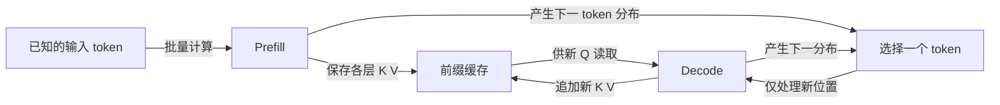

[回到知识图中的 M3](/learn/agent?node=M3) · [本组导读](/learn/agent/02-transformer-inference)

## 为什么模型参数没变，长对话却越来越慢

**教学假设：** 同一个模型回答短问题时很快，读完一大段论文后首字等待明显增加；继续生成时，显存还不断增长。模型权重没有变，额外成本从哪里来？

答案要沿 M2 的计算图找：旧 token 产生的表示需要供新 token 读取，输入变长会改变注意力计算和缓存规模。本节位于“推理原理”层。读完你应能估算一条请求的 KV 内存，区分首 token 延迟和后续生成速度，并判断一个优化到底减少了什么。

## 一、把一次回答拆成两个阶段

输入序列已经确定时，模型可以批量处理全部输入位置，建立各层表示以及 K、V。这一阶段通常称为 **prefill**。根据最后一个输入位置的输出分布，模型选择第一个生成 token。

之后每一步，都把刚选出的 token 放进模型，得到下一个 token 的分布。这个逐步扩展序列的阶段称为 **decode**。对于普通自回归生成，第 t+1 步输入依赖第 t 步的采样结果，所以单条请求存在顺序依赖。



图中的循环每转一次，通常增加一个 token；停止 token、长度预算或应用取消会结束循环。多 token 预测与推测解码可以改变实际实现，但理解标准过程是判断优化收益的起点。

## 二、缓存为什么成立

在一个固定参数、固定前缀的因果 Transformer 中，旧位置只能看见自己和更早的位置。追加一个新 token 不会改变旧位置能看到的内容，因此旧位置在每一层的 K、V 可以复用。新位置只需计算自己的 Q、K、V，把自己的 K、V 加入缓存，再用 Q 对缓存中的 K 做匹配、读取 V。

这里省掉的是旧位置表示和 K、V 的重复计算，**并没有省掉新位置对历史信息的读取**。上下文越长，新 token 通常需要处理越多历史 K、V。Hugging Face 的缓存说明给出了这一增量机制及缓存与位置、掩码之间的关系。[KV Cache 官方说明](https://huggingface.co/docs/transformers/main/cache_explanation)

为什么不缓存 Q？旧 Q 用于计算旧位置当时如何读信息；我们已经得到旧位置输出。新位置需要自己的 Q，而需要被读的历史内容仍由旧 K、V 提供。因此生成未来位置主要保留历史 K、V。

这也解释缓存失效：如果你修改了前缀中的一个 token，它后面各位置的表示都可能变化；如果你更换模型权重或适配器，投影结果也可能变化。不能因两个提示词“语义差不多”就直接复用其张量缓存。跨请求前缀缓存需要验证具体实现要求的身份、token、位置和模型配置，并隔离不该共享的数据。

## 三、亲手算一条请求占多少缓存

先考虑各层使用相同标准全注意力配置的模型，忽略分配器开销。每层、每个 token、每个 KV 头，要保存 K 和 V 两个长度为 d_h 的向量。因此：

$$
M_{KV}=2\times N_{layer}\times N_{kv}\times d_h\times S\times B\times b
$$

N_layer 是层数，N_kv 是 KV 头数，d_h 是每头维度，S 是每条序列当前缓存的 token 数，B 是等长独立序列数，b 是每个缓存元素占用的字节数。开头的 2 来自 K 和 V，而不是 batch 或双向结构。变长请求应把 `S × B` 换成各条实际缓存长度之和。

**教学配置：** 32 层、8 个 KV 头、每头 128 维、BF16 缓存每元素 2 字节、长度 8192、batch 为 1。

$$
M_{KV}=2\times32\times8\times128\times8192\times2
=1{,}073{,}741{,}824\ \text{bytes}=1\ \text{GiB}
$$

同配置每增加一个 token，逻辑缓存增加 128 KiB。若同时有 8 条彼此独立、各长 8192 的序列，就是约 8 GiB；若 KV 头改为 32，单条缓存变成约 4 GiB。

这还没有计算模型权重、临时激活、内核工作区、通信缓冲以及分配碎片。举例说，假设一个 70 亿参数模型的所有权重均以 2 字节存储，仅权重约 14 GB，即约 13.0 GiB；不能看到权重放得下，就断言任意 batch 与上下文也放得下。

```python
def kv_bytes(layers, kv_heads, head_dim, lengths, bytes_per_value=2):
    return 2 * layers * kv_heads * head_dim * sum(lengths) * bytes_per_value

print(kv_bytes(32, 8, 128, [8192]) / 2**30)      # 1.0 GiB
print(kv_bytes(32, 8, 128, [8192] * 8) / 2**30)  # 8.0 GiB
```

这个计算器是容量估算，不是性能实测。滑动窗口、层间不同配置、缓存压缩、共享前缀、量化附加元数据以及并行切分都会改变具体数值，应按真实结构逐层计算。

估算时还应区分逻辑长度与实际分配：有些缓存实现按最大长度提前分配，有些按块增长，因此两条当前长度相同的请求，在不同实现中占用的物理显存可能不同。只有把参数配置、缓存策略和测量时刻一起记录，容量数字才具有可比性。

## 四、GQA 改变的是公式中的哪一项

标准多头注意力通常每个查询头有自己的 K、V。MQA 让多个查询头共享一个 KV 头；GQA 则让一组查询头共享一个 KV 头，在两者之间选择共享程度。因此计算缓存时应使用 **KV 头数，而不是查询头数**。

例如 32 个查询头分成 8 组，每组 4 个查询头共享 K、V，缓存的 N_kv 是 8。它没有减少查询头到 8 个，而是减少需要持久保存和读取的 K、V 数量。共享也会改变模型结构与表达方式，不能对任意现成权重简单删掉头就假定质量不变。[GQA 原论文](https://arxiv.org/html/2305.13245v3)

## 五、为什么 GPU 算力很高，生成仍可能慢

GPU 的两种能力要分开看：一秒能做多少计算，以及一秒能把多少数据从显存送到计算单元。粗略地说，执行时间受到二者中较慢的那一项约束：

$$
t\gtrsim\max\left(\frac{\text{计算量}}{\text{有效算力}},
\frac{\text{搬运字节数}}{\text{有效带宽}}\right)
$$

这里的有效值会受内核利用率、通信和调度影响，不能直接用显卡宣传峰值预测服务延迟。prefill 有许多已知 token，较容易组织大矩阵运算；小 batch decode 每条序列一次只新增一个位置，可能为了少量新增计算反复读取模型权重和历史缓存，因而常受到带宽限制。但“prefill 永远计算受限、decode 永远带宽受限”不成立：上下文长度、batch、硬件与内核都可能改变瓶颈。

把多个请求一起 decode，可以摊薄读取模型权重的成本、提高利用率；与此同时，更多请求需要更多缓存，调度等待也可能增加。吞吐和单请求延迟因此不是同一个优化目标，服务层的进一步取舍见“推理服务与调度”专题。

## 六、常见优化各自保护什么

**FlashAttention** 关注注意力的 IO：通过分块等计算组织方式，避免把完整注意力分数矩阵反复写入和读取显存。它计算的是精确注意力，浮点舍入可能与其他实现不同；它没有把普通全注意力的数学配对数量从平方级变成线性。[FlashAttention 原论文](https://arxiv.org/abs/2205.14135)

**PagedAttention** 关注缓存的分配与访问组织，允许逻辑连续的缓存使用物理上不连续的块，减少浪费并支持共享等机制。它不是自动把上下文内容缩短，也不会让缓存元素变得没有内存成本。[PagedAttention 原论文](https://arxiv.org/abs/2309.06180)

**量化** 减少某类数值的存储位数。权重量化作用于权重，KV 量化作用于缓存，它们是不同开关；部署了 4-bit 权重，不意味着 KV 也为 4-bit。更低精度还要核对质量、数值范围、反量化成本和硬件支持。

**上下文压缩** 则改变模型输入内容，可能同时减少 prefill 和 KV 开销，但有信息损失风险。前三种主要处理表示或计算资源，压缩还会改变模型看到的证据，必须同时评测任务质量。

## 七、应用层应测什么

首 token 延迟 TTFT 包括排队、调度、prefill 和首 token 产出等时间。后续 token 间隔可用 TPOT 或 inter-token latency 描述；完整响应时间还取决于输出长度。粗略估算可写为“TTFT 加上后续 token 数乘以平均 token 间隔”，但真实每步速度可能变化。

对于多轮 Agent，单次调用快还不够。假如每轮都重发全部轨迹，总输入 token 可能随轮数快速累加；如果没有有效前缀复用，每轮还要重新做 prefill。缓存命中率、上下文保留策略、工具等待和模型调用轮数共同决定端到端时间。不要用模型服务的 tokens/s 代替任务完成吞吐。

## 自测与答案

<details>
<summary>1. 教学配置下，单条序列从 8192 增加到 16384 token，缓存怎么变？</summary>

在未使用窗口、共享或压缩且缓存精度不变的假设下，从 1 GiB 增加到 2 GiB。模型权重没有翻倍，只有这部分序列相关状态翻倍。实际总显存还包含其他开销。

</details>

<details>
<summary>2. KV Cache 已经保存历史，为什么还需要外部记忆或 RAG？</summary>

KV 是特定模型对特定前缀形成的计算状态，用来复用计算；外部记忆和检索决定哪些知识、事实或任务状态进入输入。缓存不会自动发现缺失资料，也不能替代可审计的业务状态存储。它们分别位于计算层与信息组织层。

</details>

<details>
<summary>3. 一次优化让 tokens/s 增加，但用户觉得更慢，可能是什么原因？</summary>

更大的 batch 可能提高总吞吐却增加排队时间；更长输出会延长整段完成时间；prefill 可能拖慢首 token；应用也可能增加了调用轮数。需要同时比较相同负载下的 TTFT、token 间隔、输出长度和端到端任务时间，而不是只看一个平均值。

</details>

## 接回知识体系

本节依赖 **M2 的因果注意力**，向上连接“推理服务与调度”的资源分配；向应用连接 **C1 的上下文预算** 与 **A1 的调用循环**；优化是否划算则交给 **E3 的质量—成本—延迟对照实验**。这条链能把硬件现象解释为模型机制，再转化为应用选择。

## 位置与下一步

**知识归属：** 大模型本体。归属表示研究对象，不表示运行先后。

**理解前置：**

- [M2 · 注意力与表示](/learn/agent/deep/attention-representation)：缓存的是各层注意力的 K/V，先看懂张量才能推算显存和计算。

**后续用途：**

- [I1 · 模型推理服务](/learn/agent/deep/inference-serving)：先理解单请求的生成与缓存，再讨论多请求的调度和共享资源。

**跨层联系：**

- [G2 · 预算与决策取舍](/learn/agent/deep/budget-decisions)：输入长度、输出长度和并发共同决定时间与显存预算。
