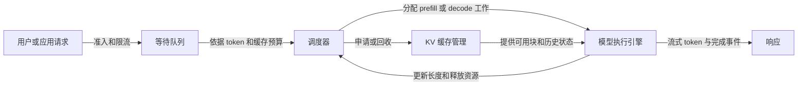

[回到知识图中的 I1](/learn/agent?node=I1) · [本组导读](/learn/agent/11-model-platforms)

## 为什么单条请求很快，上线后仍会排长队

**教学问题：** 你测得模型单次生成速度不错，但同时来了几十个用户，首字等待变长，有些请求还因显存不足被中断。这个问题不是继续修改 prompt 就能解决的，需要理解请求怎样竞争 GPU、缓存和调度时间。

本节位于“模型推理基础设施”层，前置是 M3 的 prefill、decode 与 KV Cache。目标是解释 batching、连续调度、缓存管理、量化和并行各在改变什么，并把它们与应用层 Agent Infra 分开。

调度器不是模型的思考过程。它决定哪些请求在这轮使用计算资源；模型决定每条被执行请求的输出分布。两者都影响延迟，却属于不同责任。

## 一、batching 为什么能提高利用率

小 batch decode 中，每条请求一次只增加一个 token。计算量可能不足以充分利用 GPU，但仍需要读取权重等数据。把多个请求一起计算，可以共享一些数据搬运并形成更有效率的矩阵运算，提高总 token 吞吐。

代价是要等请求凑齐、同时保存更多 KV，并在不同长度之间调度。batch 越大并非越好：显存会限制容量，排队可能损害交互体验，长 prefill 也可能影响其他请求的 decode。离线批量生成与在线聊天，应采用不同的优化目标。

## 二、连续 batching 改变了什么粒度

静态 batch 把一组请求作为相对固定的工作集合。生成长度不同时，短请求结束后，若不能及时补进新请求，就会留下无法充分利用的容量。连续 batching 在生成迭代边界重新调度，请求完成后可以退出，新请求可以加入。Orca 的 iteration-level scheduling 是理解这种调度粒度的重要原始工作。[Orca 论文](https://www.usenix.org/conference/osdi22/presentation/yu)

下面是**理想化调度算例**：A 需 3 个输出 token，B 需 6 个，C 需 2 个；C 在第 2 轮后到达。假设暂时忽略 prefill，每轮各活跃请求生成一个 token，并假设这一轮时长不随 batch 改变。后一个假设在真实系统中未必成立，所以表格只用来说明排队位置。

| 轮次 | 连续调度的活跃请求 | 本轮结束 |
| --- | --- | --- |
| 1 | A、B | 无 |
| 2 | A、B | C 随后到达 |
| 3 | A、B、C | A 完成 |
| 4 | B、C | C 完成 |
| 5 | B | 无 |
| 6 | B | B 完成 |

若固定 A、B 的 batch 在 B 完成前不能接纳 C，C 最早在第 7、8 轮执行。连续调度把 C 的等待减少了；它没有把 C 自身的两个 token 依赖消除。某些静态实现仍可提前返回已结束请求，因此不能一概说“短请求的结果必须等最长请求才返回”，真正要观察的是容量何时能重新使用。

## 三、为什么调度要看 token 和缓存，而不只看请求数

两条请求可能分别输入 100 与 30,000 token，资源需求相差很大。仅按“最多同时 16 个请求”限流，并不能准确控制显存。调度器需要考虑当前缓存长度、预计输出、可用缓存块、每轮 token 工作量和可能的抢占策略。

沿用 M3 的教学模型：一条 8192 token 请求约需 1 GiB 逻辑 KV，一条 4096 token 请求约需 0.5 GiB。假设可用于 KV 的预算为 8 GiB，在不共享且忽略开销时，容量可以是 8 条长请求或 16 条短请求；它还会随继续生成而变化。

PagedAttention 将缓存组织为块，降低连续大块预分配带来的浪费，并支持按逻辑地址读取分散的物理块。它提高的是可用内存管理效率，不会让 1 GiB 的逻辑信息自动变成零成本。[PagedAttention 论文](https://arxiv.org/abs/2309.06180)

容量不足时可以选择排队、抢占、重新计算或卸载，具体实现各异。每一种都把成本转移到等待、额外计算或数据搬运。需要观察是否频繁发生抢占，而不是只看显存利用率很高就认为系统健康。

## 四、prefill 和 decode 为什么会互相干扰

长 prefill 一次处理大量输入，decode 则希望规律地推进每个活跃请求。如果长输入占用很长的一次执行，正在流式输出的请求可能出现明显停顿。把 prefill 拆成较小工作块，有助于在吞吐和交互延迟之间安排机会，但增加调度复杂度，也可能改变算子的效率。

另一类方案把 prefill 与 decode 放到不同资源池，各自按不同瓶颈优化。这样还必须传输或共享 KV，付出网络、内存和协调成本。是否合算取决于负载、模型、互联和缓存规模，不能只因“解耦”听起来先进就采用。

## 五、量化减少了什么，代价在哪里

一个简化的仿射量化过程是把连续权重映射到有限整数：

$$
q=\operatorname{clip}(\operatorname{round}(w/s)+z),
\qquad \widehat w=s(q-z)
$$

s 是尺度，z 是零点，q 的取值范围由位宽决定。更低位宽减少存储和某些情况下的数据搬运，但引入舍入和截断误差。分组尺度、元数据和内核实现也占成本。

权重量化、激活量化和 KV 量化作用于不同对象。把 FP16 权重变成 4-bit，理论上的权重数据体积约变为四分之一，但这不等于整个服务显存或延迟都变为四分之一。激活、KV、临时缓冲以及反量化与通信仍在。GPTQ 是利用校准信息进行权重量化的一种方法，其具体实验结果不应直接移植为任意模型和设备上的保证。[GPTQ 原论文](https://arxiv.org/abs/2210.17323)

量化验证应同时看目标任务质量、长上下文表现、输出格式与性能。校准数据若只覆盖短英文段落，而部署主要是长中文代码任务，就有分布偏移风险。更小的模型文件也未必对应更快执行，还要确认设备和内核能有效利用该精度。

## 六、多张 GPU 怎样分工

**数据并行副本**让不同 GPU 或 GPU 组保存模型副本，各自处理不同请求。它适合提高总体容量，但不能独自解决一个模型放不进单张卡的问题。

**张量并行 TP**把同一层的大矩阵切分给多张卡。例如按输出维度分列，每张卡计算一部分输出，再依据后续布局拼接或通信；另一种切分可能产生需要求和的部分结果。它分摊权重与计算，却引入层内通信，互联慢时通信可能抵消收益。

**流水并行 PP**把不同层放在不同设备上。一条请求的表示依次经过各段；多条微批次可以重叠流水，但启动、收尾或负载不均会形成空闲阶段。它帮助分摊层和内存，不会把一条 token 必须经过各层的因果依赖消除。TP、PP 与数据并行的基本划分可参考 Megatron-LM 的系统研究；其训练吞吐数字不能直接当作推理性能数字使用。[Megatron-LM 并行研究](https://arxiv.org/abs/2104.04473)

## 七、指标必须与负载一起看

TTFT 是请求到首 token 的时间，受排队和 prefill 影响；TPOT 描述后续平均 token 时间，inter-token latency 可以进一步看相邻输出间隔；吞吐描述单位时间完成多少请求或生成多少 token。平均值之外，p95 等尾延迟更能暴露少数长输入和资源竞争。

一个可靠压测需要记录输入长度、输出长度、到达过程、并发、模型与精度、缓存命中和服务配置。只比较两次随手请求的 tokens/s，无法区分模型变快、负载变轻或输出变短。更有意义的目标是：在满足既定延迟和质量要求时，最多稳定服务多少目标负载。

## 八、它与 Agent Infra 的边界

模型推理 Infra 负责模型权重、张量计算、KV、请求调度和 token 交付。Agent Infra 在其上管理多轮任务、工具、权限、持久状态、沙箱、产物与恢复。一次 Agent 任务可能调用模型多次，也可能很长时间都在等工具，几乎没有 GPU 生成工作。

因此模型服务提速 20%，不保证整条 Agent 任务也提速 20%；要看模型调用占总时间多少，以及是否改变了轮数和行为。反过来，修复重复工具执行可以显著改善任务成本，却不代表优化了模型内核。岗位或项目描述中，应指出自己改变的是哪一层。

## 自测与答案

1. continuous batching 是否消除了自回归生成的串行性？

没有。它在不同请求之间更灵活地分配每轮执行机会；同一请求的下一步仍依赖已生成 token。提升来自调度和资源利用，而不是让未知的未来 token 同时成为输入。

2. 为什么 4-bit 权重部署后显存仍可能不足？

权重只是显存的一部分。长上下文和多请求的 KV、激活、工作区、通信和元数据也占空间；它们可能没有同时量化。应按对象拆开容量，再检查调度的请求长度和缓存增长。

3. GPU 利用率升高，是否意味着服务体验改善？

不一定。更大的 batch 或更激进的排队可以提高利用率，却增加首字等待或尾延迟。需要在同样负载和质量下同时看 TTFT、token 间隔、吞吐、错误及抢占，而不是优化一个孤立百分比。

## 接回总图

本节依赖模型结构与 **M3 的推理成本**，使用操作系统、并发与分布式通信的基础知识，向应用层提供模型服务。上层的 RAG 与 Agent 消费这个能力，评测负责把资源改善与真实任务收益连接起来。这里的算例和调度表均为教学分析，未声称完成相应 GPU 实测。

## 位置与下一步

**知识归属：** 基础设施与平台。归属表示研究对象，不表示运行先后。

**理解前置：**

- [M3 · 生成过程与 KV Cache](/learn/agent/deep/inference-budget)：先理解单请求的生成与缓存，再讨论多请求的调度和共享资源。

**跨层联系：**

- [G2 · 预算与决策取舍](/learn/agent/deep/budget-decisions)：服务侧排队和批处理会改变应用感知的总时延。
