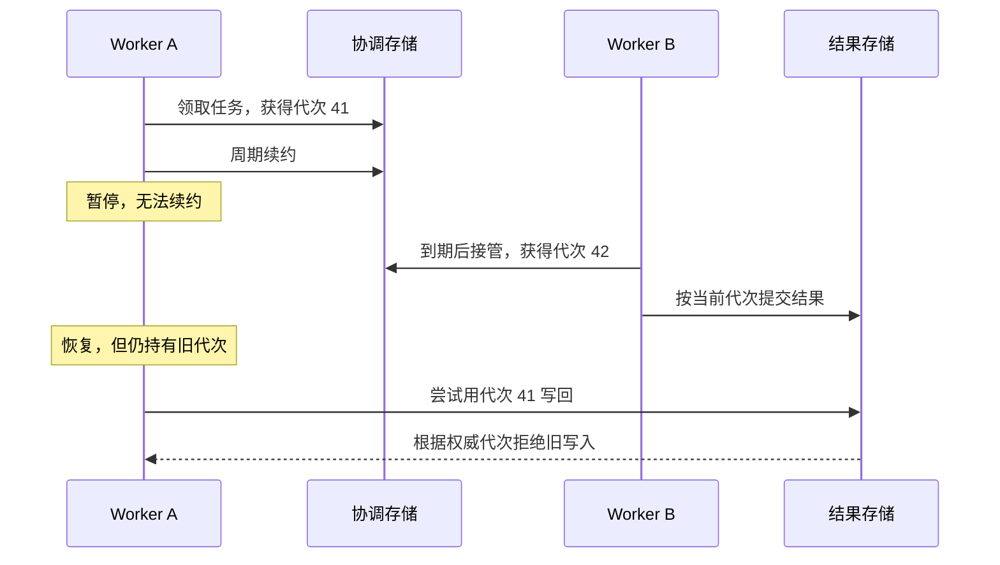

[回到知识图中的 R3](/learn/agent?node=R3) · [本组导读](/learn/agent/05-reliable-execution)

## 从一个进程暂停的故事开始

假设数据分析任务由 Worker A 执行。A 因运行时暂停或网络隔离，几分钟没更新心跳。调度器认为它失联，让 B 接管。B 已经生成新结果，A 此时恢复，又把旧结果写回。系统有心跳、有超时、有重试，仍然发生了结果覆盖。

这一节要解释：失联判断、接管权和写入权是三件不同的事。读完后，你应能沿时间线说明租约解决了什么、fencing token 为什么必须由资源端验证，以及恢复应复用哪些事实。它们适用于分布式 Worker、定时任务、数据库协调和 Agent 长任务，不是模型框架特有的能力。

## 先区分任务、尝试与远端执行

任务是业务意图，例如“分析这一版本的数据”。尝试是一次本地处理过程。远端执行是计算平台中实际存在的进程或容器。它们不一定一一对应：同一远端执行可以被多个先后接管的本地尝试观察；一次失败的本地尝试也可能已经启动了远端进程。

因此，持久记录至少要区分 `job_id`、`attempt_id` 和 `execution_id`。只记“任务正在执行”不够，因为恢复时需要知道实际计算在哪里，已有产物属于哪个输入版本，以及哪个 Worker 仍有权更新最终状态。

心跳是某个时刻收到的活跃信号。没收到心跳可能是进程死了，也可能是网络断了、事件循环被阻塞或进程暂停了。它提供故障怀疑，而不是对死亡的绝对证明。

## 为什么要逐步增加这些机制

先只有一个 Worker：它启动远端计算后退出了。如果 `execution_id` 只在内存里，重启后就不知道该去哪里查。第一步需要持久化任务身份、输入版本和执行引用；它解决“找不回原任务”，还没有解决并发。

再加第二个 Worker：两者可能同时读到 `pending`，都启动任务。此时要用原子条件更新或短事务领取，让某一时刻的所有权变更只有一个胜者。不要把长计算放进这个事务里，数据库锁并不会变成远端执行的可靠性保证。

接下来 A 失联：如果所有权永久不释放，B 永远不能接管。加入可续期的租约，允许过期后恢复进度。**租约带来了活性，也制造了新问题**：A 可能只是暂停，恢复后仍会写入。

最后处理旧 A 回来：接管时提高所有权代次，实际接收结果的一端检查代次，拒绝过期写入。若任务已在远端运行，B 应先查询并回收原执行，而非因为自己刚接管就重新启动。是否能阻止重复启动，还取决于远端提交接口的幂等与可查询能力。

这四步分别回答“在哪里”“谁领取”“失联后谁接管”“旧持有者还能不能写”。把它们分开后，下面的租约、心跳和 fencing 才各自有明确职责。

## 租约把永久等待变成可过期的所有权

租约表达一个有限期限：在权威协调者判断的有效期内，某个持有者拥有约定的处理权。持有者通过续约延长期限；没有续约，到期后系统允许其他人接管。etcd 的锁接口可以把锁所有权绑定到租约，租约过期或撤销时释放锁。[etcd 并发 API](https://etcd.io/docs/v3.6/dev-guide/api_concurrency_reference_v3/)



租约长度是恢复速度与误接管风险之间的取舍。设得短，真实崩溃后接管快，但短暂网络抖动更容易造成并发持有者；设得长，接管慢却不能彻底消除旧进程恢复。无论设多久，都不应把“本地认为还有效”当作写入安全的唯一依据。

时间也必须有明确来源。不同机器的墙钟可能漂移；单机测量经过时间适合单调时钟；租约何时过期应遵守协调服务的定义。简单用客户端各自的 `now()` 比较同一时间戳，会引入不易察觉的假设。

## Fencing 的关键在接收写入的一端

Fencing token 可以理解为递增的所有权代次。A 拿到 41，B 接管后拿到 42。资源端只有实际检查代次，才可能拒绝旧 Worker。只是把 token 写进日志，或仅由 Worker 在发送前检查一次，并没有阻止“检查后暂停、恢复后发送”的竞态。[Kleppmann 对 fencing 的解释](https://martin.kleppmann.com/2016/02/08/how-to-do-distributed-locking.html)

在单个数据库里，可以用条件更新把检查和写入放在同一原子操作内：

```sql
UPDATE jobs
SET status = 'succeeded', artifact_manifest = :manifest
WHERE id = :job_id
  AND owner_epoch = :my_epoch
  AND status = 'running';
-- 影响 0 行时，没有获得提交权；不能按成功处理。
```

前提是接管时 `owner_epoch` 已由权威事务递增，写入者不能任意修改它。若同一代次内有并发写入，还可能需要版本号或状态条件；fencing 不自动解决所有顺序问题。

对外部对象存储或计算平台，情况更复杂。某些服务只记录见过的最大 token，那么它只能拒绝“比已经见过的更大代次更旧”的写入；尚未观察到新代次时，它并不会凭空知道协调服务的租约已过期。强要求场景要设计资源端如何获取当前授权，或改成写入不可变对象、再通过数据库中的受保护指针选择有效版本。只在数据库里 fencing，也不意味着旧 Worker 已无法向其他外部服务产生副作用。

## 领取任务为什么要短事务

多个 Worker 可以使用数据库行锁在短事务中领取不同任务，然后提交所有权记录，再在事务外运行长计算。`FOR UPDATE SKIP LOCKED` 会跳过当前被锁住的行，适合队列式领取，避免大家阻塞在同一行上。它提供的视图不适合一般业务查询，也不等于长任务自动恰好一次执行。[PostgreSQL SELECT 锁语义](https://www.postgresql.org/docs/17/sql-select.html#SQL-FOR-UPDATE-SHARE)

为什么不把行锁一直持有到计算结束？因为小时级任务会让数据库连接和锁长期占用；Worker 与数据库连接断开时，锁释放了，远端进程却可能还在运行。锁保护的是数据库事务，不是所有外部资源的生命周期。短事务领取、持久身份、有限租约、受保护提交，分别覆盖不同环节。

## 恢复、重试与重放不能混用

重试是再次请求某个操作，是否安全取决于 R2 的幂等契约。恢复是继续管理已存在的任务状态，例如重新查询原执行、获取已有结果。重放是按历史事件重建状态，或在可控环境中重新执行；如果包含真实副作用，重放也可能重复计费或修改数据。

一个恢复协议可以这样推导：先读取业务意图和输入版本，再找到原 `execution_id`；确认输入摘要、环境版本和产物目录属于同一次任务；取得恢复与提交的所有权；查询远端状态；若仍运行就继续观察，若已完成则收回产物并独立验收；若无法确定则保留未知，而非立即重启。

恢复时重新启动模型可能改变答案并再次付费，所以“恢复入口没有报错”不是充分结果。要验证远端创建次数没有增加、原执行 ID 未变、原产物得到回收，并且最终验收结果符合任务契约。复用原执行本身也不保证它的科学或业务结果正确。

## 用崩溃窗口设计故障注入

| 注入位置 | 可能留下的状态 | 恢复必须证明的事实 |
| --- | --- | --- |
| 领取后、发送前 | 有所有权，没有远端执行 | 同一意图仍能被安全发送 |
| 远端接受后、回执前 | 远端存在，本地缺 ID | 可由意图 ID 找回或安全去重 |
| 收到回执后、存库前 | 内存有 ID，持久层没有 | 重启后仍有定位原执行的路径 |
| 产物生成后、归档前 | 已完成但未交付 | 能回收原产物，不再次运行 |
| B 接管后、A 恢复 | 两个活进程 | 旧代次不能覆盖有效结果 |
| 恢复时输入版本变更 | 同名任务含义不同 | 拒绝混合新输入与旧执行 |

这些是教学测试设计，不代表某个真实平台已经通过。测试应检查创建次数、状态转移、产物摘要和最终写入权，而不只检查 API 返回 200。对于外部服务无法模拟的语义，还需要小规模真实链路验证，并明确哪些故障只在假服务中验证过。

## 自测：保护的是哪一份事实

<details><summary>有租约后，还需要幂等吗？</summary>

需要。租约处理谁拥有工作和提交权；幂等处理同一业务意图被重复发送时是否产生额外副作用。Worker 可以在有效租约内发送成功后崩溃，也可能因回执丢失再次发送，这与是否发生接管无关。两者覆盖不同失败窗口。

</details>

<details><summary>把租约延长到一天，是否解决旧 Worker 写回？</summary>

只是降低某些情况下的接管频率，并让真实失败后的恢复更慢。只要可能暂停超过期限，旧 Worker 仍可能恢复。应在实际写入资源处执行所有权条件，而不是用一个“看起来足够长”的时间代替正确性机制。

</details>

<details><summary>重连原沙箱并成功下载文件，是否可以宣布恢复功能完全正确？</summary>

只能证明这一条路径在这次条件下成功。还需验证输入匹配、同一执行没有被重启、重复回收不会破坏状态、旧 Worker 不会覆盖结果、失败路径保留必要信息。下载到文件也不等于文件通过独立验收；执行恢复与任务质量是两个不同结论。

</details>

## 回到知识图：安全性与活性同时成立

安全性要求不产生不允许的结果，例如旧持有者覆盖新结果；活性要求在故障解除后有机会继续完成。租约促进接管，fencing 保护写入，幂等限制重复副作用，持久身份使恢复可定位，评测验证最终目标。Agent Infra 常在这里管理长任务；推理 Infra 则更多管理 GPU 计算、KV 生命周期和批次调度，二者会交汇，但承担的资源与正确性契约不同。

## 位置与下一步

**知识归属：** 基础设施与平台。归属表示研究对象，不表示运行先后。

**理解前置：**

- [R2 · 幂等与事务边界](/learn/agent/deep/idempotency-transactions)：恢复必须先明确一个逻辑操作的身份及可重复执行范围。

**跨层联系：**

- [C3 · 记忆与权威状态](/learn/agent/deep/memory-state)：恢复所依据的执行身份和任务快照必须来自权威记录，不能只靠模型摘要。
- [E1 · 评测契约与统计口径](/learn/agent/deep/evaluation-contracts)：区分执行失败、未观测与作答错误，才能给评测结果正确归因。
- [P2 · 信任边界与安全](/learn/agent/deep/trust-boundaries)：故障恢复不得继承超过原任务范围的权限。
