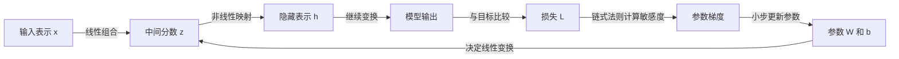

[回到知识图中的 F1](/learn/agent?node=F1) · [本组导读](/learn/agent/10-foundations)

## 为什么先看“形状”，再看公式

读 Transformer 论文时，最容易出现一种错觉：公式的每个字母都认识，却不知道它在做什么。解决办法不是先背矩阵恒等式，而是追踪三个问题：每个轴代表什么对象，运算把哪些对象组合起来，输出怎样影响下一步。

本节从一个可以手算的模型开始，建立向量、矩阵、内积、线性变换、非线性和梯度之间的关系。它不是完整的线性代数课程，但会给后续概率学习、注意力和训练目标提供一条共同语言。

## 向量首先是一组有组织的数

假设把一段文本粗略表示为两个特征：是否包含实验描述、是否包含数据来源。用列向量 x=[2,1] 表示某个教学样本。这些数只是人为设定的例子；真实模型的向量通常是学习出来的，各个维度未必能用一个中文词命名。

向量的维数是坐标数。一个 4096 维表示不是 4096 个 token，而是一个对象由 4096 个数描述。一个含 n 个 token 的序列，每个 token 用 d 维表示，通常形成 n×d 的矩阵；再加批次轴，会出现 B×n×d 的张量。张量在这里可以先理解为带有多个轴的数值数组。

维度的语义比具体数字更重要。如果把 n 当成 d，某些运算会直接报错；更危险的是恰好维数相等，程序可以运行，但实际组合了错误的对象。

## 内积为何能当成一个分数

取权重 w=[3,−1]，计算内积：

$$
s=w^\top x=3\times2+(-1)\times1=5.
$$

这个分数把输入的多个坐标按权重汇总。正权重让对应分量提高分数，负权重则降低分数。加入偏置 b 后，s=wᵀx+b 就是一个仿射函数。

内积也能描述方向关系，因为：

$$
u^\top v=\|u\|\|v\|\cos\theta.
$$

所以向量越同向，内积通常越大，但模长也会影响它。若想比较方向而不让长度主导，可以看余弦相似度。余弦为 1 只说明两个非零向量方向相同，并不自动代表两段文本在语义上等价；语义能力来自表示如何训练和使用。

这会直接连接 RAG：检索中选择点积或余弦，并不是同一个指标换了名字，需要结合 embedding 的训练目标与归一化约定。

## 矩阵乘法是在同时计算多个分数

给定两个输出方向：

$$
W=\begin{bmatrix}3&-1\\1&2\end{bmatrix},\quad
x=\begin{bmatrix}2\\1\end{bmatrix},\quad
Wx=\begin{bmatrix}5\\4\end{bmatrix}.
$$

矩阵的每一行对同一个 x 做一次内积，因此输出包含两个不同的分数。这可以理解为将原来的表示变换到另一个表示空间。转换不一定保留全部信息：从高维降到低维，一般会使一些不同输入映射到同一个输出。

把多个样本放在矩阵 X 的各行时，常写 Y=XW。此时 W 的轴方向与上面的列向量约定不同。两种写法都可以，关键是明确约定。例如 X∈Rⁿˣᵈ、W∈Rᵈˣᵏ，输出 Y∈Rⁿˣᵏ：同一组 W 被用于 n 个对象，每个对象从 d 维变为 k 维。

学习看形状时，可以用“保留了哪个轴，变换了哪个轴”来复述：这里保留 token 轴 n，只改变特征轴 d。这与注意力跨 token 混合信息是不同操作。

## 为什么神经网络需要非线性

若只有两个线性层，忽略偏置，y=W₂(W₁x)=(W₂W₁)x。无论堆了多少层，都可以合并为一个线性变换。表达能力没有因为层数自动变成任意复杂。

加入非线性函数后，例如 h=max(0,W₁x)，不同输入会激活不同的坐标，输出函数成为分段变化的映射。这里用 ReLU 只是为了容易理解，不意味着现代大模型都采用同一个激活函数。

残差连接则把输入直接加回变换结果：h=x+f(x)。它让信息可以沿恒等路径传播，也改变梯度传播路径。残差两侧必须维度兼容，不能把“加一条捷径”当作无需检查形状的技巧。

这张图把前向计算和学习连接起来。损失不是凭空产生的，它必须来自某个目标；梯度也不是“模型知道答案错了”的拟人过程，而是具体计算图上的变化率。

## 导数和梯度到底在回答什么

对于一个参数 w，导数 dL/dw 表示在当前位置对 w 做很小的改变时，L 大约会怎样变化。若导数为正，沿正方向增加 w 会局部增加损失；为了降低损失，可以向相反方向移动。

多个参数组成向量 θ 时，梯度是各参数偏导数的集合。梯度下降用：

$$
\theta_{\mathrm{new}}=\theta-\eta\nabla_\theta L,
$$

其中 η 是步长。它只依据当前位置的局部信息，不承诺一次更新后就在全局最优点。步长过大可能越过低点甚至发散；随机小批次上的梯度还会受抽样影响。

不要混淆三件事：输入梯度表示输出对输入变化的敏感度；参数梯度用于训练参数；推理时通常只做前向计算，不因为看到一次错误回答就自动更新模型权重。

## 一个可以逐步手算的反向传播例子

设 x=2，w=1，b=0，目标 y=5，模型预测 ŷ=wx+b=2，采用损失 L=½(ŷ−y)²=4.5。

先从损失对预测的导数开始：∂L/∂ŷ=ŷ−y=−3。再看预测对参数的导数：∂ŷ/∂w=x=2，∂ŷ/∂b=1。沿链式法则相乘：

$$
\frac{\partial L}{\partial w}=(-3)\times2=-6,\qquad
\frac{\partial L}{\partial b}=(-3)\times1=-3.
$$

若步长 η=0.1，则新参数 w=1.6、b=0.3，新预测为 3.5，损失为 1.125。这个数值例子展示的是一次更新如何降低这个样本的损失，不是模型已经学会泛化。

如果需要检查手算，可以用中心差分近似导数：分别把 w 加上和减去很小的 ε，观察损失差。它适合小规模梯度检查；大网络中为每个参数反复前向计算代价太大，自动微分利用计算图和链式法则高效累积梯度。可参照 [PyTorch 的 autograd 教程](https://docs.pytorch.org/tutorials/beginner/blitz/autograd_tutorial.html)理解计算图，但应先能手算上面这个例子。

## 从这个小模型走向大模型

大模型的规模更大，参数共享、注意力、归一化和非线性使计算图复杂得多，但基本对象没有改变：输入被表示成张量，前向计算产生输出，损失定义学习方向，链式法则把信号传回参数。

这也解释了为什么“懂矩阵乘法”与“会部署模型”之间仍有距离。矩阵公式描述数学计算，真实运行还涉及数据布局、精度、显存、通信和算子调度。不能因为公式相同，就假设两种实现的速度和内存相同；也不能因为速度不同，就认为数学目标必然不同。

## 自测与答案

X 是 8×16，W 是 16×4，XW 的形状和含义是什么？

输出是 8×4。若每一行表示一个 token，则仍有 8 个 token，每个 token 的特征从 16 维变成 4 维。这个乘法本身没有把第一个 token 的内容加到第二个 token 上；跨 token 的信息聚合需要另外的运算。

为什么两层线性网络不能仅靠加深得到任意复杂的函数？

因为线性变换的复合仍是线性变换；带偏置的仿射变换复合仍可写成一个仿射变换。需要非线性或其他机制改变函数族，才会获得新的表达形式。

梯度很大，是否说明这条训练数据更重要？

不能直接这样推断。梯度受当前参数、损失尺度、输入尺度和样本难度影响，还可能来自异常值或错误标签。它描述局部优化信号，不是业务价值或样本真实性的证明。

## 继续追问

在 M1 中，用概率和交叉熵替代本节的平方损失；在 M2 中，看矩阵乘法如何形成 token 间的信息聚合；在 I2 中，看同一计算图怎样拆到多张卡。先检查对象、形状和变化率，再讨论更复杂的名词。

## 位置与下一步

**知识归属：** 数学与学习原理。归属表示研究对象，不表示运行先后。

**后续用途：**

- [M1 · 概率、损失与梯度](/learn/agent/deep/probability-learning)：导数和链式法则解释损失怎样改变模型参数。
- [M2 · 注意力与表示](/learn/agent/deep/attention-representation)：矩阵乘法和向量内积解释注意力的形状与相似度。
