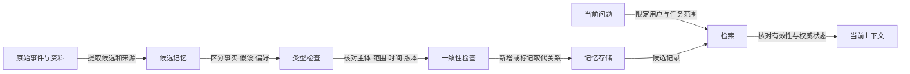

[回到知识图中的 C3](/learn/agent?node=C3) · [本组导读](/learn/agent/04-context-retrieval-memory)

## 先看问题：“它记住了”究竟指哪件事

假设研究助理昨天使用数据集第 2 版，今天任务要求使用第 3 版。它从长期记忆中读到“当前数据版本为 2”，于是覆盖了今天的明确输入。这不是单纯的遗忘，而是把旧记录当成了当前事实。

本节属于大模型应用的信息持久化与复用。它可服务跨轮问答、写作偏好、推荐和 Agent，不是 Agent 独有能力。先修是数据存储、上下文构造、检索与版本概念。学完应能区分历史、摘要、长期记忆与程序状态，设计写入、冲突处理和读取过程，并解释为什么记忆越多不一定越好。

## 先区分存在哪里、保留多久和代表什么

“短期”和“长期”容易让人想到缓存与硬盘，但在应用框架里，它们通常还描述作用范围：某个会话中的步骤状态，或者跨会话复用的信息。例如 LangGraph 官方文档区分线程内状态与跨线程的记忆存储；这是框架的组织方式，不是人类记忆机制的完整理论。[Memory overview](https://docs.langchain.com/oss/python/concepts/memory)

更有用的区分是信息承担什么责任：

| 对象 | 表达什么 | 常见用途 | 不能直接保证什么 |
| --- | --- | --- | --- |
| 原始历史 | 某时发生了哪些交互和观察 | 审计、回放、找证据 | 当前上下文能自动找到它 |
| 摘要 | 对历史的压缩表达 | 续接任务、减少输入 | 所有条件与否定都被保留 |
| 长期记忆 | 经选择后供未来复用的记录 | 偏好、知识、经验 | 每条记录永远有效 |
| 程序状态 | 系统已承诺保存的进度与状态 | 恢复、调度、去重 | 完整知道远端世界的即时事实 |

最后一列尤其重要。任务数据库可以是系统内某类状态的权威来源，但远端执行仍可能暂时未知。数据库中的 `last_seen_running` 应带观测时间，不能被解释成“现在一定仍在运行”。权威意味着由指定机制负责更新和判定，不意味着没有观测延迟。

## 为什么不能把所有对话直接写成事实

对话里同时存在用户要求、模型假设、工具观察、失败方案和被撤回的结论。如果抽取器只提取肯定句，可能把“我们可以考虑方法 B”写成“用户要求采用方法 B”，把“怀疑输入文件损坏”写成“输入文件已经损坏”。

因此记忆写入至少需要区分陈述类型。偏好应说明由谁表达、适用范围和时间；事实应保留来源；推断应保留不确定性；任务待办不应伪装成已经完成的事件。模型生成的流畅摘要可以是候选，不能因为被保存了一次就升级成事实。



这条链把“写入质量”和“读出质量”分开了。写得错误，检索越准确可能越稳定地取出错误；写得正确，检索范围和时效处理不当也会答错。

## 一个记录应该保留哪些最小语义

下面是教学记录，不绑定任何数据库产品：

```json
{
  "subject": "project:example-study",
  "predicate": "dataset_version_for_task",
  "value": 3,
  "scope": "task:report-17",
  "record_type": "user_requirement",
  "source_event": "event-82",
  "observed_at": "2026-11-26T09:00:00+08:00",
  "revision": 2,
  "supersedes": "memory-19"
}
```

主体防止不同项目混淆；范围防止本次任务规则污染所有任务；类型说明这是用户要求；来源让人可以复查；版本与取代关系说明为什么当前采用第 3 版。不是每个系统都需要这个完整结构，但缺少某个字段时，应知道自己放弃了哪种区分能力。

不要用一个“置信度 0.93”替代这些信息。模型自报置信度未必校准，而且再高的主观分数也不能替代明确来源。多条相同摘要若来自同一个原始错误，也不能算作多个独立证据。

## 更新记忆不是永远覆盖旧值

当新记录出现，需要判断它与旧记录是什么关系。相同主体、相同属性、相同适用范围下的新要求，可能取代旧要求；不同时间或不同任务的要求则可能同时正确。例如“任务 A 用版本 2”和“任务 B 用版本 3”并不冲突。

若确实冲突，优先看来源权威、适用时间和明确的修订关系，不要仅凭文本相似度判断。对于不能自动解决的冲突，保留冲突状态并回查来源，比随机选一个更可解释。历史旧值可以保留用于审计，但不应默认参与当前事实注入。

并发更新还需要数据库层面的机制。两个会话同时读取 revision=2，各自写新值，后写者可能覆盖前者。可以使用版本条件更新，或者在事务中完成冲突检测。事务隔离与并发控制是普通数据库知识，记忆系统并不因为有大模型而免除这些问题。[PostgreSQL 事务隔离说明](https://www.postgresql.org/docs/current/transaction-iso.html)

## 读取要先确定范围，再确定相似度

假设用户问“这个项目的标准化步骤是什么”。直接在所有记忆里做向量搜索，可能找到另一个用户或另一个项目中表面相似的步骤。应该先应用访问权限与明确的主体范围，再在合法候选中排序，必要时补充语义检索。

对于可以精确定位的事实，如当前任务版本或执行 ID，键值查询往往比语义检索更合适。对于“以前遇到相似错误怎么处理”，语义检索有价值，但返回的是历史经验候选，还需要核对软件版本、环境和适用条件。

时间过期策略也要区分信息类型。用户姓名通常不会因为一天未访问就自动失效；短期任务状态却可能几秒后变化。TTL 只是一种刷新策略，不是事实真假判定。对于会触发重要操作的动态事实，即使缓存尚未过期，也可能需要在执行前回查权威服务。

## 经验如何复用，才不会变成教条

一条好的经验记录不只写“遇到失败就重试”，而是写清触发条件、动作、结果和边界。例如：“在查询请求超时且已有稳定执行 ID 时，先重新查询同一执行；不能据此重新创建任务。”它连接了故障类型与可采取动作，而不是把一次偶然成功推广到所有情况。

程序性经验可以帮助写代码、安排工作流或选择检查项，但它仍然需要版本和来源。升级后的 API 可能改变返回结构；某个项目的处理方法也可能依赖特殊假设。长期记忆的目标是减少重复学习成本，而不是永久固定过去的决定。

## 怎么证明记忆帮助了任务

不能只测“能否复述昨天说过的话”。应用更关心记忆是否使今天的任务更准确、更省时，而且不会引入错误事实。

可以构造四组教学评测：需要旧信息才能回答的问题；旧信息已经被新要求取代的问题；其他用户或项目的相似干扰；原记录包含猜测、否定或未完成事项的问题。分别检查写入准确性、正确记录的检索覆盖、过期信息误用率，以及最终任务结果。

若打开记忆后平均成功率上升，但在版本更新任务上频繁使用旧要求，就不能只展示平均提升。还应记录检索命中来源、更新路径和冲突决策，让失败可追溯。

## 自测与解释

<details>
<summary>把聊天历史向量化，就等于做好长期记忆了吗？</summary>

它建立了可检索的历史索引，但没有自动区分假设与事实、处理更新冲突、限定用户范围或判断时效。可以把它作为记忆系统的一部分，但仍需在读写链上维护这些语义，否则会准确地找回不该当真的旧话。

</details>

<details>
<summary>昨天记忆写“分析已完成”，今天数据库显示仍在运行，怎么办？</summary>

先确认二者是否指向同一执行 ID 和输入版本，再回查原始事件与当前状态服务。摘要可能把“已提交”误写成“已完成”，数据库也可能只是过时观察。应由指定的状态判定流程核查事实，将冲突显式记录，不能仅按哪个文本更新或更肯定来决定。

</details>

<details>
<summary>为什么“记忆越多越聪明”不是可靠设计原则？</summary>

更多记录会增加检索候选、重复、冲突和过期事实，也会占用上下文。收益取决于写入是否准确、读取是否相关以及下游是否正确使用。应以未来任务的质量、成本和错误率评估保留策略，而不是把存储条数当作能力指标。

</details>

## 放回总图

概念归属：记忆属于**大模型应用的信息持久化与复用机制**。先修依赖是数据库、检索、时间与版本语义。应用联系：上下文工程选择哪些记忆进入本轮模型；Agent 用记忆续接长任务，问答和个性化应用也可以使用；可靠执行依靠可恢复程序状态；评测检验复用收益。长期记忆与任务数据库可以交互，但不能互相冒充。

## 位置与下一步

**知识归属：** 应用与 Agent。归属表示研究对象，不表示运行先后。

**理解前置：**

- [C1 · 上下文选择与压缩](/learn/agent/deep/context-selection)：先理解本轮输入的有限性，再讨论跨轮、跨任务的信息保存。

**跨层联系：**

- [R3 · 租约、所有权与恢复](/learn/agent/deep/leases-recovery)：恢复所依据的执行身份和任务快照必须来自权威记录，不能只靠模型摘要。
- [B3 · 存储、索引与数据一致性](/learn/agent/deep/storage-indexes)：记忆更新需要有版本、有来源的存储，避免覆盖掉权威事实。
