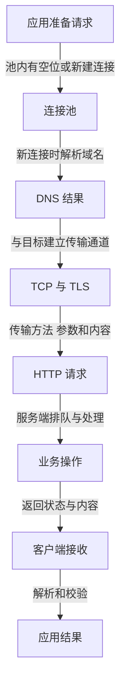

[回到知识图中的 B2](/learn/agent?node=B2) · [本组导读](/learn/agent/10-foundations)

## 从“程序卡住了”拆出具体位置

一个服务接收分析请求，读取文件，调用远端模型，再把结果写回。出现卡顿时，可能是 Python 正在计算，可能在等待磁盘，可能排队等连接，也可能远端一直不返回。“程序慢”只是现象，不能直接推出该加线程、加机器还是换模型。

本节从操作系统与网络建立定位坐标。读完应能区分进程、线程、协程，理解内存地址与物理资源的关系，并沿一次 HTTP 请求区分连接成功、请求被接受和任务真正完成。它们是所有后端与大模型工程的共同基础。

## 进程、线程和协程分别隔离什么

进程可以理解为操作系统管理的一组执行与资源边界，通常拥有自己的虚拟地址空间。两个进程中的同一个数值地址，不一定指向同一物理内存。若一个进程改了自己的普通 Python 字典，另一个进程不会自然看到同样变化，需要通过管道、套接字、共享内存等方式通信。

线程是进程内的执行单元。线程通常共享进程地址空间和许多资源，因此传递对象方便，但并发修改同一个对象需要协调。一个线程写入“任务已完成”，另一个线程恰好读取到部分更新，就涉及共享状态的一致性问题。共享内存节省了通信步骤，也增加了竞态。

协程则是程序运行时组织的执行单元。一个线程可以在许多协程之间切换，让网络等待重叠。协程不是更小的独立进程，不提供独立地址空间；异步函数里执行长时间不让出的计算，会影响同一事件循环内其他任务。

传统启用 GIL 的 CPython 多线程对纯 Python CPU 计算有并行限制，但 I/O 和部分原生扩展有不同表现。选择时应核对实际构建、库和工作类型，不能把语言口号代替运行模型。[Python 线程与 GIL](https://docs.python.org/3/library/threading.html#gil-and-performance-considerations)

## 虚拟内存不等于可以无限使用物理内存

虚拟内存给进程提供地址空间，并通过页表等机制把地址映射到实际物理页或其他后备存储。它帮助隔离和受控共享，也支持按需装入；并不意味着申请很大的地址范围后，就拥有同样多的可用 RAM。[Linux 内存概念](https://docs.kernel.org/admin-guide/mm/concepts.html)

可以把进程中的对象看作内容，把虚拟地址看作定位方式，把物理页看作当前真正承载内容的资源。页缺失可能意味着第一次需要分配物理页，也可能需要从后备存储取数据，不应把所有 page fault 都等同于磁盘故障。

教学例子：一个服务同时接收 50 份各 100 MB 的文件，先全部读入内存，再解析成对象。仅原始字节就约 5 GB，解析后的字符串和结构还会增大占用；如果多个进程各自保存一份副本，压力更大。流式读取、限制并发和避免不必要复制，比简单增加请求超时更贴近问题。

内存不足可能引发严重回收、交换或进程被终止。此时用户看到的是连接断开，根因却在内存。要把系统的 CPU、内存、I/O 与应用日志联系起来，才能避免只在 HTTP 层反复重试。

## Socket、TCP 与 HTTP 不是同一层对象

Socket 是程序使用操作系统网络能力的接口。TCP 提供可靠、有序的字节流，但不保留“这次 send 对应一条完整业务消息”的边界；应用协议必须自己定义怎样区分消息。HTTP 在更高层定义方法、目标资源、状态码、字段和内容等语义。[TCP 标准](https://www.rfc-editor.org/rfc/rfc9293.html)

一次 TCP 写入成功，可能只说明字节已交给本地网络栈；对端 TCP 确认收到，也不等于业务数据库已提交。传输层可靠性与业务操作完成是不同保证。进程可能在收到字节后、写库前崩溃。

HTTP 连接与 HTTP 请求也不是一一对应：连接可以复用，HTTP/2 可以在一条连接上承载多个流。因而“线程数”“连接数”“请求并发数”不能互相直接替换。连接池耗尽时，代码甚至还没开始新的远端请求，就已经在本地等待空闲连接。

## 沿时间线定位一次请求



图中是常见 HTTPS 新连接的简化过程，不表示每个请求都重新做 DNS、TCP 和 TLS。连接复用时会跳过部分步骤；代理、缓存和重试也会增加路径。

若错误发生在域名解析阶段，这次连接尝试尚未完成目标地址定位，不能据此说账号密码错误。若 TLS 验证失败，应检查证书与信任链；若收到 HTTP 401，才进入了服务端认证语义；若收到 200 但内容无法解析，是另一类协议或应用问题。定位错误阶段，能避免在错误层修问题。

HTTP 202 通常表示请求已被接受处理，而不是处理已经完成。长任务接口应返回可查询的任务标识，随后读取实际运行状态；HTTP 200 的业务内容也必须按接口契约解释，而不能把任意 2xx 当成最终产物正确。[HTTP 语义标准](https://www.rfc-editor.org/rfc/rfc9110.html)

## 超时应该是一份贯穿调用链的预算

连接超时、读取超时和总超时限制的范围可能不同。某些读取超时衡量两次收到数据之间的空闲时间，不等于整个响应最长只能持续多久；不断收到小片段的流式响应可能持续很长。因此应查清 SDK 参数语义，并显式维护端到端截止时间。

教学例子中用户允许 10 秒：排队花 1 秒、连接花 2 秒、远端处理花 6 秒，只剩 1 秒供解析和返回。若每个子步骤都重新获得 10 秒，就会把承诺悄悄扩大。可以用单调时钟计算剩余时间：

```python
# 概念骨架；具体客户端可能还需分别设置连接、读取和总超时。
deadline = time.monotonic() + 10

def remaining():
    value = deadline - time.monotonic()
    if value <= 0:
        raise TimeoutError("end-to-end deadline exceeded")
    return value

await obtain_slot(timeout=remaining())
result = await remote_call(total_timeout=remaining())
```

本地停止等待并不能撤销已经发出的业务操作。超时后远端是否仍在运行，要靠任务 ID、查询与取消协议确认；是否可以补发，要进入幂等与恢复章节。这就是网络基础如何直接影响业务正确性。

## 自测：从症状反推边界

<details><summary>把所有网络调用放到 100 个线程里，是否保证同时发出 100 个请求？</summary>

不保证。连接池、全局限流、DNS、服务端并发限制都可能让它们排队。线程只是本地调度资源，还会消耗栈与内存。应分别观察等待线程、已获取连接、已发送请求和远端处理中的数量。

</details>

<details><summary>收到服务器的部分流式输出，能否认为任务已经成功？</summary>

只能证明已经收到这些字节。响应可能随后中断，结构可能不完整，远端也可能还没提交最终结果。需要依据协议的完成标记、业务终态和产物校验判断完成，并记录中途断流的边界。

</details>

<details><summary>一个 Python 对象在两个进程里地址相同，是否说明共享内存？</summary>

不说明。虚拟地址属于各自地址空间，相同数值可能映射不同物理页。共享必须由明确的机制建立，并处理同步与生命周期；不能依据打印出的地址猜测数据共享。

</details>

## 回到知识图：基础层怎样进入大模型系统

R1 用调度与 I/O 解释并发和背压，R2 用网络不确定性推导幂等，R3 处理进程与远端任务的不同生命周期。推理 Infra 还要连接 GPU 内存、计算核和批次；Agent Infra 更常连接多轮工具调用、沙箱和任务状态。共同基础相同，瓶颈与完成语义不同。

## 位置与下一步

**知识归属：** 计算机与软件基础。归属表示研究对象，不表示运行先后。

**后续用途：**

- [R1 · 并发、队列与背压](/learn/agent/deep/concurrency-queues)：协程、线程和网络等待的区别决定 async 能够重叠哪段时间。
- [R2 · 幂等与事务边界](/learn/agent/deep/idempotency-transactions)：先理解请求与响应可能分别失败，才知道超时为何不能证明副作用未发生。
