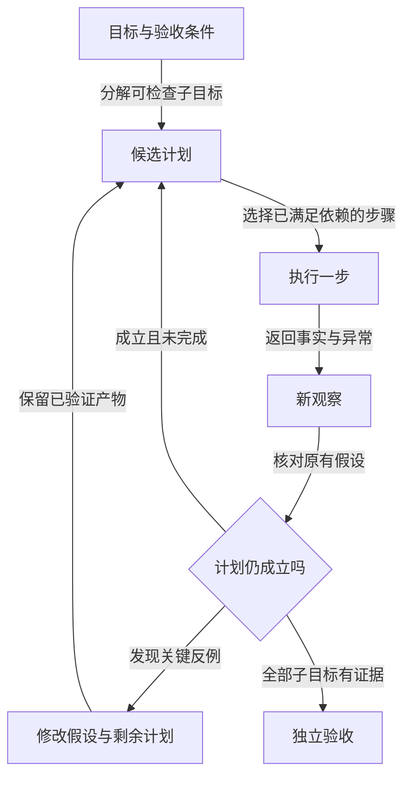

[回到知识图中的 A3](/learn/agent?node=A3) · [本组导读](/learn/agent/03-agent-loop)

## 先看问题：步骤越多，系统就越聪明吗

一个研究报告任务可以写成“查资料、读数据、分析、写报告、复核”。这看起来像计划，但没有说明何时应改变分析方法、查资料需要查到什么程度、复核失败后应退回哪一步。把几个动词排成清单，解决的是展示顺序，不一定解决决策问题。

本节属于大模型应用架构与任务编排。先修是控制流、任务依赖和 Agent 的观察—行动循环。你要学会依据任务中的未知量选择固定工作流、运行时规划或多 Agent，而不是把更多角色和更多轮数视为自然升级。以下研究助理、时间和成本均为教学假设。

## 从“下一步是否已经知道”区分两种控制

如果一份输入必须先通过格式检查，再进入分析，最后归档，这些步骤和条件在执行前就能写清楚。程序可以控制路径，模型只负责其中某个判断或生成节点。即使流程里调用了很多次大模型，它仍然可以是固定工作流。

如果必须读到当前数据和错误信息后，才能决定下一步查资料、改代码还是增加诊断，那么控制路径依赖运行时获得的新证据。让模型在这些选择点参与决策，就是动态 Agent 常见的用途。Anthropic 对预定义工作流和模型动态控制过程的区分，是一种有用的架构语言；现实系统往往混合二者。[Building effective agents](https://www.anthropic.com/research/building-effective-agents)

本节说“运行时规划”，是指根据新观察制定和调整行动计划。它与算法课中的“动态规划”，即用状态递推复用重叠子问题结果，不是同一个概念。

一个稳妥的边界是：外层程序固定权限、预算、可恢复状态和验收；内部某些探索步骤允许模型选择。这样模型不需要临时决定是否检查权限，也不会因为“计划调整”而绕过验收。

## 一个计划至少需要三类信息

计划不只是待办事项。它应包含子目标、依赖和完成证据。例如：

| 子目标 | 前置条件 | 可以验证的完成证据 |
| --- | --- | --- |
| 确认数据含义 | 数据文件可读 | 字段说明、单位、缺失值统计 |
| 选择分析方法 | 已知任务目标与数据性质 | 方法理由、假设与备选方案 |
| 运行分析 | 输入版本和配置固定 | 执行 ID、退出状态、产物引用 |
| 编写报告 | 有可核验结果 | 结论与数据、来源之间的对应 |

为什么依赖重要？如果尚未确认数据单位，就先解释数值大小，后面可能整段返工。为什么完成证据重要？因为模型可以把“准备运行”写成“已运行”，而一条有执行 ID 和日志引用的记录更容易被独立核查。



重规划不应抹掉全部历史。假设数据解析已经成功，只是模型拟合不满足条件，那么可以保留解析产物，重新选择分析方法。哪些成果可复用，取决于它们是否依赖被推翻的假设。这个判断与构建系统中“哪些输入变化会使缓存失效”具有相同结构。

## ReAct、Planner–Executor 和反思分别改变什么

ReAct 把推理和外部行动交替安排，使工具观察能够进入下一步决策。它没有要求先生成覆盖整个任务的固定计划；适合逐步探索，但可能缺少长期进度约束。需要长任务时，可以额外维护子目标和剩余预算。[ReAct 原论文](https://arxiv.org/abs/2210.03629)

Planner–Executor 将任务分解与具体执行分开。Planner 关注目标、依赖和步骤接口，Executor 处理局部细节。这样可能减少每次执行要携带的信息，也可能产生“计划写得很漂亮，执行时才发现前提不存在”的问题。因此执行器需要报告实际证据、无法满足的前提和尚未解决的问题，而不能只返回“完成”。

反思或复核增加了一次检查机会。它能否有效，取决于检查者增加了什么：新的测试、独立数据、不同的评分标准，还是只是把同一份上下文再问一遍。若两个判断共享同一个错误前提，它们的结论可以高度相关，重复赞同不等于独立证据。

例如模型 A 写分析代码，模型 B 根据函数名说代码合理，二者可能一起忽略数据泄漏。若 B 实际检查训练与测试样本标识、重跑测试并核对泄漏条件，复核才取得了不同性质的证据。这里有效的部分是检查方法，不是角色名字。

## 什么时候并行有意义：先画依赖图

假设资料检索、数据格式检查和已有代码阅读彼此独立，分别耗时 6、8、9 分钟。完全串行的等待时间约为 23 分钟；理想并行约为 9 分钟，若再花 2 分钟协调与合并，则约为 11 分钟。

$$
T_{\mathrm{serial}}\approx\sum_i T_i,\qquad
T_{\mathrm{parallel}}\approx\max_i T_i+T_{\mathrm{coord}}+T_{\mathrm{merge}}
$$

这个算例假设没有共享资源争用，并且三个子任务真正独立。若分析方法必须等数据检查结束才能确定，就不能把它们假装并行。一般任务的完成时间受依赖图关键路径和资源约束共同影响，而不是简单地用总工作量除以 Agent 数。

并行也不自动降低费用。三个 Agent 的总 token 和工具调用可能与串行相近，还会增加协调开销。它交换的是执行时间、覆盖范围与协调复杂度，需要分别计量。

## 多 Agent 的核心难点在接口和共享状态

若三个 Agent 同时改同一个脚本，它们可能互相覆盖修改。把第三个模型叫做“协调员”，并不会自动解决并发写入。更可靠的分工是让子任务拥有独立产物，由一个明确的合并步骤检查兼容性。

可以给每个子任务如下输出契约：

```text
目标：回答一个明确的局部问题
输入：固定版本的数据、问题与允许的工具
产物：结论、原始证据引用、生成文件、未确认事项
约束：不修改其他子任务拥有的文件
完成条件：能够由合并者运行或核查的检查项
```

当证据发生冲突时，应回到来源、版本和假设。例如一个子任务使用旧数据说明，另一个使用新文件结构，结论冲突首先是输入一致性问题，投票不能修复。没有单一真实答案的分析分歧，则需要明确取舍标准，而不是默认多数 Agent 正确。

## 怎样比较架构，才不是给复杂方案放水

先定义相同的任务集、验收方法和预算。比较单次调用、固定工作流、单 Agent 与多 Agent 时，记录成功率、延迟分布、总 token、工具费用和失败类型。若多 Agent 使用三倍预算，提高成功率是一个有价值的结果，但尚不能说明收益来自协作机制本身。

进一步可以做消融：保持预算近似，移除子任务隔离、去掉独立复核、把动态路由换成固定路由。观察哪一项改变了哪些失败类型。实验重点是找到复杂度带来的真实收益，而不是展示流程图里有多少节点。

## 自测与解释

<details>
<summary>任务有十个步骤，是否应该使用多 Agent？</summary>

步骤数量不决定并行价值。先检查依赖关系、共享可变状态和合并条件。如果十个步骤必须串行读取上一步结果，多 Agent 可能主要增加交接成本。若其中有几项独立调查且产物可核验，才有清楚的并行机会。

</details>

<details>
<summary>计划执行到一半发现数据单位不对，应该重新开始整个任务吗？</summary>

先追踪哪些产物依赖旧单位假设。文件下载和语法解析可能仍有效，数值计算、阈值判断和文字结论通常要重新核查。修改计划应以依赖失效为依据，保留仍成立的证据，避免既盲目重跑也盲目复用。

</details>

<details>
<summary>两个模型复核都说正确，为什么仍可能不可靠？</summary>

它们可能共享错误输入、提示或知识盲点，判断并不独立。应问它们是否接触了新的证据，是否运行了不同性质的检查。如果复核只是复述原结论，增加模型数量不能替代独立的输入检查、执行测试或结果验收。

</details>

## 连接总图

概念归属是**应用架构与编排策略**。先修依赖是控制流、任务图和观察—行动循环。应用联系包括：上下文隔离减少子任务干扰，工具契约明确产物接口，执行系统保护共享状态，评测提供取舍证据。多 Agent 是其中一种组合方式，不是模型本体、检索或分布式系统的上位概念。

## 位置与下一步

**知识归属：** 应用与 Agent。归属表示研究对象，不表示运行先后。

**理解前置：**

- [A1 · 观察—决策—反馈](/learn/agent/deep/agent-state-loop)：先掌握单个反馈闭环，再讨论如何拆分、调度与合并多个闭环。

**跨层联系：**

- [G2 · 预算与决策取舍](/learn/agent/deep/budget-decisions)：多 Agent 的协调和重复上下文也消耗预算，不能只看单个子任务耗时。
- [B1 · 数据结构与算法选择](/learn/agent/deep/algorithms-structures)：任务依赖可以表示成图，调度和并行收益受图结构约束。
