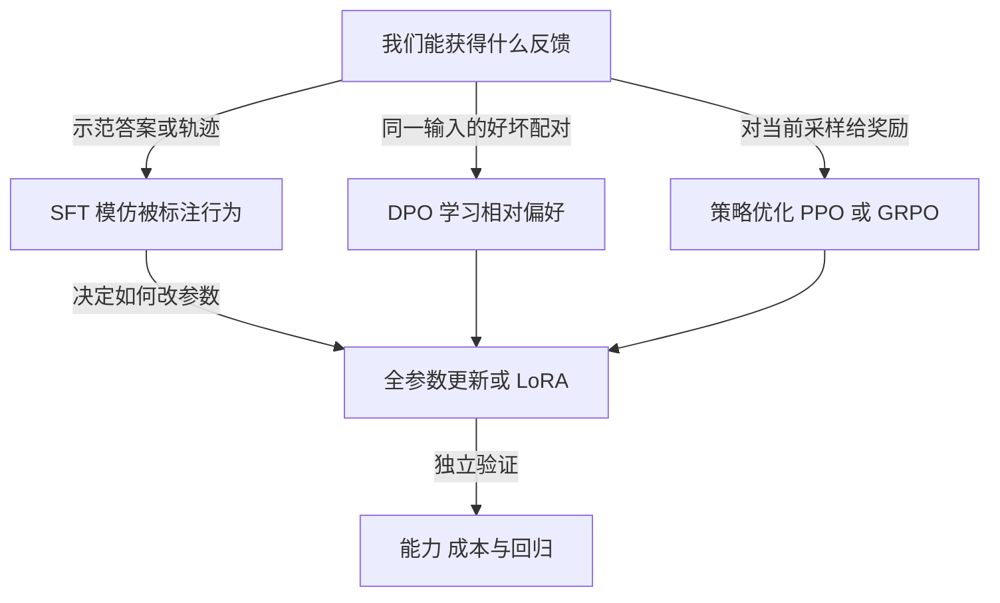

[回到知识图中的 L2](/learn/agent?node=L2) · [本组导读](/learn/agent/07-data-posttraining)

## 一个问题，为什么会有这么多方法名

**教学假设：** 基座模型能写代码，但面对数据分析任务，有时直接编造结果，有时能运行程序却不检查输出。你手中可能有三类反馈：专家完成任务的示范；两个答案谁更好的偏好；运行代码后获得的通过或失败结果。

这些反馈不是同一种信息。示范告诉模型“这里可以怎样做”；偏好告诉模型“这两个行为哪一个更合适”；奖励告诉模型“这次尝试产生了多少价值”。要理解后训练，先区分**信号、目标、可更新参数、采样过程**，再看方法名字。

本节位于“训练与适配”层，前置是 M1 的概率、损失与梯度，以及 L1 的数据和标签质量。读完应能说明某种方法需要什么数据、推动模型怎样变化，以及为什么奖励上涨仍可能损害实际任务。

LoRA 放在三条训练路线的下方，因为它限制的是参数如何更新，不是规定反馈类型。说“用了 LoRA，所以不用 SFT”相当于把优化目标和参数化方式混在一起。

## 一、SFT：提高示范行为的条件概率

监督微调使用输入 x 与目标输出 y，最大化示范输出在这个输入下的概率，等价于最小化其 token 级负对数似然：

$$
\mathcal L_{SFT}=-\mathbb E_{(x,y)\sim D}
\left[\sum_t m_t\log\pi_\theta(y_t\mid x,y_{<t})\right]
$$

m_t 是损失掩码，表示哪些 token 被监督。实际实现还会选择求和或平均方式。这个公式与 M1 的语言模型学习相连，区别主要在数据分布与监督范围。

例如教学轨迹包含“读取目录 → 找到数据 → 执行脚本 → 读取结果 → 提交”。训练输入可以包含用户要求和已观察工具结果，监督输出则是助手接下来的工具调用或回答。若把工具返回也当作助手应生成的目标，可能鼓励模型编造观察；若只留下最终报告，模型未必学到中间的验证动作。

SFT 的优势是信号明确、训练过程较直接，适合让模型获得输出格式、工具协议和基本行为模式。它的边界也来自目标：会提高示范中出现行为的概率，但不能仅凭“示范是高分的”判断其中每一步都必要。一个成功轨迹中混入冗余反思，逐 token 模仿也会把冗余一起学进去。

## 二、LoRA：把权重变化限制在较低秩的空间

设某线性层原始权重为 W₀，形状为 `d_out × d_in`。LoRA 冻结 W₀，用两个较小矩阵表示增量：

$$
W=W_0+\frac{\alpha}{r}BA,
\quad A\in\mathbb R^{r\times d_{in}},
\quad B\in\mathbb R^{d_{out}\times r}
$$

可训练参数从 `d_out × d_in` 变为 `r(d_in+d_out)`。教学算例：4096×4096 的矩阵有 16,777,216 个参数；r=8 时，两个增量矩阵共有 65,536 个参数，是前者的 1/256。α/r 是一种常见缩放方式；不同适配器变体可能采用其他缩放。

低秩不是说基座权重本身只有低秩，而是把本轮需要学习的**变化量**限制为低秩结构。这样能减少可训练梯度和优化器状态；基座权重仍要参与前向计算，激活、长序列和在线采样仍可能消耗大量显存，所以训练总显存不会自动下降 256 倍。[LoRA 原论文](https://arxiv.org/abs/2106.09685)

选择 rank、目标层和学习率，本质是在适配容量、资源和过拟合之间取舍。增大 rank 给了更多表达空间，不保证数据不足时效果更好。SFT、DPO 和某些策略优化实现都可以使用 LoRA，能否使用还取决于训练框架的具体支持。

## 三、偏好为什么不能简单变成“只学赢家”

假设同一问题有两份答案，一份正确但证据不足，另一份正确且能引用实际输出。只保留赢家做 SFT 能学到一种好行为，却丢失了“相同输入下究竟偏好哪种差别”的比较信息。

DPO 使用三元组 `(x, y_w, y_l)`：输入、较优输出、较差输出。它还使用一个固定参考策略 π_ref，典型目标为：

$$
\mathcal L_{DPO}=-\mathbb E\log\sigma\left[
\beta\left(
\log\frac{\pi_\theta(y_w\mid x)}{\pi_{ref}(y_w\mid x)}
-\log\frac{\pi_\theta(y_l\mid x)}{\pi_{ref}(y_l\mid x)}
\right)\right]
$$

先不要背公式，读里面的两项：较优答案相对参考模型的对数概率变化，减去较差答案相对参考模型的变化。DPO 要让这个差变大，从而更符合偏好标签。序列概率通常通过各个受监督 token 的 log probability 相加计算，而不是直接相乘极小数值。

**人为数值例子：** 参考模型对两份候选的概率都为 0.1，新模型给赢家 0.2、输家 0.05。两个相对倍数为 2 和 0.5，差值为 `log 2 - log 0.5 = log 4`。若 β=0.1，sigmoid 的输入约为 0.1386，偏好概率约为 0.5346。改善方向正确，却不是“赢家概率翻倍，所以已经完全学会偏好”。真实长文本的序列概率通常远小于这里的演示数值。

DPO 可以从带 KL 正则的奖励最大化目标与偏好概率模型推导出来，不要求单独训练一个显式奖励模型。它依赖偏好数据与建模假设，不是对任意人类偏好都无条件等价。β 与参考约束有关，但实际训练中的效果还受数据、优化和步数影响，不能把它当作单一“质量旋钮”。[DPO 原论文及推导](https://arxiv.org/html/2305.18290v2)

还要注意：相对偏好改善，不保证赢家的绝对概率在任何训练阶段都升高；参数共享、其他样本与归一化会共同作用。若标注者偏好更长答案，DPO 也可能学到长度偏好，除非数据和评测明确区分详细与冗余。

## 四、策略梯度：让当前模型尝试，再依据结果调整

如果我们无法提供唯一示范，但能评价一次尝试，例如程序是否通过隐藏测试，可以让当前策略采样输出 y，再用奖励 R(x,y) 调整分布。一个基本目标是：

$$
J(\theta)=\mathbb E_{y\sim\pi_\theta(\cdot\mid x)}[R(x,y)]
$$

对这个期望求导，可以得到“奖励乘以 log probability 梯度”的形式。直觉是：被采到且高回报的行为应更可能再次出现。但直接使用绝对奖励的方差可能很大，因此常减去基线，构造优势 A，衡量“比预期好多少”。

基线不是新的奖励标准。若每道题本来难度不同，获得 0.6 奖励在难题上可能不错，在简单题上可能很差。优势试图表达相对于某个预期的改进。它如何估计，会影响训练噪声、成本和偏差。

## 五、PPO 的 clipping 保护了什么

采样使用旧策略 π_old，更新后的策略为 π_θ。对某一步行为，计算新旧概率比 ρ。PPO 常用的截断代理目标为：

$$
\mathbb E\left[
\min\left(\rho A,
\operatorname{clip}(\rho,1-\epsilon,1+\epsilon)A\right)
\right]
$$

如果 A=1、ε=0.2，而概率比已经涨到 1.5，截断项只给 1.2 的收益，抑制继续沿这个方向无限增大概率的激励。若 A 为负，公式会按相应方向约束过度减小坏行为概率带来的目标收益。这个机制使同一批旧策略样本上的多轮优化更保守。[PPO 原论文](https://arxiv.org/abs/1707.06347)

**clipping 不是新策略与旧策略距离的严格硬边界。** 参数更新影响未采样行为，多个样本的梯度也会相互作用，所以概率比或 KL 仍可能超出直觉范围。实际训练需要监测偏移、梯度、奖励与回归。

在语言模型 RLHF 中，还常加入相对于固定参考模型的 KL 惩罚。这里有两个不同参照：π_old 用来计算本轮采样与更新的比率；π_ref 用来限制偏离一个较稳定的原有策略。二者不能混为一谈。KL 可以抑制过度偏离，却不能把有漏洞的奖励自动变成正确目标。

## 六、GRPO 为什么用一组答案作比较

标准 PPO 风格训练往往还要学习价值函数来估计基线。原始 GRPO 对同一个问题采样一组输出，用组内奖励的相对水平计算优势，从而省去独立价值模型。对于结果奖励，一种核心形式是：

$$
\hat A_i=\frac{r_i-\overline r}{\operatorname{std}(r)+\varepsilon}
$$

教学例子中四个输出奖励为 `[0,0,1,1]`。采用总体标准差计算时，均值和标准差都是 0.5，忽略很小的 ε，优势是 `[-1,-1,1,1]`。训练推动同一问题中更好的输出相对增加概率。原始 GRPO 还包含策略概率比、截断与参考约束；不同实现对归一化、KL 和长度权重的选择可能不同，不能仅凭算法名称推断具体目标。[DeepSeekMath 的 GRPO 定义](https://arxiv.org/html/2402.03300v3)

若一组答案全错且奖励都是 0，减去均值后没有组内差异，奖励项就不能提供有效的相对方向；其他正则项仍可能产生梯度。此时增加训练步数不等于获得新信号，可能需要更合适的任务难度、更有信息量的奖励，或先通过 SFT 建立基本能力。

省掉价值模型也不等于训练免费。一组多次采样、环境执行、评分和等待都有成本。任务越长、工具越慢，这些成本越可能超过一次反向传播。多步任务还存在信用分配问题：最终失败，不能证明每个中间动作都坏；最终成功，也不能证明每一步都值得模仿。

## 七、回到开头：怎样选方法

先验证问题位于模型行为。若模型已经读到正确材料，却不会遵循工具协议，可从经过验证的 SFT 示范入手；若基础行为已具备，且有稳定的同输入偏好数据，可以考虑 DPO；若结果能可靠验证、模型能采到有差异的候选，又有在线采样预算，可以研究 PPO 或 GRPO。LoRA 是这些路线中的参数更新选择之一。

不能用“奖励提高了多少”代替验收。教学系统若只按报告里是否写了“检查通过”给奖励，模型最容易学到的是写这句话。若奖励来自独立执行测试，则要继续检查测试覆盖、超时处理与隐藏信息隔离。训练优化会主动寻找评分函数容易奖励的行为，所以 E1/E2 的验收边界比算法名字更关键。

## 自测与答案

1. LoRA 和 SFT 是否互斥？

不互斥。SFT 指监督数据与似然目标，LoRA 指可训练权重增量的参数化方式。可以用 LoRA 做 SFT，也可以在实现支持时用于偏好或策略优化。评估时应分别记录目标、数据、适配层、rank 与资源成本。

2. PPO 的 old policy 和 reference policy 为什么不能合并理解？

old policy 描述生成当前训练样本的策略，用来构造概率比；reference policy 通常是较稳定的锚点，用来控制行为分布偏移。随着训练推进，old policy 会更新，reference 可能保持不变。clipping 和参考 KL 解决的是不同尺度的偏移问题。

3. GRPO 一组全失败，为什么不是“负反馈特别强”？

若失败奖励完全相同，组内相对优势都为 0，算法不知道哪种尝试更值得增加概率。奖励项缺少区分信号。需要检查任务是否过难、评分是否过粗、是否能提供可靠的部分进展奖励，而不是直接把所有失败想象成有用梯度。

## 知识之间的连接

**M1** 提供目标函数与梯度语言；**L1** 决定监督是否可信、是否覆盖目标分布；“预训练”解释广泛能力的来源；本节讨论如何适配行为；**E3** 用保留任务比较能力、成本和退化。训练完成后，推理服务仍负责资源，应用系统仍负责权限和真实环境状态，这些责任不会被一次微调替代。

## 位置与下一步

**知识归属：** 大模型本体。归属表示研究对象，不表示运行先后。

**理解前置：**

- [M1 · 概率、损失与梯度](/learn/agent/deep/probability-learning)：SFT、偏好和强化学习目标最终都要通过梯度改变参数。

**跨层联系：**

- [L1 · 数据反馈与分布](/learn/agent/deep/data-feedback)：训练目标无法弥补数据来源、标签和分布设计中的根本错误。
- [E3 · 对照实验与不确定性](/learn/agent/deep/causal-experiments)：训练效果必须回到冻结评测和预算一致的对照中验证。
