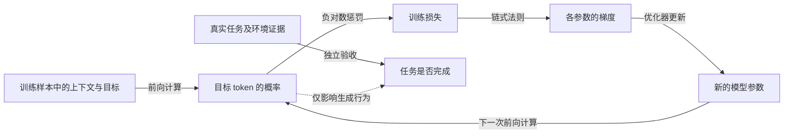

[回到知识图中的 M1](/learn/agent?node=M1) · [本组导读](/learn/agent/01-model-foundations)

## 从一个让人困惑的现象开始

**教学假设：** 一个科研助手看到“计算完成，结果文件位于……”后，总能流畅地续写一个文件名，但那个文件并不存在。把 temperature 调成 0，它仍然稳定地编出同一个名字。问题究竟出在采样、知识还是训练目标？

要回答它，必须把三件事连起来：模型给什么对象分配概率；训练怎样改变这些概率；为什么训练损失降低仍不能保证任务成功。本节读完，你应能亲手算一次参数更新，并解释“更确定地生成”和“更有证据地判断”为什么是两回事。

先记住位置：M1 解释模型如何学习；M2 解释产生概率所用的计算结构；A1 解释如何让生成行为与环境交互；E1 再判断任务是否真正完成。



实线是训练中的因果链。虚线提醒我们：生成分布会影响任务表现，但“某段文字概率高”并不是环境已满足要求的证明。

## 一、概率的条件究竟是什么

把输入记为 x，输出序列记为 y，模型参数记为 θ。自回归生成使用概率的链式分解：

$$
p_\theta(y\mid x)=\prod_{t=1}^{T}p_\theta(y_t\mid x,y_{<t})
$$

y_t 是第 t 个 token，y_{<t} 是它之前的输出。这里没有假设各个 token 独立，恰恰相反：每一项都依赖前面的内容。模型一边生成，一边改变下一步的条件。

“条件”尤其重要。模型没有读到目录列表时，预测的是“给定当前文本，什么续写常见”；读到工具返回的 `results.csv` 后，条件增加了一条环境观察。RAG、工具调用与记忆系统能改善行为，很大一部分原因就是它们改变了模型做决定时拥有的信息。

模型通常先产生一个长度等于词表大小的分数向量，称为 logits。分数可以为负，也不需要加起来等于 1。softmax 把它们变成归一化概率：

$$
p_j=\frac{e^{z_j}}{\sum_k e^{z_k}}
$$

例如三个候选的分数为 2、1、0，概率约为 0.6652、0.2447、0.0900。这些是“下一 token 是哪个”的概率。要把它变成“整个答案事实正确的概率”，还涉及多 token 语义、任务分布和概率校准，不能直接画等号。

## 二、为什么用交叉熵，而不是只数猜对几次

假设正确标签是第二个候选。只看准确率，给它 0.24 或 0.01 都算错，无法告诉优化器哪一种错误更接近目标。负对数损失保留了这个差异：

$$
\ell=-\log p_y
$$

正确标签概率为 0.2447 时，损失约 1.4076；变成 0.8 时，损失约 0.2231。若它降到 0.01，损失约 4.6052。模型把正确答案判得越不可能，惩罚越大。这里用自然对数，单位是 nats。

若真实标签写成 one-hot 向量 q，交叉熵是 `-Σ q_j log p_j`；由于只有正确位置的 q 为 1，就得到上面的形式。若标签本身是一个分布，交叉熵会同时考虑多个位置，而不再只取某一个正确类别。

语言模型把这个损失应用到每个需要监督的 token，再求和或平均。训练时常把正确前缀喂给模型预测下一 token，称为 teacher forcing。这样每个位置的训练条件已知，可以并行计算损失；推理时没有未来正确答案，必须使用自己已经生成的前缀。训练与推理的条件因此并不完全相同。

这个区别有实际后果：模型在正确前缀下预测很好，也可能在自己早期生成的错误前缀下越走越偏。Agent 中保留工具观察与纠错轨迹，是为了让系统有机会遇到并处理这些偏离。

实现时还要问清楚平均方式。按所有 token 平均，会让长样本贡献更多 token；先对每条样本平均，再对样本平均，权重就不同。在指令微调里，哪些位置计算损失也必须明确：若目标是学习助手行为，一般不会把所有用户输入和工具返回都当成助手应该生成的内容。PyTorch 的 `CrossEntropyLoss` 接收未经过 softmax 的 logits，并提供被忽略标签的处理方式；直接使用其稳定实现可以避免手工 `log(softmax(...))` 的数值问题。[PyTorch 交叉熵文档](https://docs.pytorch.org/docs/2.15/generated/torch.nn.CrossEntropyLoss.html)

## 三、梯度到底告诉了参数什么

先从多分类的一个样本推导。把交叉熵改写成：

$$
\ell=-z_y+\log\sum_k e^{z_k}
$$

对第 j 个 logit 求导：

$$
\frac{\partial\ell}{\partial z_j}=p_j-\mathbf{1}[j=y]
$$

正确类别的导数是 `p_y - 1`，通常为负。梯度下降会减去这个负值，因此倾向于抬高正确类别的分数。错误类别的导数为正，更新倾向于降低它们的分数。“概率减标签”就是 softmax 与交叉熵组合后很值得记住的局部结构。

若分类器是线性层 `z = W h + b`，其中 h 是输入表示，W 的第 j 行负责第 j 类，则链式法则继续给出：

$$
\frac{\partial\ell}{\partial W_{j,:}}=(p_j-\mathbf{1}[j=y])h^\top,
\qquad
\frac{\partial\ell}{\partial b_j}=p_j-\mathbf{1}[j=y]
$$

误差不仅会改变输出层，还能通过 h 继续传回更前面的网络。反向传播就是沿计算图复用这些局部导数，避免对每个参数单独重新计算整个模型。

## 四、亲手完成一次更新

为了把数字算到底，暂时用二分类模型：输入特征 x 为 `[1, 2]`，初始权重 w 为 `[0, 0]`，偏置 b 为 0，标签 y 为 1。这个小模型只是教学用，不代表真实 Agent 的输入特征。

$$
z=w^\top x+b,\qquad p=\sigma(z)=\frac{1}{1+e^{-z}}
$$

初始 z=0、p=0.5，二元交叉熵为 0.6931。链式法则同样得到：

$$
\frac{\partial\ell}{\partial w}=(p-y)x=(-0.5,-1),
\qquad
\frac{\partial\ell}{\partial b}=-0.5
$$

学习率 η=0.1。执行 `参数 ← 参数 - η × 梯度` 后，w 变为 `[0.05, 0.10]`，b 变为 0.05。重新前向计算得到 z=0.30、p≈0.5744，损失约 0.5544。这说明这一步更新确实提高了当前样本正确标签的概率。它没有证明别的样本也更好了。

可用下面的代码核对，而不是把 autograd 当黑箱：

```python
import torch
import torch.nn.functional as F

x = torch.tensor([1.0, 2.0])
w = torch.zeros(2, requires_grad=True)
b = torch.tensor(0.0, requires_grad=True)
y = torch.tensor(1.0)

loss = F.binary_cross_entropy_with_logits(w @ x + b, y)
loss.backward()
print(w.grad, b.grad)  # [-0.5, -1.0], -0.5
with torch.no_grad():
    w -= 0.1 * w.grad
    b -= 0.1 * b.grad
print(torch.sigmoid(w @ x + b))  # 约 0.5744
```

`backward()` 计算并累积梯度，不会自动更新参数；优化器的 `step()` 才负责更新。在通常的逐批训练中，需要清空上一批梯度；若故意做梯度累积，则应按设计的批量和缩放规则清空。计算图、梯度累积以及不追踪更新操作的原因，可对照 [PyTorch autograd 教程](https://docs.pytorch.org/tutorials/beginner/basics/autogradqs_tutorial.html)。

一批样本的损失若取平均，其梯度也是各样本梯度的平均。两个样本可能希望同一参数朝相反方向改变，更新是在它们之间折中。因此“这个样本的梯度想提高正确答案概率”是局部解释，不是保证模型更新后每道题都变好。这也是训练需要批量、独立验证和回归分析，而不能只展示一个下降曲线的原因。

## 五、什么时候训练指标会欺骗你

损失持续下降，只说明模型更适合当前训练样本与当前目标。若题目答案重复出现，模型可能记忆答案；若样本全是成功的短任务，它可能没学到恢复失败的方法；若工具日志被当作助手答案训练，它可能学会编造工具输出。问题都发生在“我们让梯度奖励了什么”这一层。

训练集、验证集和测试集承担不同职责：训练集更新参数，验证集帮助选择方案，测试集用于估计选择完成后的泛化。若不断根据同一测试集修改提示词、数据和参数，它也在间接参与优化。按行随机切分还可能把同一道题的改写、同一文档的相邻片段或同一轨迹的不同片段分到两边。需要按任务家族、来源或时间分组，具体取决于未来要推广到什么场景。

temperature 改变的是推理时从现有分布选择 token 的方式，不是重新训练事实判断器。降低温度可能减少随机性，也可能稳定地选中错误答案。要修复开头的“虚构文件”，首先考虑让 A1 调用目录工具，让 C1 保留结果，再让 E1 检查文件实际存在；只有证据显示模型反复不会使用这些信息时，才进一步考虑 L2 的训练。

## 自测：能解释因果才算掌握

<details>
<summary>1. 模型给正确 token 0.9 的概率，能否说它有 90% 概率完成任务？</summary>

不能。这个概率的事件是某个条件下的下一个 token，任务成功涉及完整序列、工具行为、环境状态与验收。还需要区分模型分布是否校准。一个概率为 0.9 的文件名 token，不会让不存在的文件变成存在。

</details>

<details>
<summary>2. 为什么正确类别的 logit 会在梯度下降后倾向于增大？</summary>

其局部导数为 `p_y - 1`，通常为负；梯度下降减去梯度，因此直接把 logit 当参数时会增大它。真实网络更新共享参数，多个样本与类别的梯度会相互作用，所以不能保证每个样本的 logit 在每一步都按这个直觉变化。

</details>

<details>
<summary>3. 验证集损失下降，但 Agent 成功率下降，先检查什么？</summary>

先核对验证数据与任务分布、loss mask、长度权重和任务评测版本是否一致，再对齐同一批任务查看工具选择、恢复与验收在哪一步退化。不能从 token 损失单独推断端到端任务改善，也不应直接断言“交叉熵没用”。两个指标测量的对象不同，需要沿系统链找到断开的环节。

</details>

## 把本节接回总图

M1 通向 **M2**，因为 Transformer 最终必须产生可学习的 logits；通向 **L2**，因为 SFT、偏好优化和策略梯度都在改变输出分布，但使用的学习信号不同；通向 **E3**，因为泛化是否改善需要独立实验。若你问的是“已知事实没有进入输入”，下一步应去 **C1/C2**；若问的是“模型声称完成但环境不满足”，应去 **A1/E1**。

## 位置与下一步

**知识归属：** 数学与学习原理。归属表示研究对象，不表示运行先后。

**理解前置：**

- [F1 · 向量、矩阵与导数](/learn/agent/deep/math-representations)：导数和链式法则解释损失怎样改变模型参数。

**后续用途：**

- [M2 · 注意力与表示](/learn/agent/deep/attention-representation)：先理解概率输出和可训练参数，再看 Transformer 怎样计算这些输出。
- [L2 · 后训练目标与算法](/learn/agent/deep/post-training)：SFT、偏好和强化学习目标最终都要通过梯度改变参数。
- [M5 · 预训练与规模规律](/learn/agent/deep/pretraining-scaling)：预训练首先是一个学习目标和数据分布上的优化问题。
- [I2 · 训练基础设施与并行](/learn/agent/deep/training-infrastructure)：训练并行必须保持梯度、参数更新与优化目标之间的语义。
- [A0 · 提示与结构化输出](/learn/agent/deep/prompting-structured-output)：提示是条件输入，结构约束不能把概率自动变成正确性。
- [C1 · 上下文选择与压缩](/learn/agent/deep/context-selection)：上下文改变条件输入而不是直接改权重，需要区分生成条件与训练目标。
