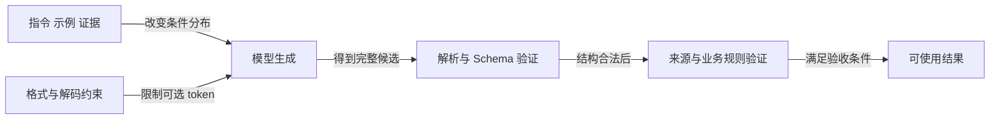

[回到知识图中的 A0](/learn/agent?node=A0) · [本组导读](/learn/agent/12-application-design)

## 先看问题：同一个模型，为什么换个问法就换了答案

假设我们从实验报告中抽取样本量、单位和结论。提示只说“整理这份报告”，模型可能写成一段摘要；提示要求返回字段，它可能生成 JSON；加上“缺失值不要猜”，结果又可能出现空值。这些变化不需要更新模型参数，但会改变模型实际生成的行为。

本节属于大模型应用中的任务表达与输出控制。先修是条件概率、token 生成和基本类型。学完后应能区分指令、示例、证据与解码约束，并解释为什么 JSON 合法不等于事实正确。报告抽取例子均为教学假设。

## Prompt 改变的是条件，不是这一轮的模型权重

对固定参数 $\theta$ 的自回归模型，一段输出的概率可以写为：

$$
P_\theta(y\mid x)=\prod_{t=1}^{T}P_\theta(y_t\mid x,y_{<t})
$$

$x$ 包含任务说明、示例和待处理材料。改变 $x$ 会改变每一步的条件分布；模型参数在通常的推理调用中保持不变。因此，prompt 是影响模型行为的输入接口，不是一段可以强制执行所有要求的程序。

“请准确回答”很难消除错误，因为它没有补足缺失信息，也没有指定如何判断准确。更有用的表达是说明数据来源、输出字段、缺失情况和验收规则。例如“仅从提供的表格抽取单位；找不到时输出 null，并给出缺失原因”，让任务边界可检查。

## 指令、示例与证据各自提供什么

指令说明要做什么，以及如何处理边界情况。示例展示输入到输出的映射，能够消除仅用语言描述时的歧义。证据提供本次任务的事实。三者混在一起时，模型可能把示例中的值复制到当前结果，也可能把材料中的一句话当作指令。

少样本提示通常是在上下文中提供少量示范，不进行梯度更新；《Language Models are Few-Shot Learners》研究了这种通过文本交互指定任务的设置。[原论文](https://arxiv.org/abs/2005.14165)

例如，抽取单位时，只给“2.5 mg → value=2.5, unit=mg”还不够覆盖歧义。可以再给一个单位缺失的例子，让模型看到缺失时应返回空值，而不是默认补成 mg。示例的价值在于展示区分规则，数量本身不是目标。

```text
任务：抽取报告中明确给出的测量值和单位。
证据范围：只能使用本次给定的原文。
缺失规则：缺失字段输出 null，不使用常识补齐。
输出：value、unit、source_quote、missing_reason。
示例：原文“读数为 2.5”对应 unit=null。
本次材料：……
```

示例也可能产生偏置：如果全部示例都是正例，模型可能倾向于总是找到答案；如果示例数值重复，它可能过度模仿。应该选取能够区分主要错误类型的代表性样本，并保留未用于调提示的测试集。

## 三种输出约束，力度并不相同

第一种是在提示中要求“返回 JSON”。它主要通过条件分布提高遵守格式的概率，仍可能有解释文字、缺字段或截断。

第二种是生成完成后解析和验证。解析器可以拒绝不合法结果，Schema 验证器可检查字段类型、必填项和枚举，但不会修改已经发生的生成过程。验证失败后是否重试，需要预算和明确的错误反馈。

第三种是受约束解码。在每一步生成时，根据当前前缀和输出规则限制可选 token。若合法集合为 $\mathcal A_t$，一种概念表示是：

$$
\widetilde P(v)=\frac{P(v)\mathbf1[v\in\mathcal A_t]}
{\sum_{u\in\mathcal A_t}P(u)}
$$

它把不允许的 token 概率置零，再在允许项中归一化。这是逐步约束的说明，不应误认为一定精确等于“原模型在所有合法完整字符串上的条件分布”。不同后端支持的语法和 Schema 子集也不同。Outlines 等工具提供类型、正则、JSON Schema 或文法等输出约束，其可用能力取决于模型与后端。[Outlines 输出类型文档](https://dottxt-ai.github.io/outlines/main/features/core/output_types/)



图中格式控制和业务校验处于不同位置。两者可以组合，不能互相替代。

## 为什么严格 Schema 也可能稳定地产生错误

假设 Schema 要求 `sample_size` 必须为整数，但原文根本没写样本量。受约束解码可以保证输出一个整数，却无法从不存在的证据中得到真实值。若接口不允许表达“未知”，你实际上在把事实缺失转化为强制猜测。

更合理的结构可能允许 `sample_size=null`，同时要求 `source_quote` 或 `missing_reason`。但这还不够：模型可能给一个数字，再引用不支持该数字的句子。因此程序还应核对原文片段确实存在，必要时增加抽取规则或人工复核。

JSON 合法是语法层，字段类型合法是结构层，数值与来源一致是事实层，结果是否适用于当前任务是业务层。把这四层拆开，才能知道该调 prompt、改 Schema、修数据还是增加检查器。

## 调 Prompt 应该像做一个小实验

先收集有代表性的输入，写清正确输出或判定规则，再保留开发集与独立测试集。根据失败分类提出一个变化，例如增加缺失值示例，而不是同时换模型、改模板和改评分器。

在同一批输入上比较旧、新提示，固定可控的模型版本与生成配置，记录原始输出。不要只看整体“感觉更好”，要分别看解析失败、漏字段、错误单位、无依据补全和正确抽取等类别。若只是把非法 JSON 变成合法但错误的 JSON，格式成功率提高不能替代任务准确率。

提示开发也会过拟合。反复查看测试集并据此加规则，会把测试集变成开发集；来自同一文档模板的近重复样本，也可能让结果虚高。可以按文档来源、模板或时间划分数据，检查改进能否迁移。

最后保存提示版本、Schema 版本、模型配置与评测口径。这样后续行为变化才能被追溯，而不是只留下“之前那个 prompt 好像更好”的印象。

## 自测与解释

<details>
<summary>Few-shot 和微调的主要区别是什么？</summary>

常见 few-shot 推理把示例放进当前输入，不通过梯度改变模型权重；微调使用训练数据更新参数。示例占用上下文，效果依赖当前输入；微调会改变之后调用的模型行为，但也需要数据、训练和独立评测。二者可以组合，不能仅按示例数量区分。

</details>

<details>
<summary>受约束解码能保证业务答案正确吗？</summary>

不能。它约束可生成的形式，无法证明数据真实、权限充分或条件适用。若允许的形式中包含错误值，模型仍可能选择错误值。缺失信息还应能以明确结构表达，而不是强迫模型输出一个看起来完整的答案。

</details>

<details>
<summary>新提示在五个例子上都更好，是否可以直接替换线上版本？</summary>

这只能说明在这五个例子上表现更好。应检查它们是否代表主要任务、是否被用于调提示，以及新规则是否破坏其他类别。至少要做独立样本回归，分别观察任务质量、格式失败和成本，再决定发布范围。

</details>

## 放回总图

概念归属是**应用层任务表达与输出控制**。先修依赖是条件概率和生成过程，应用联系包括：RAG 提供证据，上下文构造安排指令与材料，工具调用使用结构化参数，评测判断提示变化是否改善结果。Prompt 不等于整个应用，结构化输出也不等于完整的业务验证。

## 位置与下一步

**知识归属：** 应用与 Agent。归属表示研究对象，不表示运行先后。

**理解前置：**

- [M1 · 概率、损失与梯度](/learn/agent/deep/probability-learning)：提示是条件输入，结构约束不能把概率自动变成正确性。

**跨层联系：**

- [E3 · 对照实验与不确定性](/learn/agent/deep/causal-experiments)：提示改动同样需要固定评测和对照，不能靠挑选例子。
