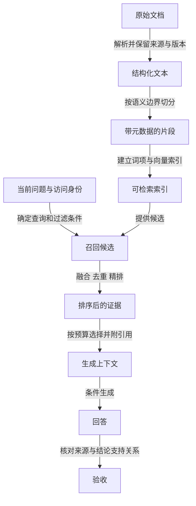

[回到知识图中的 C2](/learn/agent?node=C2) · [本组导读](/learn/agent/04-context-retrieval-memory)

## 先看问题：为什么“接了向量库”仍然经常答错

假设用户询问某个数据集第 3 版的归一化规则。系统检索到了第 2 版说明，模型完整引用并准确复述了它，最终答案仍然错。另一次系统找到了正确文档，却在切块时把例外条件和正文分开，模型得到了不完整证据。

这说明检索增强生成不是一个“向量库加模型”的单步功能。本节属于通用大模型应用中的外部知识获取机制，可用于问答、摘要、代码辅助，也可供 Agent 使用。先修是向量相似度、概率与排序。你需要能沿文档、索引、候选、排序、上下文和答案定位故障，而不把所有错误都归因于模型。

## 先拆成离线与在线两条链

离线链决定什么信息能被找到，在线链决定当前问题拿到什么信息。原始 RAG 论文把参数化模型与外部非参数化知识结合起来；今天工程中常说的 RAG 范围更广，不应把某个具体产品流水线等同于原论文的训练方法。[RAG 原论文](https://arxiv.org/abs/2005.11401)

## 切块不是按字符数剪开文档

模型最终看到的通常是片段，片段需要包含足够语义。假设一句话是“仅适用于温度低于 300 K 的样本”，如果这一条件和后面的公式被切到不同块，只召回公式就会造成错误应用。

块太短，命中可能精确但失去条件；块太长，背景占用上下文，也让多个主题混合。可以按标题、段落、函数或表格边界分块，为片段保留文档 ID、章节、版本、权限和原文位置；必要时命中子片段后补回父段落。重叠可以缓解边界问题，但会带来重复候选和额外 token，不能代替语义检查。

解析质量也很重要。PDF 的表格列错位、代码缩进丢失、单位变成乱码，这些错误在进入模型之前已经发生。若只看检索相似度，可能完全看不见它们。

## BM25：匹配词，为什么还要看词频和长度

关键词检索首先关心查询词是否出现在文档中，但“出现次数越多越相关”太粗糙。一个词在所有文档都常见，区分力小；在同一篇文章重复一百次，也不应获得无限优势；长文档自然更容易包含查询词，需要适当校正。

一种常见 BM25 写法是：

$$
\operatorname{score}(q,d)=\sum_{w\in q}\operatorname{IDF}(w)
\frac{f(w,d)(k_1+1)}{f(w,d)+k_1(1-b+b|d|/\operatorname{avgdl})}
$$

$f(w,d)$ 是词频，$|d|$ 是文档长度，$\operatorname{avgdl}$ 是平均长度。$k_1$ 控制词频收益如何饱和，$b$ 控制长度校正程度。不同实现可能对常数和统计范围作调整，不应直接比较不同索引的原始分数。[Elastic 的 BM25 解释](https://www.elastic.co/blog/practical-bm25-part-2-the-bm25-algorithm-and-its-variables)

做一个教学算例：4 篇文档中有 2 篇出现查询词，使用 $\operatorname{IDF}=\ln(1+(4-2+0.5)/(2+0.5))=\ln2$。取 $k_1=1.2,b=0.75$，平均长度 100。长度 100、出现一次的文档，得分约为 0.693；长度 200、出现三次的文档，得分约为 0.897。第二篇并没有获得三倍分数，因为重复收益饱和，而且更长的文档受到校正。

BM25 对错误码、函数名、产品编号等精确词项很有价值，但相同含义的不同措辞可能匹配不上。中文分词和领域词表也会影响结果，因此“关键词检索差”有时其实是解析或分词问题。

## 向量检索：把相关性变成几何接近

向量检索把问题映射为 $e_q$，把片段映射为 $e_d$，通过点积或余弦等相似度排序。余弦只比较方向：

$$
\cos(e_q,e_d)=\frac{e_q^\top e_d}{\|e_q\|\|e_d\|}
$$

在二维教学例子中，查询向量是 $(1,0)$，两个单位文档向量分别为 $(0.8,0.6)$ 和 $(0.6,0.8)$，余弦分数为 0.8 与 0.6。这个计算解释了排序方式，但没有证明哪个文档真实相关；相关性来自编码器训练与当前任务的匹配程度，不是几何本身自带语义。

双编码器可提前计算文档向量，使查询时检索高效；DPR 是将问题与段落分别编码来学习检索的一项代表性研究。[DPR 原论文](https://arxiv.org/abs/2004.04906)

向量检索可能把语义相似但版本错误、条件相反的段落排得很高。专有词、数字、否定关系也可能成为薄弱点。近似最近邻索引还在速度、内存与召回之间做额外取舍。所以“更接近”不等于“可用于回答”。

## 为什么召回之后还需要精排

召回阶段通常要从大量文档中迅速找出较大的候选集合。精排阶段可以对较少的候选投入更多计算，例如让模型同时读问题与候选，判断它是否真正回答当前问题。双编码器便于预计算，交叉编码器能进行更细的联合判断，但通常难以直接对整个大库逐一计算。

混合检索可以合并关键词与向量候选，但不能未经校准直接把 BM25 的 12 分与余弦的 0.8 分相加后解释大小。可以使用验证集校准的加权融合，或基于名次的融合。比如对每条检索列表的名次 $r$ 累加 $1/(k+r)$，让多个列表都靠前的文档受益；它牺牲部分分数幅度信息，换取不同评分尺度之间更容易组合。

无论精排多强，都不能把根本没召回的文档变出来。版本和权限过滤还必须贯穿检索链。不能先让模型看到无权限片段，再让它“不要引用”。

## 指标为什么要分阶段

假设一个教学问题需要两条关键证据，正确集合是 $\{d_1,d_3\}$，召回前两条是 $\{d_1,d_2\}$。此时 Recall@2 为 $1/2$，Precision@2 也是 $1/2$。前者关心需要的证据找到了多少，后者关心拿到的候选中有多少有用。标注不完整、重复切块和多种合理证据都会影响这些指标，需要写清单位与口径。

排序指标回答有用证据是否靠前；上下文检查回答它最后有没有进入模型；回答评测再检查结论正确、证据支持和引用对应。引用了某篇文章，只证明有一个链接，不能证明链接内容支持所述结论。

在严格依赖指定证据的教学任务中，可以用条件概率拆解成功路径：

$$
P(\text{成功})=P(R)P(C\mid R)P(A\mid C,R)
$$

$R$ 表示取到必要证据，$C$ 表示证据被正确送入上下文，$A$ 表示据此回答正确。若三项分别为 0.9、0.8、0.85，乘积为 0.612。这里是条件分解，不是假定各阶段独立；也不适用于允许模型从其他来源答对的所有任务。它的用途是提醒我们：单独优化最后一环，无法修复上游缺证据。

## 自测与解释

换了更强的生成模型，回答质量几乎没变，应先查哪里？

先抽查失败问题的原始文档是否存在、解析是否正确、候选是否覆盖关键证据、版本过滤是否正确、最终上下文是否保留条件。若证据从未到达模型，更强生成模型不一定能改善；可以用人工选取的正确证据做对照来分离检索与生成问题。

召回数量从 5 改到 50，Recall 提高，为什么答案可能变差？

更多候选可能引入重复、过期或表面相似的干扰，占用有限上下文并改变证据排序。召回候选数与最终送给模型的证据数可以不同。需要结合精排、去重和预算选择，并用端到端结果检查收益。

向量相似度为 0.9，能解释为答案有 90% 正确概率吗？

不能。它是某个表示空间和相似度定义下的分数，通常没有经过答案正确率校准。即使同一系统中高分更常对应相关文档，也需要在具体任务和分布上验证，更不能跨编码器或索引直接比较。

## 放回总图

概念归属：RAG 属于**大模型应用的知识获取与生成组合机制**。先修依赖：文本表示、向量几何、排序和评测。应用联系：上下文工程决定证据如何进入模型，记忆可以提供可检索的历史材料，Agent 可以动态决定是否继续检索。RAG 不要求 Agent，Agent 也不一定需要向量数据库。

## 位置与下一步

**知识归属：** 应用与 Agent。归属表示研究对象，不表示运行先后。

**理解前置：**

- [C1 · 上下文选择与压缩](/learn/agent/deep/context-selection)：检索负责补充缺失信息，召回数量必须服从上下文和证据预算。

**跨层联系：**

- [E1 · 评测契约与统计口径](/learn/agent/deep/evaluation-contracts)：端到端失败需要分解到召回、排序和生成，才能定位责任。
- [P2 · 信任边界与安全](/learn/agent/deep/trust-boundaries)：检索结果是外部数据；相关性高不等于有权控制系统行为。
- [B1 · 数据结构与算法选择](/learn/agent/deep/algorithms-structures)：哈希、倒排和近邻索引决定检索候选生成的复杂度与召回边界。
