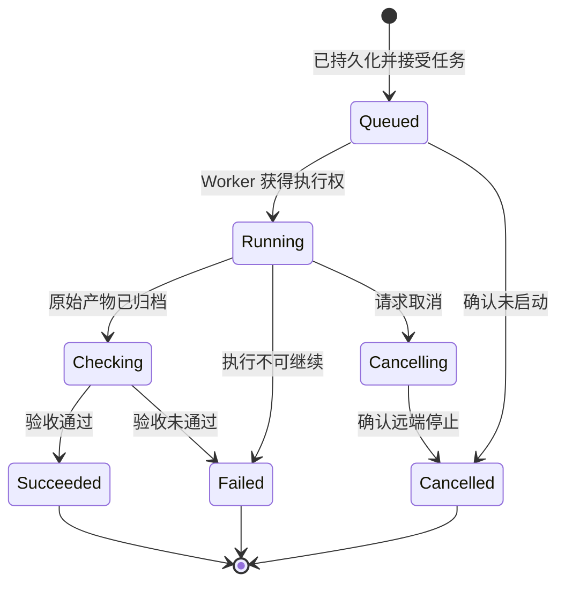

[回到知识图中的 P1](/learn/agent?node=P1) · [本组导读](/learn/agent/08-engineering-delivery)

## 从一个可运行脚本到一个可交付服务

假设你已写好一个研究助理脚本：读数据、调用模型、运行工具、保存报告。你在自己的电脑上能跑通，不代表其他人可以放心使用。使用者还需要知道提交是否被接受、任务进行到哪一步、刷新页面后能否找到结果、取消是否生效、失败后该怎么办。

这些问题没有改变模型本身，却决定了系统能否成为产品。本节把接口、任务状态、可观测性和交付连接起来，解释它们为什么是同一个生命周期的不同视图。案例是教学设计，不代表已上线平台。

## 接口承诺的应该是什么

一个耗时十分钟的任务，如果放在一个同步 HTTP 请求里等待，浏览器、网关或客户端中途断开时，用户就会失去结果入口。即使后端继续运行，也很难区分“提交失败”和“连接丢失”。

一种常见设计是将提交与执行分开：提交接口先完成身份、参数和幂等检查，持久化任务记录，再返回 task_id；后台 Worker 执行；状态接口和结果接口围绕这个稳定标识查询。提交成功表示系统接收了责任，不表示业务任务已经完成。

```text
POST /tasks       提交任务，返回 task_id
GET  /tasks/{id}  查询权威状态与进度
GET  /tasks/{id}/artifacts  查询可用产物
POST /tasks/{id}/cancel    请求取消
```

接口路径只是例子。关键是返回值、错误分类和状态含义要一致。取消请求被接受，也不必然意味着远端进程已经停止；可以先记录 cancel_requested，再由执行器确认 cancelled，防止 UI 提前宣告资源已释放。

## 用状态机表达责任，而不是装饰界面

状态机至少应该区分等待、执行、验收、成功、失败和取消等阶段，并规定哪些转换允许发生。验收失败与执行失败可以共享终态展示，但需要不同原因码。



这里没有画所有恢复路径。真正的系统要明确：Worker 崩溃以后由谁重新获得租约，能否接回原任务，哪些终态不可被旧 Worker 覆盖。状态机描述合法变化，事务和 fencing 等机制负责在并发下执行这些规则。

进度也不一定是一个可靠百分比。开放式 Agent 往往不知道总共需要多少步，显示“完成 80%”可能是假精确。可以展示已完成阶段、当前动作、最近心跳时间和待验收项，让进度信息对应真实证据。

## 前端流式展示和后台真实状态

流式输出可以改善用户等待体验，但 token 已经显示不代表任务已成功。前端应区分模型正在生成、工具正在执行、系统正在验收。页面关闭也不应成为唯一任务状态来源。

如果采用事件流，给事件稳定标识或序号，并设计断线后的补拉方式。用户重新连接时，先读取权威任务状态，再根据事件游标补齐展示。不要简单把重连后的输出追加到旧文本末尾，否则重复事件可能造成重复展示或错误进度。

这说明聊天 UI 只是系统的一个观察窗口。它不应该承担数据库、任务队列或恢复日志的责任。

## 日志、指标和轨迹分别回答什么

指标适合观察聚合趋势：排队任务数、完成率、延迟分位数、模型费用和工具失败比例。日志记录离散事件和细节。分布式 trace 通过关联 span 表达一次请求跨越多个组件的过程。三者互补，不能靠其中一个替代所有诊断。有关术语可参考 [OpenTelemetry Signals](https://opentelemetry.io/docs/concepts/signals/)。

假设用户说“今天比昨天慢”。指标先告诉你 p95 总时长升高；trace 显示主要增加在工具排队，而非模型生成；日志再解释某类任务反复重试。没有这条证据链，团队很容易先改提示词或换模型，最终没有触及瓶颈。

Agent 的业务轨迹还包含任务版本、模型配置、上下文构造、动作参数、观察、评分和产物引用。它与基础设施 trace 有重叠，但目的不同：前者解释任务决策与结果，后者定位分布式运行过程。可以用 task_id、run_id、tool_call_id 和 trace_id 建立关联，而不必把所有大文本塞进 span 属性。

## 一个具体的诊断过程

教学假设：本周 100 个任务中有 15 个未交付，系统指标显示错误率上升。第一步把失败分为输入拒绝、模型未满足任务、工具执行失败、验收故障和结果回收失败。它们对用户都可能是未完成，但修复方法不同。

第二步看版本与时间分布。如果 12 次发生在一次工具服务发布之后，而且同样输入在旧版上能完成，那么工具变更是待验证的假设。这里还不能宣布因果成立，因为任务构成也可能变了。

第三步用固定输入和固定 Agent 配置对照两个工具版本，检查相同的调用与产物。若差异可复现，再修复和回归；若无法复现，继续观察资源、时序或数据版本。可观测性并不自动给出答案，它提供构造和排除假设的证据。

## 什么才是交付指标

接口返回 200 可以作为接口可用性指标，却不一定代表用户获得有效结果。Agent 服务可以同时记录接收成功率、预算内完成率、验收通过率、有效结果费用和人工复核时间。不同分母应写清，避免只保留最漂亮的一个。

例如 100 次提交中 10 次输入非法，90 次被接受，其中 75 次在预算内交付。按全部提交算为 75%，按被接受任务算约 83.3%。两个数字都可报告，但不能在前后版本比较时悄悄切换分母。

若要讨论 SLO，应先选择真正对应服务承诺的指标，再确定观察窗口与目标。不要把某个模板中的“99.9%”直接复制过来；可接受失败率取决于业务风险、成本和当前系统能力。

## 发布与恢复是设计的一部分

版本不仅是代码 commit，还可能包括模型、提示、工具 schema、任务数据、评分器和运行镜像。否则“回滚到昨天”只能恢复部分系统，结果仍可能不同。

部署前要验证一个完整任务能够从提交走到产物与验收；发布后再用受控样例检查真实依赖。配置变更和数据库迁移应考虑兼容窗口，避免旧 Worker 与新 API 对状态字段含义不同。保存产物与任务元数据应明确保留周期，并防止调试日志泄露敏感输入。

在 FDE 或应用交付场景中，这些能力可以迁移为：理解客户的验收目标，把现有数据和权限边界接入系统，交付可运行的闭环，再用证据定位真实使用中的问题。并不要求每个项目都先建一套庞大的平台。

## 自测与答案

<details>
<summary>用户刷新页面后任务不见了，首先怀疑什么？</summary>

先检查任务是否持久化、身份与查询范围是否一致、UI 是否只依赖内存中的会话对象。模型生成内容丢失与任务记录丢失是不同问题，应沿提交记录、task_id、状态查询和前端恢复逐步定位。
</details>

<details>
<summary>为什么工具错误日志很多，未必能说明系统更不稳定？</summary>

可能只是观测覆盖提高、日志级别改变或任务量增加。需要固定统计口径，观察独立任务的失败比例、是否恢复以及最终交付结果，不能只比较日志条数。
</details>

<details>
<summary>怎样向非技术同学解释可观测性？</summary>

“像一张可追溯的检查单：总表告诉我们最近是否变差，过程记录指出卡在哪一段，细节记录帮助解释为什么。它让我们依据发生过的事排查，而不是凭感觉换一个零件。”再补充记录本身也可能缺失或有偏，需要检查完整性。
</details>

## 继续追问

B2/B3 提供通信与持久化基础，R1/R2/R3 让状态机在并发和失败下成立，E1/E3 让指标能够支持判断，P2 限定记录和执行的权限。工程交付把这些机制连接到用户真正拿到的结果。

## 位置与下一步

**知识归属：** 基础设施与平台。归属表示研究对象，不表示运行先后。

**理解前置：**

- [R1 · 并发、队列与背压](/learn/agent/deep/concurrency-queues)：服务要在有限资源下接收任务，队列、背压与超时决定可交付性。
- [B4 · 测试与交付链路](/learn/agent/deep/testing-delivery)：服务发布需要可重建版本、验证边界和恢复路径。

**跨层联系：**

- [E3 · 对照实验与不确定性](/learn/agent/deep/causal-experiments)：日志、指标和轨迹为对照实验提供可追溯的测量证据。
- [A4 · 应用架构与技术选型](/learn/agent/deep/application-architecture)：架构中的每个组件要成为可观测、可运维的交付对象。
