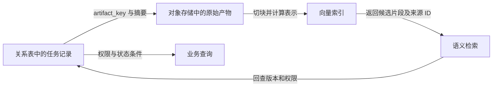

[回到知识图中的 B3](/learn/agent?node=B3) · [本组导读](/learn/agent/10-foundations)

## 为什么把所有东西放进一个向量库并不够

假设系统要回答两种问题：“用户上次分析得到了什么结论？”以及“编号 42 的任务现在是否完成、费用有没有扣过？”前者可能需要语义检索，后者需要准确状态与并发约束。相似度很高的一段历史文字不能替代权威任务记录。

本节从数据表示与查询方式解释内存、关系数据库、对象存储和向量索引的分工。读完后，你应能为一个查询设计基本索引，理解事务隔离为什么影响并发更新，并说清“大文件在哪里、状态在哪里、语义检索入口在哪里”。

## 内存中的值与持久化事实有什么区别

进程内字典访问方便，但进程崩溃后通常丢失。持久化的目标是让某些已确认的事实在故障后仍可恢复。真正的保证取决于存储系统、写入确认方式、复制和故障模型，而不是只要调用了一个名为 `save` 的函数。

缓存适合保存可以重新计算或重新读取的内容；业务账目、任务意图和当前所有权则需要明确权威来源。缓存可能过期、被淘汰或暂时不同步，因此读取命中并不自动证明它是最新事实。系统应规定哪些决定允许用缓存，哪些必须核对权威状态。

## 关系表先表达约束，再讨论查询速度

一个任务表可以包含 `id`、`owner_id`、`status`、`created_at`、`input_hash` 和 `artifact_key`。主键唯一定位一条业务记录，外键表达记录之间的关系，唯一约束阻止不允许的重复。表不仅是一组 JSON，也是一组可由数据库执行的约束。

教学数据如下：

| id | owner_id | status | created_at |
| --- | --- | --- | --- |
| 41 | u1 | succeeded | 09:00 |
| 42 | u2 | succeeded | 09:02 |
| 43 | u1 | running | 09:03 |
| 44 | u1 | succeeded | 09:05 |

要找 u1 最新成功任务，结果应为 44、41。数据只有四行时，全表扫描很便宜；有几百万行时，扫描所有行、筛选再排序的代价可能变大，于是需要索引。

## B-tree 索引为什么能减少读取

B-tree 类索引维持有序的键结构，把很多键放在一个节点中，利用较大的分支因子减少逐层定位所需的访问。它不是把数据库变成一张神奇字典，而是提前维护一种适合等值、范围和排序访问的组织方式。PostgreSQL 的 B-tree 支持常见比较与有序访问，其他索引类型对应不同查询需求。[PostgreSQL 索引类型](https://www.postgresql.org/docs/17/indexes-types.html)

```sql
CREATE INDEX jobs_owner_status_time
ON jobs (owner_id, status, created_at DESC);

SELECT id, created_at, artifact_key
FROM jobs
WHERE owner_id = 'u1' AND status = 'succeeded'
ORDER BY created_at DESC
LIMIT 20;
```

这个复合索引先按用户分组，再按状态分组，组内按时间排序，因而与查询中的等值条件和排序需求相配。数据库可能直接定位相关范围，读取前若干结果，减少无关扫描和排序。不过是否选择它仍取决于表大小、数据分布、统计信息与成本模型，应查看执行计划和实际扫描行数，不能仅凭创建成功就宣布优化生效。

如果查询不限定用户，却只按时间找全站最新结果，这个索引的排列就未必合适。索引顺序与查询形状有关。更多索引也有代价：占用空间，每次新增或更新相关字段时要维护索引。不能给每个字段都加索引后就忽略写入成本。

## 事务为什么不是“几条 SQL 放一起”这么简单

假设用户剩余预算为 10，两个并发任务各消费 3。若二者都先读出 10，再各写回 7，最终余额为 7，正确应为 4。这叫丢失更新：两个独立计算覆盖了彼此的修改。

可以用原子条件更新，让数据库在更新时同时检查余额：

```sql
UPDATE accounts
SET budget = budget - 3
WHERE user_id = 'u1' AND budget >= 3;
-- 必须检查影响行数；0 行意味着没有完成扣减。
```

若还要同时创建任务，就把扣减和任务记录纳入适当事务，并检查约束。更复杂的跨行规则可能需要行锁、版本比较或更强隔离；发生序列化失败后也可能需要按协议重试整个事务。

隔离级别描述并发事务可观察哪些变化，而不是简单的“有事务或没事务”。例如 PostgreSQL 的 Read Committed 通常在每个语句开始时获得对应快照；同一事务中的不同语句可能观察到不同的已提交状态。Serializable 提供更强的可串行化目标，但也要求应用处理被中止的事务。[PostgreSQL 隔离级别](https://www.postgresql.org/docs/17/transaction-iso.html)

## 对象存储保存产物，数据库保存可解释的关系

分析报告、模型权重和大日志适合以对象保存，通过键和可选版本标识获取。对象存储通常将内容视为字节，而不会自动理解“报告属于哪个任务、谁有权限读取、当前哪个版本已验收”。这些关系可以保存在数据库中。[S3 对象模型](https://docs.aws.amazon.com/AmazonS3/latest/userguide/UsingObjects.html)



一种可理解的交付流程是先写不可变对象，计算摘要，成功后在数据库里提交“这一任务使用这一产物”的指针。中间失败可能留下孤立对象，需要清理机制；如果先提交指针再上传，读者可能拿到不存在的产物。跨存储系统没有自动共享一个事务，设计时要明确顺序、重试和修复路径。

## 向量索引提供候选，不提供事实裁决

向量表示把文本等对象映射为数值向量，用距离或相似度寻找相近内容。精确扫描可以算所有向量的距离；规模很大时，近似最近邻索引用一定召回损失交换速度和资源。HNSW 通过分层邻近图组织搜索，是一种典型方法。[HNSW 原论文](https://arxiv.org/abs/1603.09320)

检索到“任务 42 已完成”的旧日志，不代表当前权威状态仍是完成。检索结果还要带来源 ID、版本、时间和权限条件。向量近邻误差与嵌入语义误差也不同：即使近邻搜索完全准确，表示空间里距离最近的文本也未必能回答问题。

因此，关系查询适合明确条件和约束，全文检索适合词项匹配，向量检索适合语义候选；系统可以组合它们，而不应把一种检索方式当作所有存储问题的答案。

## 自测：按查询和约束选择存储

<details><summary>任务表加了索引，查询仍然慢，应先判断什么？</summary>

先看查询条件是否匹配索引顺序、实际返回比例、执行计划、扫描行数和排序，再看锁等待与 I/O。若要读出表中大部分记录，全表扫描可能本来就更合理；若慢在锁等待，增加索引也未必解决业务争用。

</details>

<details><summary>向量库中已经保存了所有历史消息，是否还需要任务状态表？</summary>

需要明确的权威状态来源。历史消息描述曾经观察到什么，向量检索返回相关候选；状态表表达当前业务事实及其更新约束。两者可互相引用，但不能用相似消息替代唯一任务身份、所有权和事务更新。

</details>

<details><summary>文件上传成功但数据库提交失败，该怎么办？</summary>

保留可识别的对象 ID 与任务意图，按照协议重试关联或回收孤立对象。不能把未关联对象直接当成已交付，也不应在结果未知时盲目删除可能仍被使用的对象。若采用不可变键和摘要，可更容易识别重复上传与恢复。

</details>

## 回到知识图：存储既支持检索，也支撑正确性

数据结构解释索引怎样加速查询；数据库隔离连接 R2 的事务；对象与版本支持 R3 恢复和 E1 评测复现；向量索引连接检索与记忆。模型上下文、检索缓存和权威状态处于不同层，区分它们是建立可靠大模型系统的重要基础。

## 位置与下一步

**知识归属：** 计算机与软件基础。归属表示研究对象，不表示运行先后。

**后续用途：**

- [R2 · 幂等与事务边界](/learn/agent/deep/idempotency-transactions)：唯一约束、事务与持久化为去重和状态提交提供具体机制。

**跨层联系：**

- [C3 · 记忆与权威状态](/learn/agent/deep/memory-state)：记忆更新需要有版本、有来源的存储，避免覆盖掉权威事实。
- [I2 · 训练基础设施与并行](/learn/agent/deep/training-infrastructure)：训练 checkpoint 必须持久化并关联数据位置与优化器状态。
