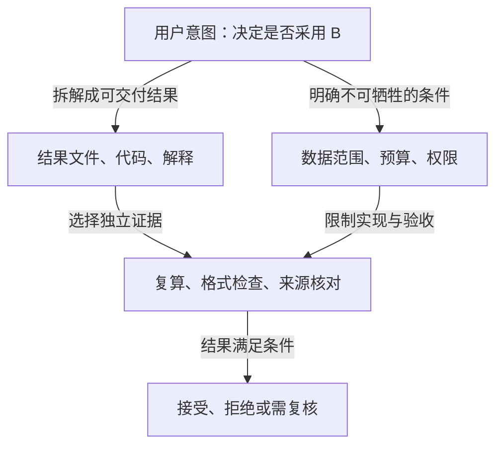

[回到知识图中的 G1](/learn/agent?node=G1) · [本组导读](/learn/agent/06-evaluation-experiments)

## 从“帮我分析一下”到一个可判定的任务

假设有人给研究助理一份实验数据，说：“比较两种方法，写一份可靠的分析报告。”这个要求在交流中自然，在程序中却不够确定。比较什么指标？缺失值如何处理？报告必须附代码吗？允许使用哪些数据？若结果没有显著差异，是否仍算完成？这些未决定的事情会被模型、开发者或评分器各自补上，最后得到几种互不一致的“正确”。本节的例子都是教学假设。

你要学会的不是写一张很长的需求表，而是把**用户关心的结果、系统可观察的证据、允许采用的过程**分开。这样才能解释为什么流畅报告、程序成功退出和业务目标完成不是同一个事件。

## 先区分四个对象

**意图**是用户为什么提出需求，例如决定是否将方法 B 替代方法 A。它通常无法直接转化成一个布尔判断，因为还涉及成本和风险。

**交付物**是最后应当拿到什么，例如 `analysis.py`、固定格式的 `results.json` 和说明报告。它是意图的承载形式，不是意图本身。报告文件存在，只证明交付物中有一个对象。

**验收条件**是怎样根据证据判断这次交付是否满足要求。例如结果必须可在指定数据版本上复算、指标定义一致、不能把测试数据用于调参、解释必须区分观察结果与推测。

**约束**是实现中不能越过的边界，例如只能读取指定目录、不得上传原始数据、运行时间不超过 15 分钟。一个结果即使数值正确，也可能因为违反约束而不能交付。

把四者混成一句“回答质量要高”，会让实现和评测都失去抓手。它们不是越细越好，而是需要细到不同执行者能对关键边界达成一致。



图中的验收从用户意图和约束共同派生。若先写一个容易实现的评分器，再把它的得分当目标，系统可能学会提高分数，却没有更好地完成任务。

## 一次具体的契约推导

先问这份报告会触发什么决定。假设用户要知道 B 是否值得进入下一阶段验证，而不是要求 B 必须胜过 A。于是“没有发现明显提升”也可以是正确结果，不能把正结论写成验收条件。

再固定比较对象。假设数据版本为 `dataset-v3`，指标为 40 个独立样本上的平均绝对误差。明确缺失值规则，避免 A 排除了困难样本、B 使用全部样本，却仍拿两个均值比较。

然后决定需要哪些独立证据。JSON 中写一个均值不够；验收器应读取逐样本预测并复算。报告中的“提升”应能连接到两组同样本结果。这里的独立，指验收证据不完全依赖被评对象的自述；不意味着验收器绝对不会错。

最后处理不确定性和失败。数据文件损坏、模型无法完成分析、评分进程崩溃是三种不同情况。可以为面向用户的交付率都记为未完成，但诊断字段应保留原因。否则模型迭代会替环境故障承担责任。

一个最小契约可以是：

```yaml
task_version: analysis-v1
input:
  dataset_version: dataset-v3
  sample_ids: fixed-40
output:
  required: [analysis.py, predictions.csv, results.json, report.md]
checks:
  - predictions cover exactly the required sample ids
  - metric recomputed from predictions matches results.json
  - report conclusion is supported by paired results
constraints:
  allowed_data: /workspace/input
  deadline_seconds: 900
  allow_external_upload: false
```

这只是声明。真正的执行系统还需要把权限和截止时间变成可执行的控制，验收器则要把检查变成代码或明确的人工判断协议。不能因为 YAML 写着不允许上传，就认为上传已经被阻止。

## 从目标到指标，中间会丢掉什么

设真实目标是用户获得的价值 U，自动评分器测得分数 S。我们希望提高 S 时通常也提高 U，但二者并非同一个变量。一个报告可以通过所有格式检查，却使用错误单位；也可以因为等价表达未被评分器识别而被扣分。前者是验收遗漏，后者是验收过窄。

因此需要将指标分成几层：交付物是否完整、结果是否符合事实、解释是否足以支持决策、过程是否满足约束。不要简单把它们加权成一个总分后丢掉分项。总分相同的两个方案，可能一个经常超预算，另一个主要是解释不完整，修复方向完全不同。

如果某项是硬约束，例如不得泄漏数据，那么用“其他项高分”补偿它通常不合适。可以先判是否符合硬约束，再在合格结果之间比较质量与成本。这是一种业务决策，不是数学天然要求；应把采用的规则写明。

## 可测量不等于值得优化

假设方案 A 在 100 个任务上交付 85 次，平均费用 1 元；方案 B 交付 90 次，平均费用 6 元。如果任务价值很高，B 可能合适；如果只是低风险批量整理，A 可能更好。这里不存在脱离使用场景的“更强”。只有先固定目标和约束，比较才有意义。

也不要为了量化而选最容易计数的东西。报告数量、调用次数、覆盖的工具数描述工作量或系统规模，不能单独证明用户问题解决得更好。更接近价值的是在明确输入范围和预算下，可验证地交付了多少任务、节约了多少人工复核、仍有哪些失败类别。数字必须有分母、时间窗口和测量方式。

## 如何把契约用到研发过程

在实现前，准备少量正常样例和反例：空报告、格式正确但数值错误、引用不存在的来源、使用错误数据版本、环境不可用。它们不是完整评测集，而是检查团队对“完成”的理解是否一致。

当这些例子的预期判断仍有争议时，先解决规则，而不是急着写更多 Agent 代码。规则明确后，再把一个任务从输入一直跑到独立验收，形成最小的完整闭环。增加题量和并发应发生在这个闭环可解释之后。

相关的原始讨论可参考 Anthropic 对 [task、trial、grader、outcome 与 harness 的区分](https://www.anthropic.com/research/demystifying-evals-for-ai-agents)。本节的实验数据与验收清单是自建教学例子，不是该文案例或真实业务成果。

## 自测：先判断，再看解释

<details>
<summary>模型写出了完整报告，但没有提交可复算代码，算完成吗？</summary>

取决于事先确定的交付契约。如果要求可复现，缺代码就是未满足条件；如果任务只需要快速概览，强制要求代码可能是后加的标准。关键在于提前定义，而不是看到结果后临时移动门槛。
</details>

<details>
<summary>评分器运行崩溃，为什么不能直接当模型答错？</summary>

因为我们缺少关于答案质量的有效观察。产品交付率可以将该次计为未完成，但模型能力统计必须说明评分缺失如何处理，并报告覆盖率。两个指标回答不同问题，不能只改一个分数而隐藏故障。
</details>

<details>
<summary>怎样向不懂技术的人解释这个节点？</summary>

“先约定你最后要拿到什么、用什么证据判断它有用、哪些做法不能用。AI 写得像完成了，只是一种自述；我们还要实际核验成果。”再用同一份报告存在但数字无法复算的反例说明区别。
</details>

## 把位置接回总图

本节属于应用设计，却直接约束 A1 的停止条件、A2 的权限、G2 的预算和 E1 的评测口径。它不要求先学完 Transformer：需求可以先于实现明确；但选模型和方案时，需要再用模型、信息和系统知识判断是否做得到。

## 位置与下一步

**知识归属：** 应用与 Agent。归属表示研究对象，不表示运行先后。

**后续用途：**

- [A1 · 观察—决策—反馈](/learn/agent/deep/agent-state-loop)：先知道验收目标，才能判断动作是否使任务向前推进。
- [G2 · 预算与决策取舍](/learn/agent/deep/budget-decisions)：没有成功标准，就无法定义多花一次调用的收益。
- [E1 · 评测契约与统计口径](/learn/agent/deep/evaluation-contracts)：评分逻辑需要落实已定义的成功标准，不能反过来用容易测的量替代目标。
- [A4 · 应用架构与技术选型](/learn/agent/deep/application-architecture)：架构选择服务于真实的交付目标，而不是预先选定某个框架。
