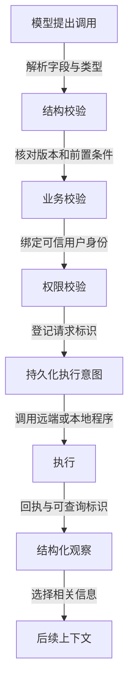

[回到知识图中的 A2](/learn/agent?node=A2) · [本组导读](/learn/agent/03-agent-loop)

## 先看问题：JSON 正确，为什么仍然可能做错事

假设一个研究助理要在指定数据集上运行分析。模型生成 `{"dataset_id":"data-7","method":"regression"}`，JSON 格式和字段类型都正确，但 `data-7` 可能属于别的用户，可能已经更新了版本，也可能根本不适合回归分析。格式约束只解决了“程序能不能读懂”，没有解决“这次操作应该发生吗”。

本节属于大模型应用的工具与接口设计。它同样适用于单次函数调用、固定工作流和动态 Agent。先修是函数参数、类型和 API 请求；学完要能分别解释结构合法、业务合法、用户授权和执行结果四层语义，并知道 MCP 位于其中哪一层。

## 工具为什么首先是一个契约

普通函数调用的调用方由程序员编写，程序员知道隐含约定。模型调用工具时，主要根据可见描述、参数约束和反馈作出决定。一个只写着“处理数据”的工具，隐藏了太多问题：处理哪个版本、是否覆盖原文件、运行多久、重复调用会怎样、失败后是否能继续。

工具契约的任务，是把这些隐含前提变成可检查的约束。可以按一次请求的生命周期理解它，而不是只记“name、description、parameters”三个字段。



这些检查不是互相替代的。结构合法的调用可以业务非法；业务合理的操作可以没有权限；已经授权的请求也可能因网络问题得不到回执。每层应产生不同的错误，让调用方知道下一步是修参数、换方案、等待授权，还是查询执行状态。

## Schema 约束到哪里为止

下面是一个教学用参数结构，具体语法可由所用 JSON Schema 实现支持的版本调整。

```json
{
  "type": "object",
  "properties": {
    "dataset_id": {"type": "string", "minLength": 1},
    "dataset_version": {"type": "integer", "minimum": 1},
    "method": {"type": "string", "enum": ["summary", "regression"]}
  },
  "required": ["dataset_id", "dataset_version", "method"],
  "additionalProperties": false
}
```

`enum` 能阻止模型拼出不存在的方法名；显式版本能让调用指向确定输入。但 Schema 无法单独回答：数据集是否存在、当前用户是否有权访问、回归所需字段是否存在、当前项目是否还有资源预算。这些条件来自数据库和业务规则，需要服务端校验。

一个常见错误是允许模型传入 `user_id` 或 `is_admin`，然后把它们当作权限依据。模型提供的参数是待校验数据。真正的主体身份应来自已认证的请求上下文，访问范围由服务端规则计算。如果业务参数中确实需要“被查询用户”，也应和“发起请求的用户”分开命名与处理。

## 工具粒度是在降低哪一种不确定性

给模型 `read_file`、`run_python` 等低层工具，组合空间大，适合开放任务，但模型需要管理更多中间步骤。提供 `analyze_dataset` 这样的高层工具，可以隐藏重复劳动，也可能把关键判断藏进黑盒。

例如“读取指定版本、检查字段、计算固定统计量、写入新结果目录”有稳定规则，可以封装成一次高层操作。至于“根据研究问题选择回归还是分类”，若没有明确规则，强行塞进同一个工具，只是把不确定性挪到工具内部。

选择粒度时，应问三个问题：中间是否需要新的信息才能决定下一步；这组操作能否有清楚的成功条件；失败后能否定位到足以恢复的阶段。工具越少并不自动越好，工具越细也不自动更灵活。接口设计的目标是让可选动作清晰、可观察、可控制。

## 返回值应该帮助下一步决策

如果分析需要几分钟，工具可以返回稳定的执行标识，而不是让一条请求永久等待。以下只是教学协议：

```json
{
  "accepted": true,
  "run_id": "run-42",
  "execution_state": "queued",
  "input_version": 7,
  "status_query": {"run_id": "run-42"}
}
```

`accepted` 说明服务接收了任务，不能写成分析已经成功。随后状态查询若超时，也不应返回 `execution_state: failed`。它可以报告 `observation_error: timeout`，同时保留上次已知状态及观测时间。

错误结构最好同时服务程序和模型：稳定的错误码供程序路由，简短说明帮助模型调整参数，必要的字段和证据路径供复查。不要把几万行日志直接塞进一个 `message`；可以返回摘要、日志引用和最后一个相关异常，允许需要时继续读取。

## 重复调用的语义必须写进契约

查询任务通常可重复，创建任务则可能每次启动一次计算。模型重试、HTTP 客户端重试和消息队列重投叠加后，同一个用户意图可能触发多次副作用。

一个可行设计是：宿主为用户的同一次执行意图生成幂等键，并将它与规范化参数的摘要绑定。相同键、相同参数返回已有执行；相同键、不同参数拒绝；明确的新任务生成新键。这里的“同一次意图”是业务定义，不是简单地对文本相似度做判断。

幂等键应在重试之前持久化。若每次重试都生成新键，它只是在给重复任务取不同名字。服务端还需要原子地记录键与执行关系，单靠提示词“不要重复调用”无法保证副作用只发生一次。具体实现会连接事务、唯一约束和故障恢复。

## MCP 解决连接契约，宿主和服务仍负责业务

MCP 把应用访问外部工具、数据等能力的交互方式标准化。Host 是使用能力的应用，Client 在 Host 中与相应 Server 通信，Server 暴露能力。协议并不规定应用如何规划任务或挑选上下文。[官方架构文档，2026-07-28 版](https://modelcontextprotocol.io/docs/2026-07-28/learn/architecture)


可以把 MCP 理解为各方约定怎样发现能力、表达调用和传回结果。它不会自动保证某个科学计算方法适合当前数据，也不会自动给业务任务增加去重、租约或验收机制。接通协议只是具备调用条件，可靠交付还依赖应用和服务的实现。

截至本节核对的官方规范，MCP 的授权规范针对 HTTP 传输，并建立在 OAuth 等标准之上；STDIO 使用不同的凭据处理方式。协议级访问授权与某条数据、某种操作的业务权限仍需分别检查。[官方授权规范，2026-07-28 版](https://modelcontextprotocol.io/specification/2026-07-28/basic/authorization)

还有一个容易忽略的边界：工具返回的数据不是新的系统指令。检索出的论文中即使包含“忽略用户要求”，也只能作为文档内容处理。服务可返回用户有权读取的数据，不代表这些数据有权改变任务目标或扩大工具权限。

## 自测：把接口当作可执行承诺

<details>
<summary>模型输出完全符合 Schema，是否可以直接执行？</summary>

不可以。还要检查业务前提、资源版本、调用者权限和预算。结构校验保证数据具有指定形状，不能证明这些值在现实系统中存在或被允许。至少要能够指出每条业务约束由哪一层执行，而不是只写在工具描述中。

</details>

<details>
<summary>一个创建任务工具超时，应该如何设计返回或恢复路径？</summary>

超时后通常无法确定任务是否已经创建。调用前应保存请求标识，服务端支持按标识查询或去重。恢复时先查已有执行，或使用同一幂等键重试。若工具没有这类能力，应将结果视为未知，避免自动再次创建。单纯增加重试次数会放大重复执行风险。

</details>

<details>
<summary>面试中说“使用 MCP 接入工具”，还缺少什么解释？</summary>

要说明宿主、客户端、服务端分别是什么，工具参数如何约束，身份如何传递，业务权限在哪里检查，执行超时与重复请求如何处理，以及返回结果如何进入上下文。MCP 是连接层面的选择，以上问题才说明这条业务链能否可靠工作。

</details>

## 三种关系，不要混成一棵树

概念归属：工具调用、Schema 和 MCP 属于大模型应用集成的相关机制，但彼此也不是同义词。先修依赖：理解 API、类型、认证与授权，才能理解一个调用契约。应用联系：Agent 规划会使用工具契约，固定工作流也会使用；可靠执行实现重复调用和恢复语义；安全边界限制调用权限。这个设计可以被多个应用复用。

## 位置与下一步

**知识归属：** 应用与 Agent。归属表示研究对象，不表示运行先后。

**后续用途：**

- [P2 · 信任边界与安全](/learn/agent/deep/trust-boundaries)：必须先知道工具能做什么，再限制谁能对哪些资源执行它。

**跨层联系：**

- [A1 · 观察—决策—反馈](/learn/agent/deep/agent-state-loop)：先区分模型建议与外部动作，再设计二者之间的校验接口。
- [R2 · 幂等与事务边界](/learn/agent/deep/idempotency-transactions)：幂等键和重复请求语义必须先成为工具契约的一部分。
