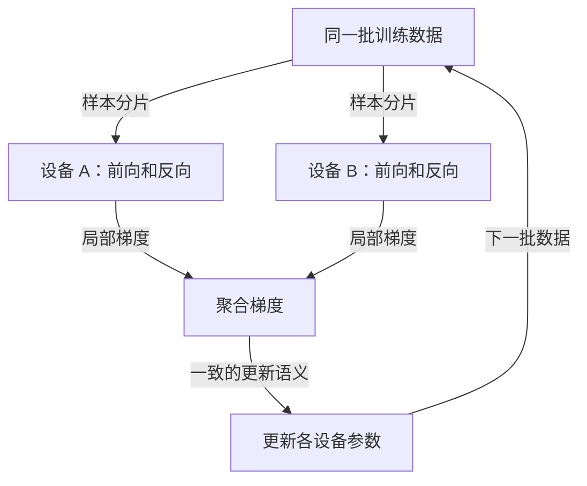

[回到知识图中的 I2](/learn/agent?node=I2) · [本组导读](/learn/agent/11-model-platforms)

## 训练为什么不能理解成“推理多跑几遍”

训练和推理可能使用同一套前向网络，但资源需求和状态不同。推理通常给定参数产生输出；训练还要保留或重新计算反向传播所需的中间量，生成梯度，并维护优化器状态。一个权重能放进显存的模型，未必能在同样的设备上完成全参数训练。

本节建立训练基础设施的入门坐标：计算、内存、通信、数据和恢复分别承担什么。它用于理解技术取舍，不代表已经具备大型集群调优经验。下面的参数规模和字节计算都是教学模型。

## 先列出显存中到底有什么

假设有 P 个参数，每个权重占 2 字节，只看推理权重需要约 2P 字节。训练还可能需要梯度、FP32 主权重、优化器的一阶和二阶状态，以及激活、临时工作区和通信缓冲。

用一种常见但并非通用的混合精度 Adam 配置举例：低精度权重 2P、低精度梯度 2P、FP32 主权重 4P、两个 FP32 优化器状态 8P，合计约 16P 字节，还没包括激活。P=10 亿时，这部分约 160 亿字节，即约 14.9 GiB。某些实现的梯度精度、主权重和状态管理不同，不能把 16P 当成所有训练框架的固定公式。

序列更长、batch 更大时，激活开销可能继续上升。因此解决“放不下”前，应先知道占用来自哪一类对象。只减少 batch，可能缓解激活，却不能减少被完整复制的优化器状态。

## 数据并行：同一模型，处理不同样本

假设一个 batch 包含 8 个样本，两张卡各计算 4 个。若目标是所有样本平均损失，可以分别求局部梯度，再按正确权重聚合，得到与整体 batch 对应的更新信号。

这里的“正确权重”很关键。若两边有效 token 数不同，简单平均两个已经各自归一化的梯度，未必等于全体有效 token 平均损失的梯度。分布式训练不仅是通信连通，还要保持损失归一化与优化语义一致。

普通复制式数据并行在每个设备上保存完整模型副本。它可以增加总处理能力，却不会自动让一个本来放不进单卡的模型放进去。梯度同步又需要通信，计算太小或网络太慢时，加卡收益会很有限。可以参考 [PyTorch DDP 的设计说明](https://docs.pytorch.org/docs/stable/notes/ddp.html)理解梯度同步机制，具体实现接口应以使用版本为准。

如果某个 Worker 在其他 Worker 等待同步时退出，剩余进程可能卡在通信操作上。训练平台必须检测失败、终止或恢复整个相关计算组，不能把普通任务队列的“换一个 Worker 就行”直接套过来。

## 状态分片：减少冗余副本

当主要问题是多个设备重复保存相同训练状态，可以把优化器状态、梯度或参数分片存储。ZeRO 系列工作就是从这些冗余出发组织优化；不同阶段分片的对象不同。FSDP 也围绕参数等状态的分片和按需通信组织执行。见 [ZeRO 原论文](https://arxiv.org/abs/1910.02054)和 [PyTorch FSDP 教程](https://docs.pytorch.org/tutorials/intermediate/FSDP_tutorial.html)。

直观地说，四张卡不再每张都永久保存某些状态的四份完整副本，而是各保存一部分；某层计算需要完整参数时，再通过通信临时获得。节省常驻内存的代价，是额外通信、执行调度和暂时聚合的内存峰值。

因此“平均除以卡数”只能作为理想化下界，不能代替真实峰值分析。某一层仍可能很大，聚合时还有缓存和激活。参数分片也不等于算子中的每次矩阵乘法都被切成几块，后者属于另一种并行轴。

## 张量并行与流水线并行

张量并行把同一个层或算子的计算分给多个设备。例如把矩阵乘法的输出维或输入维切开，再按算法需要收集或归约结果。它减少单设备承担的一部分参数和计算，但让通信进入层级计算路径，通常更依赖互联带宽和延迟。

流水线并行把不同层放在不同设备上，让微批次依次流过。它的直觉像装配线：设备 A 处理早期层，设备 B 处理后期层。但装配线启动和结束时会出现空闲阶段，各阶段耗时不平衡也会拖慢整体。

这些方式可以组合。理解时不要先背“几维并行”，先问拆的是样本、参数状态、层内计算，还是层间执行。拆分轴决定通信内容、内存节省和新的瓶颈。

## 激活重计算与梯度累积

激活重计算在前向时少存一些中间量，反向需要时再计算。它以额外计算换显存，适合激活占用较大的情况，但不能自动解决优化器状态过大的问题。

梯度累积则将大 batch 分为多个小批次，先累积梯度，再执行一次参数更新。它可以降低单次前向/反向的激活峰值，并改变更新频率。要保持与目标 batch 对应的损失缩放，且注意某些依赖 batch 的算子、随机行为和数值误差可能使执行不完全等价。

这两种机制经常一起出现，但它们改变的是不同部分。一个回答如果只说“显存不够就开 checkpoint 和 accumulation”，还没有说明问题究竟在哪里。

## 训练平台为什么还需要数据与恢复系统

GPU 空闲可能不是算子慢，而是数据读取、解压、预处理或主机到设备传输跟不上。数据管线需要控制版本、分片、随机顺序和数据位置；否则恢复以后重复或跳过大量数据，会改变训练过程。

一个可靠的训练 checkpoint 通常不只是模型权重，还要考虑优化器、学习率调度、随机状态、训练进度和数据消费位置。精确恢复要求更高，并非所有系统都能跨版本或跨拓扑完全复现；应明确目标是继续训练、近似恢复，还是逐位一致。

保存 checkpoint 也会占 I/O 和时间。频繁保存降低故障时丢失的计算量，却增加稳定运行成本；间隔应根据故障概率、保存时间和恢复代价决定。分片 checkpoint 还需要解决各分片完整性与版本的一致提交，不能仅以“目录存在”判断保存成功。

## 与 Agent Infra 的区别和联系

训练 Infra 主要协调张量计算、训练状态、数据和设备通信。模型推理 Infra 主要调度请求、token、KV Cache 和计算资源。Agent Infra 则管理更长的任务生命周期、工具调用、权限、沙箱、执行身份和恢复。

它们都需要调度、观测和故障处理，但被调度的对象和正确性约束不同。Agent Worker 可以在等待一个外部任务时让出执行资源；分布式训练的一组 GPU 却可能必须共同参与下一次同步。知道这些差别，才能判断岗位要求中的“infra”具体指哪一层。

## 自测与答案

增加数据并行卡数，为什么不一定解决单卡显存不足？

普通复制式数据并行仍让每张卡保存完整模型和相关状态。它减少每卡处理的样本或提高总 batch，并不天然分片参数与优化器。要先确认占用来源，再考虑状态分片、模型并行或激活优化。

四张卡的局部 loss 都在下降，为什么整体训练仍可能有问题？

局部损失可能采用了不同归一化、数据重复或不同版本；梯度聚合也可能没有实现预期目标。需要固定全局目标，检查数据分片、有效样本/token 权重、同步和更新计数，并用独立验证集观测效果。

保存了模型权重，为什么无法从同一步准确继续训练？

优化器状态、学习率进度、随机状态和数据位置影响后续更新。只有权重能恢复一个参数起点，不一定恢复原来的训练过程。恢复要求应在系统设计时明确，而不是故障发生后才补定义。

## 后续位置

先用 F1/M1 说明计算图与目标，再用本节理解资源拆分；用 M5 和 L2 判断训练在改善什么，用 E3 设计实验验证。若问题变成服务请求的排队与 token 生成，则进入 I1，而不是继续套训练并行的术语。

## 位置与下一步

**知识归属：** 基础设施与平台。归属表示研究对象，不表示运行先后。

**理解前置：**

- [M1 · 概率、损失与梯度](/learn/agent/deep/probability-learning)：训练并行必须保持梯度、参数更新与优化目标之间的语义。

**跨层联系：**

- [B3 · 存储、索引与数据一致性](/learn/agent/deep/storage-indexes)：训练 checkpoint 必须持久化并关联数据位置与优化器状态。
