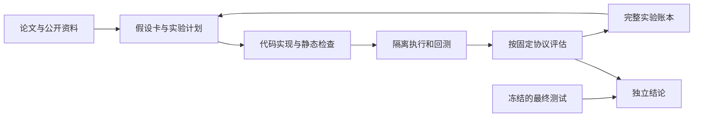

## 起点：Agent 能写策略代码，接下来最难的是什么

Agent 可以更快阅读论文、提出因子、编写代码和分析结果。困难是这些步骤同时放大了错误机会：误读公式、使用未来数据、反复适配测试集，最后生成一份很有说服力的总结。**研究自动化需要加速有效实验，也需要约束结论怎样产生。**

本层依赖[Agent 状态循环](/learn/agent/deep/agent-state-loop)、[工具契约](/learn/agent/deep/tool-contracts)与[评测](/learn/agent/deep/evaluation-contracts)，在量化侧汇合[数据](/learn/quant/market-data)、[信号验证](/learn/quant/signals-validation)和[回测执行](/learn/quant/backtest-execution)。

## 把研究拆成有边界的产物

研究者先提交假设卡：要预测什么、需要哪些字段、这些字段何时可用、适用市场与持有期、预期机制、对照基线和失效条件。开发者把假设转成代码，执行环境产生结果，评估器再按固定协议解释结果。

箭头表示研究产物的依赖。最终测试不应成为日常修改提示词的反馈源，否则它已参与优化。不同角色可以由不同进程或同一模型承担，关键是数据访问与职责边界；仅给角色换名字不会自动实现隔离。

[RD-Agent(Q) 原论文](https://arxiv.org/abs/2505.15155)和[公开代码](https://github.com/microsoft/RD-Agent)展示了研究、开发与反馈循环，以及因子和模型共同优化的路线。它适合作为实现参考，但论文回测不是对任意数据、任意部署方式的收益保证。

## 假设卡为什么比一句提示词更重要

**教学例子：**“研究财报情绪是否预测下一周收益”仍不够明确。要进一步写出：只使用公告首次公开之后的文本；情绪如何定义；下一周从哪个可交易时点开始；与简单词典及无文本基线比较；如何处理同日市场波动与行业暴露。

这些字段会决定代码与评测。若 Agent 在结果不佳后偷偷改变持有期、股票池和基线，实验已经更换问题，不能把它当作同一方案的自然优化。修改可以进行，但需要新版本和明确记录。

论文里的公式也不一定可直接运行。变量是截面排名还是时间序列排名、窗口是否包含当前样本、缺失值如何处理，都会改变实现。应先用人工小例子验证运算，再扩大到真实数据。

## 执行成功不等于实验有效

代码退出码为零，只表示程序正常结束。它可能读错字段、输出常数，或者把标签意外带进特征。环境层、数据层、实现层和策略层应该分别报告状态。

**教学例子：**总共发起 40 次实验，8 次因依赖环境故障中断，12 次因输出违反契约被拒绝，只有 20 次形成可用结果。若只在这 20 次中报告“收益为正的占比”，就遮蔽了 50% 的有效实验率。反过来，把环境失败记为策略零收益，也会污染效果比较。

因此，平台可以分别衡量有效实验比例、获得可复核结论的时间与成本、结论复现情况，以及独立评估上的效果。尝试次数增加是吞吐量信息，不能单独证明研究质量提升。

## 实验账本需要支持反驳自己的结论

每次运行应绑定假设版本、数据快照、特征与标签代码、依赖环境、模型配置、随机种子、切分、成本规则和原始输出。随机种子并不保证所有硬件与并行运算逐位相同，但有助于界定可复现条件。

保存失败与被放弃的尝试，是为了知道最优结果经历了多少选择。如果只留最终赢家，就无法评估搜索预算对结果的影响。[PBO 经典论文](https://www.davidhbailey.com/dhbpapers/backtest-prob.pdf)是理解这种选择偏差的入口；Agent 自动尝试更多候选，并不会使这个统计问题消失。

结果摘要应从可校验的实验产物生成。不能让模型凭记忆重写收益、样本量或基线分数。一个实用做法是把数字、口径与文件位置作为结构化输入，评审结论保留引用，并对关键计算独立复算。

## 模型本身也可能携带未来信息

即使检索数据库只开放历史新闻，通用模型的参数也可能包含评估期之后发生的事件。让今天的模型回答几年前某家公司的前景，不能直接等同于当时可部署的预测系统。

可以区分两种研究问题：今天能否自动实现某个历史回测流程，以及当时的信息条件下是否存在可用预测能力。前者可检验研究工程效率；后者还要考虑模型训练数据、评估事件和访问边界。匿名化或限制检索可能降低部分风险，却不能据此证明参数中完全没有相关信息。

## 工具权限和预算属于研究设计

生成代码应在资源受限的环境运行，控制文件、网络、凭据和执行时长。论文、网页与日志是待分析的数据，不能因为包含命令就获得更高权限；这与[信任边界](/learn/agent/deep/trust-boundaries)中的提示注入问题相同。

平台还要限制总尝试次数、模型调用成本和评估预算。否则系统可能持续搜索到偶然高分，或用极大计算消耗换来没有统计说服力的改善。预算应在比较方案之前确定，并作为结果条件公开。

## 自测与答案

1. 多个 Agent 分别负责研究和评估，能否保证测试集隔离？

不能。隔离取决于访问控制与信息流。如果研究 Agent 能看到评估明细并反复调整，测试集仍参与选择。应限制最终测试反馈，明确哪些集合允许迭代。

2. 一次实验崩溃，应该记成策略收益为零吗？

不应该。环境或实现失败没有产生有效策略评价，应单独记录失败类型，并计入平台可靠性指标。只有协议明确规定的有效结果才能进入效果统计。

3. 自动生成了一千条因子，可以直接写成发现了一千个 Alpha 吗？

不能。生成候选、实现有效、存在样本外预测证据和形成扣成本收益，是不同阶段。应报告通过了哪一层验证，以及完整搜索预算，而不是把候选数量改名为有效发现。

## 接下来沿哪条关系走

把研究系统与[数据反馈闭环](/learn/agent/deep/data-feedback)对照，关注失败如何转成下一次可检验的改进；再到[Q6 · 宏观产业证据](/learn/quant/macro-evidence)，训练自动资讯整理与投资判断之间的证据边界。
