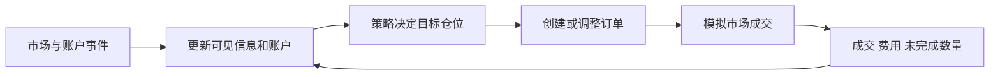

## 起点：模型有分数，不代表账户有收益

模型输出的是预测；组合给出目标仓位；交易系统提交订单；市场决定何时、以什么价格成交。回测要模拟这条链如何改变现金、持仓和风险，而不是直接把预测正确的次数换成收益。

本层需要[市场数据时点](/learn/quant/market-data)与[组合风险](/learn/quant/portfolio-risk)，工程上连接[网络](/learn/agent/deep/os-network-foundations)、[幂等与事务](/learn/agent/deep/idempotency-transactions)及[可观测性](/learn/agent/deep/service-observability)。

## 把回测理解成一台有时钟的状态机

任一时刻，系统有账户状态，包括现金、持仓、未完成订单、已发生费用和可用信息。行情、公告、成交、公司行为和交易时段变化作为事件到来，策略只能读取该时钟之前已可用的数据。

**教学反例：**用今天收盘价计算信号，同时假设订单恰好按同一个收盘价全部成交，可能偷用了决策之后才完整可见的信息。是否合理取决于具体信号截点、订单类型和交易制度，不能只因数据频率都是“日线”就默认可行。

向量化回测便于快速研究，但很多订单状态被隐含简化。事件驱动回测能够表达部分成交、异步回报和账户约束，却仍依赖成交模型。应根据问题选择精度，说明没有模拟什么。

## 一笔订单为什么不会自动按屏幕价格成交

市价单通常更重视尽快成交，却会消耗可见流动性；限价单限制价格，但可能等待或完全不成交。历史价格碰到某个价位，不等于你的限价单能成交：它还取决于队列位置、对手方数量、隐藏流动性和订单优先规则。

订单数量越大，越可能改变成交价格。价差、手续费、冲击与延迟是不同成本来源；把它们统一填成一个常数可以作为初步假设，却不能据此宣称真实可交易。

对于高换手策略，执行模型的误差可能大于预测优势。Qlib 的[嵌套决策执行文档](https://qlib.readthedocs.io/en/latest/component/highfreq.html)把组合决策与更细频率的执行联系起来，便于研究两层相互影响；框架存在不意味着填入任何成交假设都可信。

## 手算成本怎样吃掉微弱优势

**教学例子：**账户期初价值 100,000，某周期累计买入与卖出成交金额之和为 50,000。这里把双边成交总额除以账户价值定义为交易量比例 0.5；它与某些资料使用的“单边换手率”不是同一个口径。

假设对每一单位成交额收取 10 个基点的合计费用，1 个基点为 0.01%，则：

$$
\text{费用}=50{,}000\times0.001=50
$$

相对于账户价值，费用是 5 个基点。如果该周期成本前收益为 8 个基点，扣费后只剩 3 个基点；若额外冲击再消耗账户价值的 4 个基点，最终变成负 1 个基点。

这个例子不代表真实市场成本，而是说明必须统一分母：成交额费率、账户收益率和换手率，不能直接混用。还要确认融资、借券、税费等是否适用，避免漏计或重复计费。

## 超时是未知结果，不是“肯定没下单”

**教学例子：**系统计划买入 100 股，交易端已经接收订单，但确认回执丢失。若客户端把超时理解成失败，再发送一笔新订单，可能买入 200 股。

恢复时应依赖可追踪的业务订单标识，先核对原订单与成交回报，再决定剩余数量。部分成交 40 股时，目标剩余数量也不是原来的 100 股。撤单请求超时同样可能处于结果未知状态，不能假设原订单已消失。

本地数据库事务不能原子地控制外部市场。能够做到的是保存意图、使用交易接口支持的标识或防重机制、对账并处理异常；若外部接口没有所需保证，就必须把这种限制纳入恢复策略。这里与长任务 Agent 的[租约与恢复](/learn/agent/deep/leases-recovery)共享“本地状态不等于远端事实”的原理。

## 回测应当保存什么证据

只有一条资金曲线，很难判断错误在哪里。一次可追溯运行还需要数据与策略版本、时钟规则、目标仓位、订单、成交、费用和账户快照。收益异常时，应能定位是信号、组合、价格、费用还是状态更新出了问题。

先做小规模守恒检查比堆很多策略更有效：无成交时现金不应无故减少；买入后现金减少额应等于成交额与适用费用；拆股后的股数和价值应按契约变化；重复回放同一成交事件不应重复记账。

压力情境可以覆盖行情延迟、回执丢失、部分成交和数据源中断。结果应区分“策略亏损”“执行偏差”“模拟器错误”，因为三者需要不同修复。

## 边界：从模拟到运行，还缺什么

历史回测无法观察“假如我的大订单当时真的进入市场，其他参与者会如何反应”的完整世界。纸面交易可以检查接口和运行稳定性，却也不天然包含真实成交冲击。因此不同阶段提供不同证据，不能用模拟收益替代实盘证明。

交易制度也属于系统约束。上交所[程序化交易管理实施细则公告](https://www.sse.com.cn/lawandrules/sselawsrules2025/trade/universal/c/c_20250612_10781696.shtml)提供正式规则入口；具体项目应按市场、主体和最新有效规则核对，不从一个通用软件模板推导合规结论。

## 自测与答案

1. 历史最低价低于限价买单价格，能否认定买单成交？

不能。还需订单到达时刻、报价和成交方向、队列与数量等信息。仅凭日内最低价是很强的成交简化，应明确记录并检验其影响。

2. 为什么同一个策略在不同回测器上可能收益不同？

它们可能使用不同的可用时点、复权、成交、费用、现金和交易限制。应先对齐一笔笔订单与账户变化，再讨论哪个汇总指标更高。

3. 请求超时后再次查询也失败，能否直接补发订单？

不能据此确定原订单不存在。此时结果仍未知，应按预先定义的限制保留状态、继续对账或转人工处理。恢复机制需要把重复执行风险与未完成目标风险一起考虑。

## 接下来沿哪条关系走

到[Q5 · AI 量化研究平台](/learn/quant/ai-quant)，把这套回测和证据契约交给自动研究流程；也可回到[评测契约](/learn/agent/deep/evaluation-contracts)，理解为什么基础设施故障应与模型效果分别统计。
