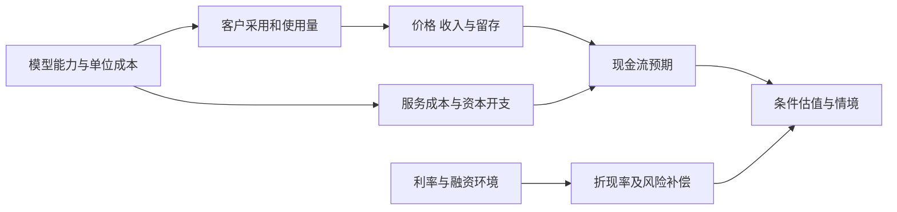

## 起点：知道很多新闻，为什么仍然没有判断链路

一家公司发布更强的模型、一个央行调整利率、一个负责人表达乐观，这些都是不同类型的信息。它们可能改变需求、成本、融资条件或预期，也可能早已被其他参与者知道。阅读的目标不是立刻给出涨跌结论，而是定位：**这条证据改变了哪个变量，经过什么机制，还缺哪一环验证？**

本层联系[组合风险](/learn/quant/portfolio-risk)与[数据时点](/learn/quant/market-data)，技术侧连接[推理服务](/learn/agent/deep/inference-serving)、[训练基础设施](/learn/agent/deep/training-infrastructure)和[预算决策](/learn/agent/deep/budget-decisions)。

## 用一个简化估值式定位信息

在一个使用恒定、与风险匹配的折现率 k 的教学模型里，未来各期预期现金流的现值为：

$$
V=\sum_{t=1}^{T}\frac{\mathbb E[CF_t]}{(1+k)^t}
$$

分子包含未来可能收到多少现金、何时收到；分母体现资金时间价值与承担风险所要求的补偿。技术新闻可能改变分子，利率与风险认知可能改变分母，同一事件也可能同时改变两者。

现金流口径必须与折现率一致：股东可获得的现金流与公司所有资本提供者可获得的现金流不是同一对象。Damodaran 的[估值原理讲义](https://pages.stern.nyu.edu/~adamodar/New_Home_Page/lectures/approach.html)解释了这种匹配关系。公式用于组织假设，不能把无法验证的长期预测变成精确事实。

**教学例子：**假设只有一年后的 110 单位现金流，折现率为 10%，现值为 100；现金流不变、折现率升到 20%，现值约为 91.67。若现金流同时提高到 121，折现率变为 21%，现值又回到 100。经营预期改善，不保证估值一定上升。

## 利率不是一个数字，风险溢价也不是常数

政策利率影响短期资金条件；不同期限的国债收益率还反映市场对未来利率和期限风险等因素的定价。企业融资利率与股东要求的回报率还包含其他风险，不等于央行公布的某个利率。

教学上可以把要求回报理解为无风险基准与风险补偿的组合，但具体资产、币种、期限和现金流口径不同，不能机械相加后通用于所有公司。经济走弱时，即使短期政策利率下降，现金流预期也可能下降、风险补偿可能上升。

Fed 的 [H.15 原始发布](https://www.federalreserve.gov/releases/H15/)适合观察不同利率口径。2026 年 11 月 26 日核验时，页面发布日期为 11 月 25 日，表格观测日期截至 11 月 24 日。这是日度统计，不是 26 日实时价格；未来访问滚动页面时应重新核对日期。

## 从模型能力走到经营结果，中间还有多层

每条箭头都需要证据。基准能力提升是否改善客户任务？单位推理成本下降是否传导为价格下降？价格下降后，用量是否增长得足以弥补单位收入变化？扩张需要多少新增硬件和营运资金？这些问题不能只用模型排行榜回答。

**教学例子：**服务原来提供 100 单位用量，每单位收入 10、可变成本 6，扣除可变成本后的贡献为 400。竞争后用量升到 150，单价降到 7、可变成本降到 5，贡献变为 300。用量增长 50%，贡献却下降。这里尚未扣除研发、销售、资本开支和税费，不能把贡献额叫作自由现金流。

因此，评估“更便宜的模型”要分别看用户收益、供应商利润和整个产业的需求变化。不同主体可能同时出现不同结果。

## 官方报告与领导者观点分别提供什么证据

ECB 在 [2026 年 11 月金融稳定报告发布稿](https://www.ecb.europa.eu/press/pr/date/2026/html/ecb.pr261118~83c5c60158.en.html)中讨论 AI 盈利预期和基建债务融资，以及重估向不同资产与机构传导的风险。这提供风险机制，不构成某项投资必然亏损的证据。

Barr 的 [11 月 16 日原始讲话](https://www.federalreserve.gov/newsevents/speech/barr20261116a.htm)把 AI 基建融资和模型同质化等问题放在金融稳定框架中。讲话应与引用的研究和统计分开阅读，区分已观察现象、理论结果和担忧。

公司负责人更接近自身业务，但也有商业立场；技术负责人更了解实现约束，也未必能证明整个市场需求。报道引用一句话时，先找原文、上下文和时间，再问其依据来自实际数据、预测还是愿景。人物影响力不能替代证据质量。

## 怎样避免把先后关系写成因果

“发布模型之后股价上涨”只说明时间上相邻，还可能同时有财报、利率、行业行情等变化。即使市场反应与事件有关，也不意味着事前能够交易获利；价格可能在公开信息到达时已经调整。

一张有用的证据卡应写明事实、可能机制、替代解释和待验证观察。比如“推理单价下降”是事实候选，“客户使用量将扩大”是机制假设，“收入增长足以覆盖资本开支”则还需要更多数据。把这三句分开，就不会让一个正确事实撑起过长的结论链。

持续跟踪时优先寻找能改变判断的证据：客户留存、收入确认、服务毛利口径、算力利用率、融资期限和债务约束。没有新证据时保持原判断区间，比每天强行编造方向更有价值。

## 自测与答案

1. 降息是否一定提高科技公司估值？

不一定。较低的基准利率可能降低部分折现压力，但降息原因也可能伴随需求下滑或风险溢价上升。需要同时考察现金流、融资与风险补偿，不能只改变公式中的一个变量。

2. 模型基准分数更高，为什么不能直接推出公司更赚钱？

还缺少任务价值、采用率、定价、留存、服务成本和资本开支之间的证据。能力是业务的一项输入，商业结果取决于整条链以及竞争反应。

3. 一位负责人预测需求翻倍，日报应该怎样写？

先标明这是某人在某时点的预测，链接原始来源并保留适用范围；再说明它会影响哪些假设，以及用什么后续经营数据验证。不能将预测改写成已经实现的增长。

## 接下来沿哪条关系走

回到[Q1 · 数据与时点](/learn/quant/market-data)，确保宏观数据使用的是当时版本；到[Q5 · AI 量化研究平台](/learn/quant/ai-quant)，让资讯 Agent 保存证据链，而不是自动把新闻摘要转换成交易结论。
