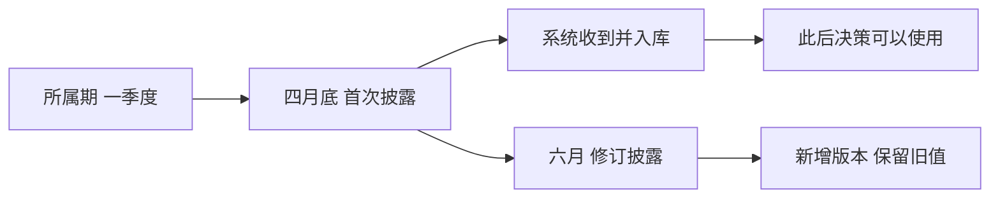

## 起点：数据正确，为什么研究仍然会错

量化研究不是把今天能下载的数据交给模型，再问过去能赚多少。它要重建一个更严格的问题：**在过去的决策时刻，只使用那时能够获得的信息，系统会采取什么行动？** 数值本身真实，并不代表当时就能知道。

这一层依赖[数据存储与索引](/learn/agent/deep/storage-indexes)，向后支撑[信号与统计检验](/learn/quant/signals-validation)和[回测执行](/learn/quant/backtest-execution)。先保证“看见什么”符合时间约束，后面的模型比较才有意义。

## 一条记录至少有两种时间

第一种是数据描述的时间，例如“一季度收入”；第二种是它能够进入决策的信息时间，例如“4 月 30 日晚上发布”。实际系统还可能需要记录供应商收到时间、系统入库时间和修订时间。数据公布之后，也不意味着你的系统立刻可用。

**教学例子：**某公司的第一季度收入最初为 100，4 月 30 日发布，6 月 10 日更正为 90。4 月 15 日做决策时，这一期收入尚不可用；5 月 10 日能使用 100；6 月 11 日才可以使用更正后的 90。直接按“第一季度”关联最终收入 90，会把两次未来信息带回过去。

这里的箭头表示信息产生与可用的先后，季度末不是披露时刻。对应到数据库查询，需要回答“截至决策时间，最近一个已经可用的版本是什么”，而不是“这期数据的最新版本是什么”。Qlib 的 [PIT 文档](https://qlib.readthedocs.io/en/latest/advanced/PIT.html)明确区分公告日期和报告期；[ALFRED](https://alfred.stlouisfed.org/)提供经济数据在历史日期可见的发布版本。

## 从时间约束推导数据接口

一条研究记录可以包含 `entity_id、period、available_at、revision_id、value`。如果系统的入库时间晚于公告时间，真实线上复现还要保留 `ingested_at`。研究“理想公开信息策略”与复现“实际系统表现”，可能使用不同的可用时间，必须在契约中说明。

查询时先筛选 `available_at ≤ decision_time` 的记录，再按同一对象、同一报告期选择当时可见的最新修订。不能先取最终修订，再过滤报告期。前者重建历史信息集，后者只是把现在的数据排成历史形状。

还要确定时间精度。如果数据晚上公布，而策略假定当天收盘前下单，仅有日期字段就会制造歧义。一个合理的保守处理是延后到下一次可交易时点，并在实验中固定规则；有可靠时间戳时再细化，而不是默认为全天都已知。

## 研究对象也有历史

幸存者偏差不只来自删除坏样本。若拿今天仍在指数里的公司回测十年前，可能漏掉当时的退市公司、被剔除成员和后来上市的公司。模型仿佛提前知道了谁能存活。

因此，股票池是随时间变化的数据：成员何时进入、何时退出、何时停牌，以及当时是否满足交易条件，都要被记录。缺失值也不能一律填零；零可能表示真实观测，而缺失可能表示尚未披露、停牌、源站失败或字段不适用。不同原因对应不同研究处理。

这与通用数据工程中的“空值语义”相同：为了凑齐矩阵而填补数据，会改变模型实际看到的信息。填补、标准化和异常值阈值同样不能利用未来样本估计。

## 价格、收益与可成交价格是三个对象

**教学例子：**一股价格为 100 的股票发生一拆二，之后每股价格为 50。原持有者变成两股，资产仍为 100。只比较原始价格会算出负 50%，把公司行为误当成市场损失。

研究收益需要明确拆股、现金分红和再投资假设；模拟成交还需要还原当时实际价格、股数和现金变化。用于连续收益分析的复权序列，不能直接当作历史订单的真实成交价。不同数据提供者的复权约定也未必一致。

[Kenneth French 数据库](https://mba.tuck.dartmouth.edu/pages/faculty/ken.french/data_library.html)说明其底层数据格式变化会影响月度收益和分红再投资口径。这提醒我们：即使文件名相同，版本变化也可能改变结果。可复现记录应保存来源、下载时间、版本或内容摘要与处理代码。

## 如何知道这一层已经做对

与其只检查行数，不如设计会揭露时间错误的反例：在披露前查询某财报，应得不到它；修订前后查询，应返回不同版本；退市公司在退出前，应仍存在于历史股票池。再抽取几次决策，把输入字段与原始披露逐项对齐。

这些检查仍不能证明供应商数据完全无误，但能把“模型分数下降”与“数据管道改变”分开。数据契约应该与实验一起版本化，因为更换股票池或调整可用时间，已经改变了研究问题。

## 自测与答案

1. 财报属于三季度，能否在 9 月 30 日用它预测 10 月收益？

不能只凭所属季度决定。要查正式披露时间以及系统可用时间；如果 10 月底才披露，9 月底使用它就是未来信息。预测期的开始时间必须晚于信息可用和策略实际决策时间。

2. 已有按时间排序的训练集，为什么仍可能泄漏？

时间排序只约束样本顺序，不能保证每个字段是当时版本。最终修订财报、今天的指数成分、用全数据计算的标准化参数，都可能把未来带进历史样本。

3. 下载同一数据源两次，为什么结果可能不同？

数据可能更正、补齐，公司行为处理或底层格式也可能变化。固定来源名称不足以复现，应保存内容摘要、版本、下载时刻和处理代码，并比较变化影响了哪些样本。

## 接下来沿哪条关系走

到[Q2 · 信号与统计检验](/learn/quant/signals-validation)，把“当时可见的输入”变成明确预测问题；到[Q4 · 回测成本执行](/learn/quant/backtest-execution)，检验决策时间与成交时间是否一致。基础上可回到[评测契约](/learn/agent/deep/evaluation-contracts)，理解为什么数据口径属于实验定义。
