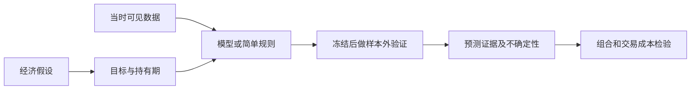

## 起点：一个看起来有效的因子，究竟证明了什么

“某个指标与未来收益相关”至少包含三层主张：输入在决策时可获得；相关性在未参与选择的数据上仍存在；使用这种信息形成的组合，在成本与风险约束下有价值。三者不能互相代替。

本层接在[数据与时点](/learn/quant/market-data)之后，依赖[概率、损失与梯度](/learn/agent/deep/probability-learning)和[因果实验](/learn/agent/deep/causal-experiments)。它输出的是关于预测能力的证据，随后才进入[组合风险](/learn/quant/portfolio-risk)。

## 先定义预测对象，再讨论模型

设决策时刻能看到的信息为 x，未来一段持有期的收益为 y。模型可以估计条件均值、上涨概率、收益排序，也可以估计波动率；这些不是同一个任务。预测期、调仓时点和标签计算方式必须写清。

**教学例子：**预测“明天是否上涨”和“未来一个月最大可能损失”需要不同标签。前者正确率高，也可能在少数错误时遭受大损失；后者不直接回答买什么，却可能帮助限制风险。不能只因为两者都输出一个数，就使用同一套评测。

对于收益回归，均方误差刻画预测偏差；对于横截面排序，IC 常指预测值与未来收益的相关系数，Rank IC 则比较排名关系。相关性可以帮助判断排序信息，但不包含仓位大小、成交可行性和费用。因此 IC 不是收益率，也不是“预测正确的概率”。

## 为什么先比较简单基线

复杂模型可能只是复制市场共同涨跌、行业差异或一个简单滞后特征。若不与均值预测、线性模型、简单排序规则比较，就无法知道复杂性带来了什么。

比较还必须使用相同数据范围、预测期、缺失处理和验证窗口。新模型使用了更多样本或更新的数据时，结果改善不能全部归因于架构。Qlib 的[平台论文](https://arxiv.org/abs/2009.11189)与[公开实现](https://github.com/microsoft/qlib)可用来观察数据、模型、分析与回测如何分层，但使用平台本身不保证实验公平。

经济假设的作用是约束研究：为什么这条信息可能未充分进入价格？适用于什么市场和时间尺度？什么变化会使它失效？一个事后听起来合理的故事，仍然可能是对随机结果的解释，必须继续接受样本外验证。

## 手算一次“不确定性有多大”

**教学例子：**把 16 个互相独立、近似正态的月度 IC 看成样本，均值为 0.02，样本标准差为 0.04。均值的标准误约为：

$$
SE=\frac{0.04}{\sqrt{16}}=0.01
$$

自由度为 15 的双侧 95% t 区间使用约 2.131 的临界值，于是区间约为 `0.02 ± 0.02131`，即 `[-0.00131, 0.04131]`。均值为正，但这个例子中的区间仍覆盖零，不能只展示 0.02 而省略不确定性。

真实金融样本常有序列相关、波动聚集和分布变化，独立正态假设未必成立。此时简单标准误可能偏小，应根据依赖结构考虑时间分块重采样或适当的稳健估计。更换误差估计方法，也不能修复已经泄漏的输入。

## 为什么试得更多，证据反而可能更弱

**教学例子：**假设 100 个独立的无效检验各自有 5% 的误报概率，至少出现一次误报的概率为：

$$
1-(1-0.05)^{100}\approx 99.4\%
$$

真实因子之间通常相关，这个数不能直接套用，但方向明确：从大量尝试中只报告赢家，会夸大可信度。数据挖掘越自动化，越需要保存完整实验历史。

[回测过拟合概率 PBO 论文](https://www.davidhbailey.com/dhbpapers/backtest-prob.pdf)研究的正是策略选择带来的样本内外落差。它提供评估选择风险的方法，不意味着算出一个指标就可以免于新的样本外验证。

## 时间切分怎样才有意义

训练集拟合参数，验证集选择模型与超参数，最终测试集用于一次预先定义的结论。如果反复看测试结果，再让 Agent 改代码和特征，这个测试集实际上已经参与选择。

金融标签还可能重叠。例如某日标签覆盖未来五天收益，临近切分边界的训练标签可能包含测试期行情。仅按样本起始日切开仍不够，应检查标签区间，去除跨越边界的训练样本。具体隔离长度由标签与特征定义决定，不能机械套用一个天数。

滚动验证能模拟“用过去训练、向未来预测”，但它也需要固定模型重训频率、数据更新和选择规则。表现只在某一时期成立时，应报告这种条件，而不是把不同时间窗口挑选成一条最好看的曲线。

## 预测关系为什么不等于因果关系

一个因子可能只是代理了行业、规模或市场状态。即使关系在样本外存在，也不表示人为改变该指标会造成收益变化。因果解释需要额外识别假设与研究设计；预测系统首先应证明在给定信息条件下的可重复表现。

研究结论最有用的形式是：“在什么数据与区间、相对什么基线、采用何种选择预算和成本假设，观察到多大的差异与不确定性。”它比单独一个高分更能指导下一步实验。

## 自测与答案

1. Rank IC 为正，为什么策略仍可能亏损？

排序信息可能很弱，收益不足以覆盖换手成本；组合也可能暴露于共同风险。Rank IC 不包含仓位、交易价格、融资和费用，需要继续检验组合与执行。

2. Agent 试了两千个因子，只展示最优十个，缺了什么？

缺少全部尝试与选择过程、独立评估区间以及对多重试验的处理。最优结果可能来自搜索预算而非真实信息优势，失败试验也必须进入账本。

3. 结果不显著，是否证明因子完全没用？

不能。证据不足可能来自效应弱、样本少或噪声大，也可能确实没有效应。应看效应区间、统计功效与实验条件，不能把“不拒绝零效应”直接解释成“证明零效应”。

## 接下来沿哪条关系走

到[Q3 · 组合风险](/learn/quant/portfolio-risk)，理解预测怎样转成受约束的仓位；到[Q5 · AI 量化研究平台](/learn/quant/ai-quant)，把冻结测试、完整试验账本和预算约束落实到 Agent 工作流。
